# Architecture & Data Flow

This document details the hexagonal architecture, system design, components, runtime environments, and data flow of `babylon_data_loader`.

---

## 1. System Architecture

The `babylon_data_loader` operates across three execution contexts:
1. **Cloud Serverless Runtime (Production)**: Event-driven AWS Lambda ARM64 container (`cmd/lambda`) invoked by Amazon S3 object uploads, persisting transaction datasets to **MongoDB Atlas**.
2. **Workstation CLI Runtime (Local Ingestion & Automation)**: CLI entrypoint (`cmd/cli`) interacting with local filesystem storage and local MongoDB instance.
3. **Desktop Application Runtime (Interactive GUI)**: Wails v2 desktop application (`desktop`) providing interactive progress telemetry and audit history.

```mermaid
flowchart TD
    subgraph Cloud ["Production Ingestion (AWS Lambda & MongoDB Atlas)"]
        S3In["S3 Landing Bucket<br/>unprocessed/*.csv"] -->|ObjectCreated Event| Lambda["AWS Lambda Container<br/>cmd/lambda (ARM64)"]
        SM["AWS Secrets Manager<br/>(MONGO_SECRET_ID)"] -.->|Resolve Credentials| Lambda
        Lambda -->|In-memory Stream| S3Store["S3 ObjectStore<br/>(internal/infra/storage/s3)"]
        S3Store --> Pipeline1["Ingestion Pipeline<br/>(internal/app/pipeline)"]
        Pipeline1 -->|Batch Upsert & dataSync| Atlas[("MongoDB Atlas Cluster<br/>Collections: transactions_chase, positions_fidelity, transactions_synthetic, dataSync")]
        Pipeline1 -->|Archive Completed| S3Out["S3 Landing Bucket<br/>processed/*.csv"]
    end

    subgraph Local ["Local Workstation & Desktop Runtime"]
        LocalFiles["Local CSV Files<br/>data/unprocessed or tmp/"] --> LocalStore["Local ObjectStore<br/>(internal/infra/storage/localfs)"]
        CLI["CLI Entrypoint<br/>cmd/cli"] --> LocalStore
        Desktop["Desktop Application<br/>desktop (Wails v2 + React)"] --> LocalStore
        LocalStore --> Pipeline2["Ingestion Pipeline<br/>(internal/app/pipeline)"]
        Pipeline2 -->|Batch Upsert & dataSync| LocalMongo[("Local MongoDB Docker<br/>localhost:27017")]
        SynthGen["Synthetic Source Adapter<br/>(internal/infra/sources/synthetic)"] -->|Write CSV| LocalFiles
        SynthGen -->|Persist Direct| Pipeline2
    end
```

---

## 2. Core Components

The codebase is organized according to Hexagonal Architecture (Ports and Adapters) principles:

1. **Driving Adapters & Entrypoints**:
   - **CLI (`cmd/cli`)**: Command-line router providing `ingest` and `generate` commands for local batch execution, configuration wiring, and graceful exit handling.
   - **Lambda Container (`cmd/lambda`)**: Serverless entrypoint subscribing to AWS S3 event notifications (`events.S3Event`), initializing cloud infrastructure, and executing in-memory streaming ingestion.
   - **Desktop Application (`desktop`)**: Wails v2 desktop application binding Go domain services with a React frontend, emitting real-time progress events (`ingest:progress`), providing audit history query capabilities, and managing lifecycle shutdown (`OnShutdown`).

2. **Application Layer**:
   - **Ingestion Pipeline (`internal/app/pipeline`)**: Core orchestrator implementing `port.PipelineRunner`. Streams files through source extractors, coordinates batch upserting, writes transactional audit logs (`dataSync`), and executes object archival.
   - **Ingest Service (`internal/app/ingest`)**: High-level application coordination service binding storage, source resolution, and execution context.

3. **Domain Core**:
   - **Domain Models (`internal/domain/model`)**: Pure domain models (`TransactionRecord`, `FidelityPositionRecord`, `DataSyncLog`, `LineageMetadata`, `SourceType`) with precise types, zero-value safety, and financial integrity.
   - **Domain Ports (`internal/domain/port`)**: Driving and driven interface contracts defining persistence (`port.Repository`), audit history reading (`port.SyncLogReader`), object store operations (`port.ObjectStore`), progress notifications (`port.ProgressNotifier`), and source extraction (`port.SourceExtractor`).

4. **Driven Infrastructure Adapters**:
   - **Source Adapters (`internal/infra/sources`)**: Format-specific parsers mapping raw statement feeds into domain models:
     - `internal/infra/sources/chase`: Chase banking and credit card CSV parser.
     - `internal/infra/sources/fidelity`: Fidelity brokerage positions CSV parser.
     - `internal/infra/sources/synthetic`: Deterministic mock transaction generator and canonical CSV writer for testing without PII.
   - **Storage Adapters (`internal/infra/storage`)**: Concrete persistence implementations satisfying domain ports:
     - `internal/infra/storage/mongo`: MongoDB client providing atomic bulk upsert operations with idempotency keys and transactional `dataSync` audit logging.
     - `internal/infra/storage/s3`: AWS S3 object store adapter providing in-memory streaming download, copy, delete, and listing.
     - `internal/infra/storage/localfs`: Local filesystem object store adapter providing file streaming and directory management.

5. **Composition Roots**:
   - **Configuration & Secrets (`config`)**: Resolves database connection credentials dynamically from AWS Secrets Manager (`MONGO_SECRET_ID`) or local environment fallback (`MONGO_URI`) with thread-safe in-memory caching.
   - **Context & Logging (`appcontext`)**: Standardizes structured context propagation with `slog` logger instances attached.

---

## 3. Data Ingestion Lifecycles

### 3.1. Cloud Event-Driven Flow (AWS Lambda)
1. A financial statement CSV is uploaded to `s3://babylon-landing-${account_id}/unprocessed/` (e.g. via `tools/upload-csv-s3.sh`).
2. Amazon S3 fires an `ObjectCreated` event notification triggering the Lambda container (`cmd/lambda`).
3. The Lambda handler checks its in-memory credential cache. If cold, it resolves MongoDB credentials dynamically from AWS Secrets Manager using the configured secret identifier (`MONGO_SECRET_ID`).
4. The handler initializes `s3.ObjectStore` and delegates execution to `pipeline.Pipeline`.
5. The pipeline streams object content directly from S3 in-memory via `port.ObjectStore`, bypassing disk scratch space.
6. The appropriate source extractor parses the stream into canonical domain records (`model.TransactionRecord` or `model.FidelityPositionRecord`).
7. `mongo.Repository` executes an atomic bulk upsert into the appropriate collection (`transactions_chase`, `positions_fidelity`, or `transactions_synthetic`) and records an audit log in `dataSync`.
8. Upon successful persistence, the pipeline archives the S3 object to `processed/` and removes it from `unprocessed/`.

For detailed cloud datalake specifications, see `docs/specs/mongodb-atlas-datalake.md`.

### 3.2. Local CLI Ingestion Flow
1. The developer executes `make run-ingest` (which runs `data-loader ingest`).
2. The CLI initializes `localfs.ObjectStore` pointing to the configured local directory (e.g., `data/unprocessed`).
3. The pipeline identifies unprocessed CSV files, streaming each file through the matching source adapter.
4. The repository executes bulk upserts into the local MongoDB instance (`localhost:27017`) and writes `dataSync` logs.
5. On successful completion, processed files are archived to `data/processed`.

### 3.3. Desktop Application Flow
1. The user launches the Wails desktop application (`desktop`) and selects a target CSV file via the UI.
2. The desktop adapter (`App.IngestFile`) automatically resolves the file's source type and binds the Wails progress notifier bridge.
3. During execution, real-time progress events (`ingest:progress`) emit phase, current record count, and total count to the React frontend.
4. The user inspects completed ingestion runs, status badges, and execution statistics through the interactive audit history viewer (`App.GetHistory`).
5. On application quit or window close, `App.OnShutdown` guarantees graceful connection closure within a 5-second deadline context.
