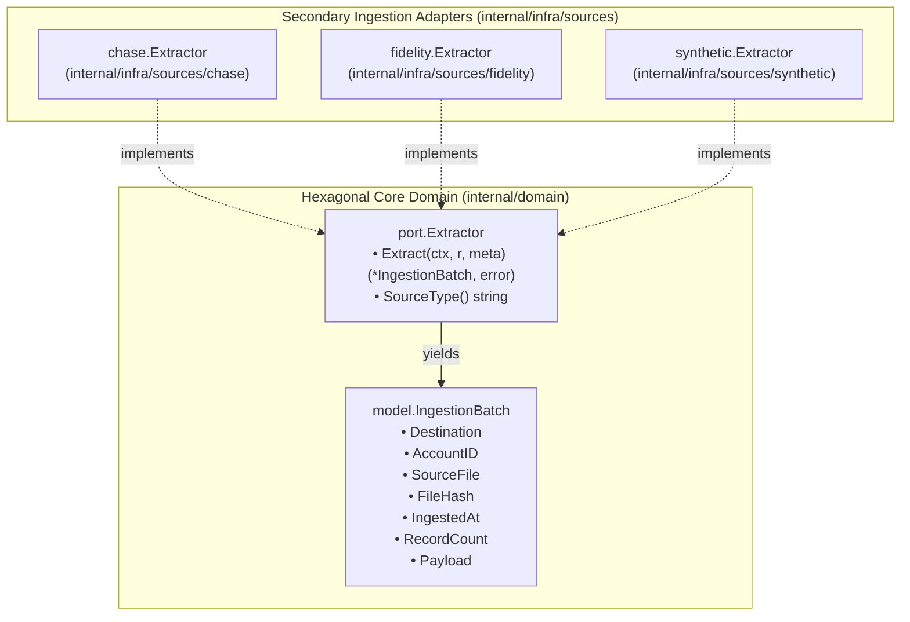

# Ingestion Adapters Architecture Catalog & Specification Suite

This catalog indexes the modular architectural specifications for secondary ingestion adapters within the `babylon_data_loader` hexagonal architecture. The specifications detail the decoupling of file parsing, stream classification, data cleansing, and validation from core business domains and persistence layers.

---

## 1. Architectural Document Catalog

| Document | Primary Component / Scope | Key Architectural Invariants & Topics |
| :--- | :--- | :--- |
| **[Ingestion Architecture Overview](./ingestion-overview.md)** | `internal/domain/port/`<br>`internal/infra/sources/` | Hexagonal port boundaries, stream lifecycle, batch envelopes, standard-library isolation rules, forbidden dependencies. |
| **[Chase Statement Adapter](./chase-adapter.md)** | `internal/infra/sources/chase/` | Declarative 4-stage pipeline orchestrator (`validateExtractParams` -> `classifyStream` -> `parseDialect` -> `buildBatch`), pure static strategy router (`resolveDialectRoute`), pluggable `Classifier`, 40B stack-allocated `rowReader` value struct, tabular placeholder & Unicode dash detection (`isPlaceholderNumeric`), date fallback logic (`resolveCreditCardDate`), unwrapped context error propagation (`handleReadError`). |
| **[Fidelity Portfolio Adapter](./fidelity-adapter.md)** | `internal/infra/sources/fidelity/` | Point-in-time holdings ingestion, UTF-8 BOM detection/stripping, multi-line legal disclaimer filtering, cash sweep normalization (`CASH`), single-account batch inference. |
| **[Synthetic Deterministic Adapter](./synthetic-adapter.md)** | `internal/infra/sources/synthetic/` | Deterministic pseudo-random generation via `math/rand/v2` PCG, PRNG seed state encapsulation, concurrency-safe mutex synchronization, memory-bounded batch generation. |
| **[Verification Harness & Quality Gates](./verification-and-quality.md)** | Quality Assurance & Gates | Standard library isolation gate, race detector execution gate, allocation benchmarks (`BenchmarkRowReader_ParseRow` vs `BenchmarkDirect_ParseRow` at 16 B/op and 0 from `rowReader`), linter rules, 95.0% statement coverage. |
| **[Remediation Log & Design Decisions](./remediation-log.md)** | Architectural Decision Records | Consolidated review logs across Phase 2, Phase 2B (Fidelity), Phase 2C (Chase), and Phase 1-3 readability cleanups (PR #51, PR #52, and Phase 3 pipeline orchestrator). |

---

## 2. Hexagonal Boundary & Port Contract

All secondary ingestion adapters reside in `internal/infra/sources/` and satisfy the primary extraction port defined in `internal/domain/port/extractor.go`:



---

## 3. Cross-Cutting Architectural Invariants

Across all secondary source adapters, the following architectural invariants are strictly enforced:

1. **Standard Library Isolation**: Ingestion adapters must rely solely on the Go standard library (`encoding/csv`, `bufio`, `io`, `time`, `strings`, `math`). External database drivers, ORMs, and third-party CSV utilities are strictly prohibited.
2. **Zero-Allocation Stack Encapsulation**: Record parsing primitives (such as Chase `rowReader`) leverage value semantics (40-byte stack value structs) to eliminate heap allocations and garbage collection overhead during high-throughput statement ingestion.
3. **Memory-Bounded Stream Processing**: Stream inspection is strictly capped (e.g., 4KB `bufio.Reader.Peek`), preventing memory exhaustion (OOM) on unbounded or malformed streams.
4. **Context Cancellation Propagation**: Context cancellation (`context.Canceled`) and deadline expiration (`context.DeadlineExceeded`) must be returned strictly unwrapped to ensure worker orchestrators identify pipeline interruptions immediately.
5. **Physical Lineage Preservation**: Every domain entity preserves exact 1-based physical file row numbers via `csv.Reader.FieldPos(0)`, ensuring forensic traceability for data auditing and compliance.

---

## 4. Navigation & Directory Structure

```text
docs/specs/architecture/
├── README.md                     # This document (Architecture Catalog)
├── ingestion-overview.md         # Hexagonal boundary, lifecycle, and isolation rules
├── chase-adapter.md              # Chase statement extractor & dialect parsers
├── fidelity-adapter.md           # Fidelity portfolio holdings extractor
├── synthetic-adapter.md          # Synthetic deterministic fixture extractor
├── verification-and-quality.md   # Testing harness, benchmarks, and quality gates
└── remediation-log.md            # Comprehensive remediation logs across all phases
```
