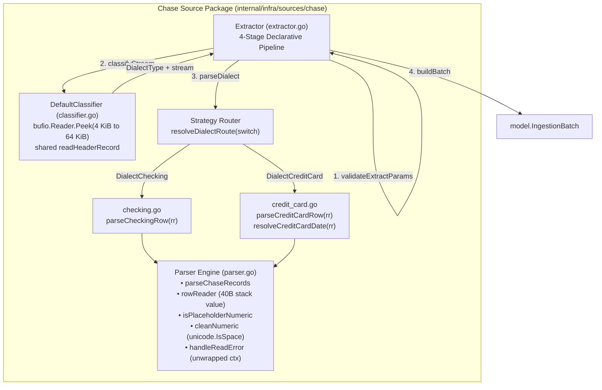

# Chase Statement Ingestion Adapter Architecture Specification

This document provides the complete architectural and technical specification for the Chase Bank Statement Ingestion Adapter located in `babylon_data_loader/internal/infra/sources/chase/`.

---

## 1. Overview & Architectural Boundaries

The Chase adapter extracts, classifies, sanitizes, and normalizes financial statement records from Chase Bank CSV exports for deposit accounts (checking/savings) and revolving credit lines (credit cards). 

Following the Phase 1–3 readability and robustness cleanups, the adapter enforces a strict separation of concerns:
- **`extractor.go`**: Declarative 4-stage pipeline orchestrator implementing `port.Extractor`.
- **`classifier.go`**: Memory-bounded in-stream dialect classification. The peek starts at 4 KiB and grows to at most 64 KiB, and the header is located with the parser's own header detection.
- **`parser.go`**: Dedicated zero-allocation parser primitives (`rowReader`, `isPlaceholderNumeric`, `cleanNumeric`), the header detection shared with the classifier (`skipUTF8BOM`, `newChaseCSVReader`, `readHeaderRecord`, `normalizeColumn`), streaming coordination (`parseChaseRecords`), and context-aware error unwrapping (`handleReadError`).
- **`checking.go`**: Ergonomic row mapper for deposit accounts using `rowReader`.
- **`credit_card.go`**: Ergonomic row mapper for credit card accounts with pending date fallback (`resolveCreditCardDate`).



---

## 2. Declarative 4-Stage Pipeline Orchestrator (`extractor.go`)

`Extractor.Extract` decomposes statement ingestion into a 16-line declarative pipeline:

```go
func (e *Extractor) Extract(
	ctx context.Context,
	r io.Reader,
	meta model.FileMetadata,
) (*model.IngestionBatch, error) {
	ctx, err := validateExtractParams(ctx, r, meta)
	if err != nil {
		return nil, err
	}

	dialect, stream, err := e.classifyStream(ctx, r)
	if err != nil {
		return nil, err
	}

	dest, records, err := parseDialect(ctx, dialect, stream, meta)
	if err != nil {
		return nil, err
	}

	return buildBatch(dest, meta, records)
}
```

### Stage 1: `validateExtractParams`
Defensively sanitizes input arguments and establishes short-circuit evaluation:
1. Context Nil Guard: If `ctx == nil`, defaults to `context.Background()`. This is the **only** place a nil context is normalized. `Classifier` implementations and the parsers always receive a non-nil context from `Extract`, and `DefaultClassifier.Classify` documents a non-nil `ctx` as a precondition for direct callers.
2. Immediate Cancellation Check: Evaluates `ctx.Err()` **first**, immediately returning raw `context.Canceled` or `context.DeadlineExceeded` prior to any struct or reader validations.
3. Stream Guard: Verifies `r != nil`, returning typed sentinel `ErrNilReader`.
4. Metadata Invariant Guard: Executes `meta.Validate()`, guarding against empty `FileName`, `AccountID`, or zero `IngestedAt`. `FileHash` is **not** validated: an empty hash is accepted and propagated to the batch and lineage as given.

```go
func validateExtractParams(ctx context.Context, r io.Reader, meta model.FileMetadata) (context.Context, error) {
	if ctx == nil {
		ctx = context.Background()
	}
	if ctxErr := ctx.Err(); ctxErr != nil {
		return nil, ctxErr
	}
	if r == nil {
		return nil, ErrNilReader
	}
	if err := meta.Validate(); err != nil {
		return nil, fmt.Errorf("invalid file metadata: %w", err)
	}
	return ctx, nil
}
```

### Stage 2: `classifyStream` & Nil Stream Protection
Delegates to `Classifier.Classify` while enforcing pipeline safety invariants:
- Unwrapped Context Error Propagation: If classification fails due to context cancellation, returns raw `context.Canceled` or `context.DeadlineExceeded` without wrapping (F-01).
- Nil Stream Guard: Guarantees that custom or third-party classifier implementations never return a `nil` stream reader with a non-error status (F-02), preventing `csv.NewReader(nil)` panic.
- Nil-Safe Receiver: `classifierOrDefault` falls back to `DefaultClassifier` when the `*Extractor` is nil or a zero value (`chase.Extractor{}`), so neither panics. `NewExtractor` returns the concrete `*Extractor`, and `var _ port.Extractor = (*Extractor)(nil)` asserts the port contract at compile time.

```go
func (e *Extractor) classifyStream(ctx context.Context, r io.Reader) (DialectType, io.Reader, error) {
	if ctxErr := ctx.Err(); ctxErr != nil {
		return DialectUnknown, nil, ctxErr
	}

	dialect, stream, err := e.classifierOrDefault().Classify(ctx, r)
	if err != nil {
		if ctxErr := ctx.Err(); ctxErr != nil {
			return DialectUnknown, nil, ctxErr
		}
		if errors.Is(err, context.Canceled) {
			return DialectUnknown, nil, context.Canceled
		}
		if errors.Is(err, context.DeadlineExceeded) {
			return DialectUnknown, nil, context.DeadlineExceeded
		}
		return DialectUnknown, nil, fmt.Errorf("failed to classify chase statement dialect: %w", err)
	}

	if stream == nil {
		return DialectUnknown, nil, fmt.Errorf("classifier returned nil reader stream for dialect %s", dialect)
	}

	return dialect, stream, nil
}
```

### Stage 3: `parseDialect` & Pure Static Strategy Router
Replaces mutable package-level global routing maps with a pure static switch statement (`resolveDialectRoute`):
- **Compile-Time Immutability**: Zero runtime mutation risk, zero heap allocations, and elimination of `//nolint:gochecknoglobals,exhaustive` waivers (F-07).
- Routes `DialectChecking` -> `model.DestChaseChecking` and `parseChecking`.
- Routes `DialectCreditCard` -> `model.DestChaseCreditCard` and `parseCreditCard`.
- **Shared Destination**: Both constants are `"transactions_chase"`, so both dialects land in one datalake collection and the batch `Destination` does not identify the dialect. The dialect is observable only through the payload fields each parser populates (`Details`/`CheckOrSlipNum` for checking; `Category`/`Memo` and the `"Sale"` type default for credit card), and the routing tests assert those fields. Changing this would be a domain-model change and is out of scope for the adapter.
- Defensively handles `DialectUnknown` and unrecognized dialect types, wrapping typed sentinel `ErrUnknownDialect`.

```go
type dialectParser func(ctx context.Context, r io.Reader, meta model.FileMetadata) ([]model.ChaseTransaction, error)

type dialectRoute struct {
	destination model.Destination
	parser      dialectParser
}

func resolveDialectRoute(dialect DialectType) (dialectRoute, bool) {
	switch dialect {
	case DialectChecking:
		return dialectRoute{
			destination: model.DestChaseChecking,
			parser:      parseChecking,
		}, true
	case DialectCreditCard:
		return dialectRoute{
			destination: model.DestChaseCreditCard,
			parser:      parseCreditCard,
		}, true
	case DialectUnknown:
		return dialectRoute{}, false
	default:
		return dialectRoute{}, false
	}
}
```

### Stage 4: `buildBatch` & Envelope Completeness
Encapsulates parsed transactions into an `IngestionBatch`, populating and validating all 6 envelope metadata properties:
1. `Destination`: Determined by strategy route (`DestChaseChecking` or `DestChaseCreditCard`, which share the value `"transactions_chase"`).
2. `AccountID`: Propagated from `FileMetadata`.
3. `SourceFile`: Propagated from `FileMetadata.FileName`.
4. `FileHash`: Propagated from `FileMetadata.FileHash`.
5. `IngestedAt`: Propagated from `FileMetadata.IngestedAt`.
6. `RecordCount`: Set to `len(records)`.
7. `Payload`: Strongly-typed `[]ChaseTransaction`.

---

## 3. In-Stream Dialect Classification (`classifier.go`)

### Memory-Bounded Header Peeking
[`DefaultClassifier.Classify`](../../../internal/infra/sources/chase/classifier.go) wraps incoming streams in a `bufio.Reader` and peeks at the stream prefix:
- **Bounded Memory**: The fast path peeks 4 KiB (`initialPeekSize`). Only when no complete header record fits in the prefix (for example, a long blank preamble) does it rebuffer into a 64 KiB `bufio.Reader` and double the peek up to `maxPeekSize` (64 KiB). Streams without a header inside 64 KiB are reported as `DialectUnknown`, so unbounded streams cannot cause Out-Of-Memory (OOM) exhaustion.
- **Non-Destructive Reuse**: Returns the (possibly rebuffered) `bufio.Reader` as the unconsumed stream, so every peeked byte is replayed to the parser. The parser's `bufio.NewReader` reuses it rather than double-buffering.
- **Context Checks**: `ctx.Err()` is checked before the first read and after every `Peek`, the only blocking calls. The in-memory header parse is bounded by `maxPeekSize`. A cancellation that lands during a peek is returned unwrapped, never reported as `DialectUnknown`.

### Single Header-Detection Path
The classifier and the parser locate the header the same way, so they cannot disagree about which row is the header:
1. A leading UTF-8 BOM is removed before CSV tokenization (`skipUTF8BOM` on the stream in the parser, the same `utf8BOM` prefix trimmed from the peeked bytes in the classifier).
2. Both tokenize with `newChaseCSVReader` (`FieldsPerRecord = -1`, `TrimLeadingSpace = true`, strict quoting).
3. Both take the first record for which `isRowEmpty` is false (`readHeaderRecord`). Blank lines, whitespace-only lines and comma-only rows such as `,,,,,,` are all skipped.
4. Columns are compared by exact normalized name (`normalizeColumn`: trim, lower-case), not by substring.

A header record that is cut off at the peek boundary (no line terminator inside the prefix) is treated as incomplete and the peek grows. A CSV syntax error in the prefix is treated the same way, and is reported as `DialectUnknown` at EOF or at the 64 KiB limit.

### Classification Rule Precedence
Because Chase credit card exports occasionally include balance columns (e.g. `"New Balance"`), credit card indicators must be evaluated **before** checking balance indicators. Every condition is an exact column-name match on the normalized header:

```text
Dialect Precedence Hierarchy
├── 1. Credit Card Markers (Evaluated First)
│   └── Any of "category", "memo", "transaction date", "trans date"
│       └── Result: DialectCreditCard
├── 2. Checking & Deposit Markers (Evaluated Second)
│   ├── "check or slip #" OR "check or slip num"
│   ├── "details" AND ("posting date" OR "post date" OR "balance")
│   ├── "details" AND "description" AND "amount"
│   └── "posting date" AND "balance"
│       └── Result: DialectChecking
├── 3. Minimal Credit Card Export (Evaluated Third)
│   └── "post date" AND "description" AND "amount"
│       └── Result: DialectCreditCard
└── 4. Unrecognized
    └── Result: DialectUnknown
```

A bare `"balance"` column is not a checking marker (F-10), so foreign CSVs such as `Employee Name,Leave Balance,Start Date` remain `DialectUnknown`.

### Empty-Statement Contract
- An empty, whitespace-only or comma-only stream has no header and is rejected by the classifier with `ErrUnknownDialect`.
- A header-only statement succeeds with `RecordCount == 0`.
- If a custom classifier routes a stream with no header to a parser, the parser returns `ErrMissingRequiredColumns` ("has no header row"), never a silent empty batch.

---

## 4. Shared Zero-Allocation Parser Primitives (`parser.go`)

### 1. Reusable Streaming Harness (`parseChaseRecords`)
Coordinates CSV decoding using `encoding/csv.Reader` with `FieldsPerRecord = -1` and `TrimLeadingSpace = true`:
- Strips a leading UTF-8 BOM from the stream before tokenization (`skipUTF8BOM`), so BOM-prefixed **quoted** headers (Excel "CSV UTF-8") parse under strict quoting.
- Locates the header with `readHeaderRecord`, shared with the classifier.
- Validates the header (`indexHeader`): a column containing `\r` or `\n` returns `ErrMalformedHeader`. That shape means CR-only (classic Mac) line endings, which `encoding/csv` does not treat as record terminators, so the whole file was read as one header record. A duplicate **required** column returns `ErrDuplicateColumn`. For a duplicate optional column, the first occurrence wins.
- Pre-allocates record slice with `defaultTransactionsCapacity = 64`.
- Obtains exact 1-based physical line numbers via `reader.FieldPos(0)` for audit lineage.
- Skips empty rows (including comma-only rows) without error.
- Evaluates `ctx.Err()` on every iteration.
- Wraps every row rejection in `ErrInvalidRow`, so callers can separate bad input data from I/O failures.

`LazyQuotes` stays `false`. A bare or unclosed quote fails the statement loudly with `ErrMalformedCSV` and the line and column, rather than risking a silent mis-parse of financial data.

### 2. Context Cancellation Unwrapping Contract (`handleReadError`)
Resolves critical review finding F-01: when context cancellation or deadline expiration occurs during CSV header detection or row scanning, errors are returned strictly unwrapped:

```go
func handleReadError(ctx context.Context, dialectName, target string, err error) error {
	if ctxErr := ctx.Err(); ctxErr != nil {
		return ctxErr
	}
	if errors.Is(err, context.Canceled) {
		return context.Canceled
	}
	if errors.Is(err, context.DeadlineExceeded) {
		return context.DeadlineExceeded
	}
	var parseErr *csv.ParseError
	if errors.As(err, &parseErr) {
		return fmt.Errorf("%w: dialect %s %s: %w", ErrMalformedCSV, dialectName, target, err)
	}
	return fmt.Errorf("failed to read Chase %s CSV %s: %w", dialectName, target, err)
}
```

CSV syntax errors wrap both `ErrMalformedCSV` and the original `*csv.ParseError` (`errors.As` exposes `StartLine`, `Line` and `Column`). Any other read failure is wrapped as an I/O error that matches neither `ErrMalformedCSV` nor `ErrInvalidRow`.

### 3. Stack-Allocated `rowReader` Value Struct
Encapsulates row slice access, header column index lookups, and physical line number formatting:
- **Memory Footprint**: Exactly 40 bytes on 64-bit architectures:
  - `row []string`: 24 bytes (pointer [8B] + length [8B] + capacity [8B])
  - `colIndex map[string]int`: 8 bytes (pointer to `runtime.hmap`)
  - `lineNum int`: 8 bytes (machine integer)
- **Zero Heap Allocations**: All methods use uniform value receivers (`func (r rowReader)`). Go compiler escape analysis (`-gcflags="-m -m"`) proves `rowReader` never escapes to the heap.
- **Line-Attributed Error Reporting**: Formats validation errors with physical line number attribution (`row %d: ...`).

```go
type rowReader struct {
	row      []string
	colIndex map[string]int
	lineNum  int
}

func newRowReader(row []string, colIndex map[string]int, lineNum int) rowReader {
	return rowReader{
		row:      row,
		colIndex: colIndex,
		lineNum:  lineNum,
	}
}

func (r rowReader) get(aliases ...string) string {
	return getFieldValue(r.row, r.colIndex, aliases...)
}

func (r rowReader) parseDate(aliases ...string) (time.Time, error) {
	dateStr := r.get(aliases...)
	if dateStr == "" {
		return time.Time{}, fmt.Errorf("row %d: %w", r.lineNum, model.ErrMissingPostingDate)
	}
	t, err := parseDate(dateStr)
	if err != nil {
		return time.Time{}, fmt.Errorf("row %d: %w", r.lineNum, err)
	}
	return t, nil
}

func (r rowReader) parseDescription(aliases ...string) (string, error) {
	return parseDescription(r.get(aliases...), r.lineNum)
}

func (r rowReader) parseAmount(aliases ...string) (float64, error) {
	return parseAmount(r.get(aliases...), r.lineNum)
}

func (r rowReader) parseBalance(aliases ...string) (*float64, error) {
	return parseBalance(r.get(aliases...), r.lineNum)
}
```

### 4. Tabular Missing-Value & Unicode Dash Detection (`isPlaceholderNumeric`)
Centralizes detection of absent values across optional numeric columns, eliminating parser crashes when encountering financial spreadsheet missing tokens or typographic dashes:
- Matches tabular missing tokens: `"-"`, `"--"`, `"---"`, `"n/a"`, `"na"`, `"#n/a"`, `"none"`, `"null"`, `"nil"`, `"-$"`.
- Scans for strings made only of dashes, using the same rune set as `cleanNumeric` (`isDashRune`): ASCII `-`, `\u2012` (figure dash), `\u2013` (en-dash `–`), `\u2014` (em-dash `—`), `\u2015` (horizontal bar `―`), `\u2212` (minus sign `−`), `\ufe63` (small hyphen-minus) and `\uff0d` (fullwidth hyphen-minus).
- Preserves valid numeric zeros: `0`, `0.00`, `$0.00`, `-0.00`.

```go
func isPlaceholderNumeric(val string) bool {
	trimmed := strings.TrimSpace(val)
	if trimmed == "" {
		return true
	}

	switch strings.ToLower(trimmed) {
	case "-", "--", "---", "n/a", "na", "#n/a", "none", "null", "nil", "-$":
		return true
	}

	for _, r := range trimmed {
		if !isDashRune(r) {
			return false
		}
	}
	return true
}
```

### 5. Strict Currency Grammar (`cleanNumeric`, `parseCurrency`)
`cleanNumeric` normalizes a cell, then accepts only a strict currency shape before `strconv.ParseFloat` ever sees it:
- Strips every Unicode whitespace category with `unicode.IsSpace` (ASCII spaces, tabs, `\r`, `\u00a0`, `\u202f`, `\u2007`).
- Maps Unicode minus and dash variants (`isDashRune`) to `-`, so `−4.50`, `–$1,234.00` and `$−4.50` parse as negatives.
- Accepts an optional leading sign **or** accounting parentheses (`($50.00)`, `$(45.00)`), with an optional `$` on either side of the sign or inside the parentheses.
- Accepts commas only between groups of exactly three digits, and at most two decimal places.
- Rejects everything else with no coercion: `12,34`, `1,2,3`, `1+2`, `0x1p4`, `1e3`, `1_000`, `NaN`, `Inf`, `4.505`, `.50`, and trailing-minus negatives such as `4.50-`.
- Returns the unsigned digits and the sign separately, so a negative amount does not allocate a re-signed string.

Because the grammar admits only decimal digits, `ParseFloat` can fail only on out-of-range magnitudes, and it never returns `NaN` or `Inf`. `parseAmount` wraps every failure with `model.ErrInvalidAmount`, and `parseBalance` wraps every failure with `model.ErrInvalidBalance`. Placeholder balances (`-`, `$ -`, `n/a`, `—`) still yield `nil`.

```go
func cleanNumeric(val string) (string, bool, bool) {
	clean := strings.Map(func(r rune) rune {
		if unicode.IsSpace(r) {
			return -1
		}
		if isDashRune(r) {
			return '-'
		}
		return r
	}, val)

	negative := false
	clean = strings.TrimPrefix(clean, "$")
	switch {
	case strings.HasPrefix(clean, "(") && strings.HasSuffix(clean, ")"):
		negative = true
		clean = strings.TrimPrefix(clean[1:len(clean)-1], "$")
	case strings.HasPrefix(clean, "-"), strings.HasPrefix(clean, "+"):
		negative = clean[0] == '-'
		clean = strings.TrimPrefix(clean[1:], "$")
	}

	digits, ok := stripThousandsSeparators(clean)
	if !ok {
		return "", false, false
	}
	return digits, negative, true
}
```

### 6. Defensive Column Lookups & Bounds Guard (`findColumn`, `getFieldValue`)
- `findColumn`: Normalizes candidate aliases with `normalizeColumn` and skips empty candidate strings before map lookup.
- `getFieldValue`: Enforces two-sided bounds checking (`!ok || idx < 0 || idx >= len(row)`), preventing negative index panics from uninitialized map values.

### 7. Scoped Date Parsing (`parseDate`)
Uses a stack-allocated fixed array `layouts := [...]string{...}` inside `parseDate` (`MM/DD/YYYY`, `M/D/YYYY`, `YYYY-MM-DD`, `YYYY/MM/DD`), eliminating mutable package-level globals and normalizing all timestamps to midnight UTC (`time.Date(..., time.UTC)`).

---

## 5. Dialect Row Mappers

### Checking Dialect Row Mapper (`checking.go`)
Streamlined to 78 lines. Uses `rowReader` to extract fields with cognitive complexity = 2:

```go
func parseCheckingRow(
	row []string,
	colIndex map[string]int,
	lineNum int,
	meta model.FileMetadata,
) (model.ChaseTransaction, error) {
	rr := newRowReader(row, colIndex, lineNum)

	postingDate, err := rr.parseDate("posting date", "post date")
	if err != nil {
		return model.ChaseTransaction{}, err
	}

	desc, err := rr.parseDescription("description")
	if err != nil {
		return model.ChaseTransaction{}, err
	}

	amount, err := rr.parseAmount("amount")
	if err != nil {
		return model.ChaseTransaction{}, err
	}

	balance, err := rr.parseBalance("balance")
	if err != nil {
		return model.ChaseTransaction{}, err
	}

	details := rr.get("details")
	txType := firstNonEmpty(rr.get("type"), details, "TRANSACTION")
	checkNum := rr.get("check or slip #", "check or slip num")

	tx := model.ChaseTransaction{
		Lineage:        buildLineage(meta, lineNum),
		AccountID:      meta.AccountID,
		PostingDate:    postingDate,
		Description:    desc,
		Details:        details,
		Amount:         amount,
		Type:           txType,
		Balance:        balance,
		CheckOrSlipNum: checkNum,
		Category:       "",
		Memo:           "",
	}

	if valErr := tx.Validate(); valErr != nil {
		return model.ChaseTransaction{}, fmt.Errorf("row %d validation error: %w", lineNum, valErr)
	}

	return tx, nil
}
```

### Credit Card Dialect Row Mapper (`credit_card.go`)
Streamlined to 97 lines. Handles pending transaction date fallbacks and preserves balance when present in credit card CSVs:

```go
func parseCreditCardRow(
	row []string,
	colIndex map[string]int,
	lineNum int,
	meta model.FileMetadata,
) (model.ChaseTransaction, error) {
	rr := newRowReader(row, colIndex, lineNum)

	postingDate, err := resolveCreditCardDate(rr)
	if err != nil {
		return model.ChaseTransaction{}, err
	}

	desc, err := rr.parseDescription("description")
	if err != nil {
		return model.ChaseTransaction{}, err
	}

	amount, err := rr.parseAmount("amount")
	if err != nil {
		return model.ChaseTransaction{}, err
	}

	balance, err := rr.parseBalance("balance")
	if err != nil {
		return model.ChaseTransaction{}, err
	}

	txDate, err := resolveTransactionDate(rr)
	if err != nil {
		return model.ChaseTransaction{}, err
	}

	tx := model.ChaseTransaction{
		Lineage:         buildLineage(meta, lineNum),
		AccountID:       meta.AccountID,
		PostingDate:     postingDate,
		Description:     desc,
		Details:         "",
		Amount:          amount,
		Type:            firstNonEmpty(rr.get("type"), "Sale"),
		Balance:         balance,
		TransactionDate: txDate,
		CheckOrSlipNum:  "",
		Category:        rr.get("category"),
		Memo:            rr.get("memo"),
	}

	if valErr := tx.Validate(); valErr != nil {
		return model.ChaseTransaction{}, fmt.Errorf("row %d validation error: %w", lineNum, valErr)
	}

	return tx, nil
}

func resolveTransactionDate(rr rowReader) (*time.Time, error) {
	raw := rr.get("transaction date", "trans date")
	if isPlaceholderDate(raw) {
		return nil, nil
	}
	parsed, err := parseDate(raw)
	if err != nil {
		return nil, fmt.Errorf("row %d: transaction date: %w", rr.lineNum, err)
	}
	utcMidnight := parsed.UTC()
	return &utcMidnight, nil
}

func resolveCreditCardDate(rr rowReader) (time.Time, error) {
	postDateStr := rr.get("post date", "posting date")
	if isPlaceholderDate(postDateStr) {
		postDateStr = rr.get("transaction date", "trans date")
	}
	if isPlaceholderDate(postDateStr) {
		return time.Time{}, fmt.Errorf(
			"row %d: missing both post date and transaction date: %w", rr.lineNum, model.ErrMissingPostingDate,
		)
	}
	postingDate, err := parseDate(postDateStr)
	if err != nil {
		return time.Time{}, fmt.Errorf("row %d: %w", rr.lineNum, err)
	}
	return postingDate, nil
}

func isPlaceholderDate(val string) bool {
	return isPlaceholderNumeric(val) || strings.EqualFold(strings.TrimSpace(val), "pending")
}
```

---

## 6. Exported Sentinel Errors

[`extractor.go`](../../../internal/infra/sources/chase/extractor.go) exports typed sentinel errors for callers and test suites to inspect with `errors.Is`:

```go
var (
	// ErrNilReader indicates that a nil io.Reader was supplied.
	ErrNilReader = errors.New("reader cannot be nil")

	// ErrUnknownDialect indicates that the Chase statement header did not match a known dialect.
	ErrUnknownDialect = errors.New("unsupported or unknown Chase statement dialect")

	// ErrMissingRequiredColumns indicates that required header columns are missing from the statement.
	ErrMissingRequiredColumns = errors.New("chase CSV missing required header columns")

	// ErrMalformedHeader indicates that the header row is structurally invalid, for example because
	// a column contains an embedded line break produced by CR-only line endings.
	ErrMalformedHeader = errors.New("chase CSV header is malformed")

	// ErrDuplicateColumn indicates that a required column appears more than once in the header.
	ErrDuplicateColumn = errors.New("chase CSV header contains a duplicate required column")

	// ErrMalformedCSV indicates a CSV syntax error. It wraps the underlying *csv.ParseError,
	// which carries the line and column of the failure.
	ErrMalformedCSV = errors.New("chase CSV is malformed")

	// ErrInvalidRow indicates that a data row was rejected. It wraps the row-level cause, which
	// matches the domain sentinels (model.ErrInvalidAmount, model.ErrMissingDescription, ...)
	// where one applies. Callers can use it to tell bad input data apart from I/O failures.
	ErrInvalidRow = errors.New("chase CSV row is invalid")
)
```

### Error Taxonomy

| Failure | Matches with `errors.Is` / `errors.As` |
| :--- | :--- |
| Context canceled or deadline exceeded | `context.Canceled` / `context.DeadlineExceeded`, returned **unwrapped** (strict equality) |
| Nil reader | `ErrNilReader` |
| Unrecognized header, empty stream, or header beyond 64 KiB | `ErrUnknownDialect` |
| Missing required column, or no header row | `ErrMissingRequiredColumns` |
| Column with an embedded line break (CR-only file) | `ErrMalformedHeader` |
| Duplicate required column | `ErrDuplicateColumn` |
| CSV syntax error (bare or unclosed quote) | `ErrMalformedCSV` and `*csv.ParseError` (`csv.ErrBareQuote`, `csv.ErrQuote`) |
| Empty description | `ErrInvalidRow` and `model.ErrMissingDescription` |
| Empty posting date, or both credit card dates missing | `ErrInvalidRow` and `model.ErrMissingPostingDate` |
| Missing or malformed amount | `ErrInvalidRow` and `model.ErrInvalidAmount` |
| Malformed balance | `ErrInvalidRow` and `model.ErrInvalidBalance` |
| Invalid date format, or domain validation failure | `ErrInvalidRow` (domain sentinel where one applies) |
| Stream I/O failure | the underlying error (for example `io.ErrUnexpectedEOF`), and none of the above |

---

## 7. Performance Profiles & Benchmarking Guarantees

The Chase adapter is validated against rigorous throughput, bandwidth (`MB/s`), memory allocation, and concurrency benchmarks:

### 1. Comparative Row Parsing Parity & Multi-Core Scaling
- **Sequential Baseline Parsing**:
  - Procedural Direct Parsing (`BenchmarkDirect_ParseRow`): 402.3 ns/op, 16 B/op, 2 allocs/op.
  - Stack `rowReader` Parsing (`BenchmarkRowReader_ParseRow`): 441.2 ns/op, 16 B/op, 2 allocs/op.
  - **Zero-Allocation Invariant**: Both benchmarks register identical memory footprints (16 B/op, 2 allocs/op), which stems solely from heap boxing the optional `*float64` balance field (`bal, err := parseBalance(...)`). The `rowReader` value struct itself introduces **`0 B/op` and `0 allocs/op`**.
- **Multi-Core Parallel Parsing**:
  - Parallel Direct Parsing (`BenchmarkDirect_ParseRow_Parallel`): 82.51 ns/op, 16 B/op, 2 allocs/op.
  - Parallel `rowReader` Parsing (`BenchmarkRowReader_ParseRow_Parallel`): 85.63 ns/op, 16 B/op, 2 allocs/op.
  - **Parallel Scalability**: Achieves ~5.1x throughput scaling over sequential execution under `b.RunParallel`, demonstrating complete stack isolation and zero lock contention across worker cores.

### 2. Pipeline Extraction Throughput & Bandwidth
Re-measured after the Round 3 remediation. The classifier now tokenizes the header with the parser's CSV reader, which adds a fixed cost of about 13 allocations, about 0.7 KB and under 1 µs per file. Per-row cost is unchanged.
- **Single Checking Batch** (`BenchmarkChaseExtractor_Extract_Checking`): ~5,400 ns/batch, **~43 MB/s**, 25,200 B, 55 allocs.
- **Single Credit Card Batch** (`BenchmarkChaseExtractor_Extract_CreditCard`): ~5,000 ns/batch, **~55 MB/s**, 25,256 B, 51 allocs.
- **Concurrent Ingestion** (`BenchmarkChaseExtractor_Extract_Parallel`): ~4,900 ns/batch, **~53 MB/s**, 25,228 B, 53 allocs, verified under Go race detector (`-race`) across 20 parallel workers with **zero data races**.
- **High-Volume Streaming Scaling (500 Rows)**:
  - Sequential (`BenchmarkChaseExtractor_Extract_HighVolume_500Rows`): Parses 500 records in ~343 µs, **~82.6 MB/s**, 309,401 B/op, 1,549 allocs/op (~686 ns/row, ~3 allocs/row), confirming linear scaling without GC pauses.
  - Multi-Core Parallel (`BenchmarkChaseExtractor_Extract_HighVolume_Parallel`): Processes 500-row statement batches in ~149 µs, **~190 MB/s**, 309,406 B/op, 1,549 allocs/op (**2.3x scaling** over sequential execution under concurrent worker pools).

### 3. Fast-Fail & Interruption Guarantees
- **Pre-Canceled Context** (`BenchmarkChaseExtractor_Extract_PreCanceledContext`): Fast-fails in **26.27 ns** (32 B/op, 1 alloc), immediately returning raw unwrapped `context.Canceled` before stream reader inspection or metadata parsing.
- **Cancellation Storm Stress** (`BenchmarkChaseExtractor_Extract_PreCanceledContext_Parallel`): Under concurrent worker contention, pre-canceled contexts short-circuit in **63.91 ns** (32 B/op, 1 alloc) with zero data races.
- **Empty Stream** (`BenchmarkChaseExtractor_Extract_EmptyStream`): Fails in **~570 ns** (4,337 B, 6 allocs). The classifier's first peek hits EOF with no bytes and returns `DialectUnknown`, so `Extract` returns `ErrUnknownDialect` without building a CSV reader.

### 4. Batch Envelope Completeness
Every batch returned by `Extractor.Extract` is verified to satisfy all 6 metadata properties:
- `Destination`: `model.DestChaseChecking` or `model.DestChaseCreditCard` (same value). Dialect routing is verified through dialect-specific payload fields (`assertDialectPayload`).
- `AccountID`: Verified against input `meta.AccountID`.
- `SourceFile`: Verified against input `meta.FileName`.
- `FileHash`: Verified against input `meta.FileHash`.
- `IngestedAt`: Verified against input `meta.IngestedAt`.
- `RecordCount`: Verified strictly equal to `len(batch.Payload)`.
