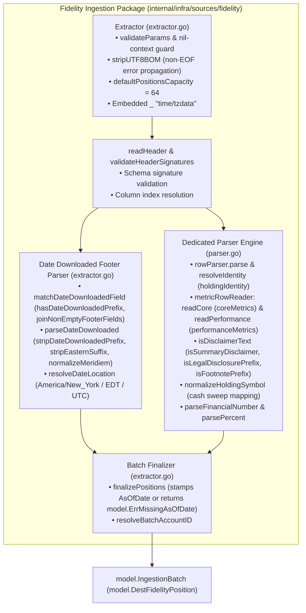

# Fidelity Portfolio Ingestion Adapter Architecture Specification

This document specifies the architectural patterns, stream handling, and data normalization invariants of the Fidelity Portfolio Ingestion Adapter located in `babylon_data_loader/internal/infra/sources/fidelity/`.

---

## 1. Overview & Architectural Boundaries

Fidelity brokerage portfolio exports represent point-in-time holdings snapshots across one or more accounts. The adapter transforms heterogeneous, tabular portfolio exports into strongly-typed `model.FidelityPosition` domain records, stamps every position in a non-empty batch with the UTC snapshot instant extracted from the `"Date downloaded ..."` footer, and encapsulates them into an `IngestionBatch`.



---

## 2. Real-World Export Quirks & Handling

Fidelity portfolio CSV exports exhibit distinctive formatting characteristics that require specialized parsing defenses:

### 1. `"Date downloaded "` Footer Detection, Parsing & Batch-Level `AsOfDate` Stamping
Fidelity portfolio exports do not include a snapshot date column on individual position rows; instead, the capture timestamp is emitted in a trailing footer line formatted as `"Date downloaded MMM-DD-YYYY H:MM a.m./p.m. ET"` (e.g., `"Date downloaded Oct-01-2025 9:13 p.m ET"`). [`extractor.go`](../../../internal/infra/sources/fidelity/extractor.go) extracts, normalizes, and stamps this timestamp across the batch:

- **Footer Invariants**:
  1. **First Footer Wins**: Only the first `"Date downloaded "` footer encountered in the stream is parsed (`asOfDate.IsZero()`); any subsequent footer lines are ignored.
  2. **Never Emitted as a Position**: When `matchDateDownloadedField` matches a row, `parsePositions` records `asOfDate` and immediately `continue`s before invoking `rowParser.parse`.
  3. **Mandatory on Non-Empty Batches**: In `finalizePositions`, if `len(positions) > 0` and `asOfDate.IsZero()`, extraction fails with `model.ErrMissingAsOfDate`.
  4. **Optional on Empty / Header-Only Streams**: If a stream is empty, header-only, or contains only disclaimers (`len(positions) == 0`), `finalizePositions` succeeds with an empty batch even when no footer is present.
- **Detection (`matchDateDownloadedField`, `hasDateDownloadedPrefix`, `joinNonEmptyFooterFields`)**: Scans row cells, trimming quotes, commas, spaces, tabs, and newlines (`dateTrimCutset = "\", \t\r\n"`), and checks the first non-empty field case-insensitively for the `"date downloaded"` keyword (`dateDownloadedKeyword`) followed by end-of-string or a delimiter (`' '`, `'\t'`, `':'`, `','`). When matched, `joinNonEmptyFooterFields` rejoins any comma-split unquoted trailing cells in the row with `" "`.
- **Parsing & Timezone Resolution (`parseDateDownloaded`, `stripDateDownloadedPrefix`, `stripEasternSuffix`, `normalizeMeridiem`, `resolveDateLocation`)**:
  - Imports `_ "time/tzdata"` to embed the IANA timezone database directly in the binary for container/serverless portability.
  - `stripDateDownloadedPrefix` validates and removes the `"Date downloaded"` prefix; if the remaining date string is empty, returns an error wrapping `ErrInvalidDateDownloaded`.
  - `stripEasternSuffix` strips `"EDT"`, `"EST"`, or `"ET"` suffixes (case-insensitively) and resolves the location via `resolveDateLocation`: loads `"America/New_York"` (falling back to a fixed `"EDT"` `UTC-4` zone if unavailable) when an Eastern suffix is present, or `time.UTC` otherwise.
  - `normalizeMeridiem` normalizes Fidelity's varied meridiem tokens (`"p.m."`, `"a.m."`, `"P.M."`, `"A.M."`, `"p.m"`, `"a.m"`, `"P.M"`, `"A.M"`, `"pm"`, `"am"`) to standard Go `"PM"` / `"AM"`, and internal whitespace runs are collapsed via `strings.Join(strings.Fields(dateStr), " ")`.
  - Parses against `"Jan-02-2006 3:04 PM"` (with fallback to single-digit day `"Jan-2-2006 3:04 PM"`, wrapping `ErrInvalidDateDownloaded` and `errSingle` on failure) and normalizes the resulting instant to `.UTC()`.
- **Batch-Level Stamping (`finalizePositions`)**: Assigns the parsed UTC `asOfDate` to `positions[i].AsOfDate` for every extracted position in the slice.

### 2. UTF-8 Byte Order Mark (BOM) Detection & Propagation
Fidelity CSV files routinely start with a 3-byte UTF-8 BOM (`0xef, 0xbb, 0xbf`). [`stripUTF8BOM`](../../../internal/infra/sources/fidelity/extractor.go) inspects the stream header:
- Surfaces non-EOF I/O peek errors immediately.
- Treats graceful EOF (empty file) as a non-error.
- Discards the BOM bytes without corrupting header detection.

```go
func stripUTF8BOM(br *bufio.Reader) error {
	bom := []byte{0xef, 0xbb, 0xbf}
	peekBytes, err := br.Peek(len(bom))
	if err != nil {
		if errors.Is(err, io.EOF) || errors.Is(err, io.ErrUnexpectedEOF) {
			return nil
		}
		return fmt.Errorf("failed to peek BOM header: %w", err)
	}
	if bytes.Equal(peekBytes, bom) {
		if _, discardErr := br.Discard(len(bom)); discardErr != nil {
			return fmt.Errorf("failed to discard BOM: %w", discardErr)
		}
	}
	return nil
}
```

### 3. Multi-Line Legal Disclaimers & Summary Totals Filtering
Fidelity statements include multi-line legal notices, quote delays, and summary lines (e.g. `"Account Total"`, `"Ending Value"`) embedded in the CSV body. [`isDisclaimerText`](../../../internal/infra/sources/fidelity/parser.go) decomposes disclaimer detection into three focused semantic predicates backed by `hasAnyPrefix`:
- **Summary Disclaimers (`isSummaryDisclaimer`)**: Matches exact `"total"` or prefixes `"total market"`, `"account total"`, `"portfolio total"`, and `"ending value"`.
- **Legal Disclosure Preambles (`isLegalDisclosurePrefix`)**: Matches prefixes `"the data and information"`, `"brokerage services"`, `"disclaimer"`, `"please note"`, `"important"`, `"quotes are"`, and `"security prices"`.
- **Footnote Annotations (`isFootnotePrefix`)**: Matches leading `"*"` (excluding the `"**"` cash sweep symbol) and numbered footnote prefixes `"1."`.

### 4. Core Cash Sweep Normalization
Fidelity represents cash sweeps using non-standard ticker markers:
- `"**"` (cash holding indicator)
- `"FCASH"` (Fidelity cash reserve)
- `"CORE"` (Core sweep position)

The parser normalizes these tokens to canonical `"CASH"`, while carefully preserving valid tickers that carry footnote asterisks (e.g. `SPAXX**` -> preserved as `SPAXX**` or resolved to ticker).

```go
func normalizeSymbol(symbol, description string) (string, bool) {
	symUpper := strings.ToUpper(strings.TrimSpace(symbol))
	if symUpper == "**" || symUpper == "FCASH" || symUpper == "CORE" {
		return "CASH", true
	}
	if symUpper != "" {
		return symUpper, true
	}
	descUpper := strings.ToUpper(description)
	if strings.Contains(descUpper, "HELD IN") || strings.Contains(descUpper, "CORE") || strings.Contains(descUpper, "CASH") {
		return "CASH", true
	}
	return "", false
}
```

### 5. Preservation of Mutual Funds with "Total" in Description
Earlier parsers dropped legitimate broad-market index funds (e.g. `VTI` Vanguard Total Stock Market, `BND` Total Bond Market, `TTE` TotalEnergies) because their descriptions contained `"Total"`. The parser decouples symbol evaluation: if `symbol != ""` and the row is not a summary row, the record is unconditionally preserved.

### 6. Legacy Field Parity & Performance Metrics
To preserve complete fidelity with legacy `positions_fidelity` documents, [`parser.go`](../../../internal/infra/sources/fidelity/parser.go) extracts 8 additional optional performance, allocation, and classification columns alongside core valuation metrics:
- **The 8 Legacy-Parity Fields**:
  1. `LastPriceChange` (`"last price change"`): Per-unit dollar change (`float64`, parsed via `parseCurrency`).
  2. `TodaysGainLossDollar` (`"today's gain/loss dollar"`, `"todays gain/loss dollar"`): Today's dollar gain/loss (`float64`, parsed via `parseCurrency`).
  3. `TodaysGainLossPct` (`"today's gain/loss percent"`, `"todays gain/loss percent"`): Today's percentage gain/loss in percentage points (`"+0.84%"` -> `0.84`, parsed via `parsePercent`).
  4. `TotalGainLossDollar` (`"total gain/loss dollar"`): Cumulative dollar gain/loss (`float64`, parsed via `parseCurrency`).
  5. `TotalGainLossPct` (`"total gain/loss percent"`): Cumulative percentage gain/loss in percentage points (`float64`, parsed via `parsePercent`).
  6. `PercentOfAccount` (`"percent of account"`): Portfolio allocation weight in percentage points (`float64`, parsed via `parsePercent`).
  7. `AverageCostBasis` (`"average cost basis"`): Per-unit cost basis in dollars (`float64`, parsed via `parseCurrency`).
  8. `Type` (`"type"`): Raw Fidelity holding classification, trimmed (e.g. `"Cash"`, `"Margin"`).
- **`parsePercent` Heuristics**:
  - **Strict Placeholder Pre-Check**: Evaluates `isNumericDefaultZero` on the raw trimmed input *before* stripping `%` so legitimate placeholders (`""`, `"-"`, `"--"`, `"n/a"`, `"unknown"`, `"pending"`) resolve to `0.0`, while bare or placeholder-prefixed percent tokens (`"%"`, `"-%"`, `"--%"`, `"N/A%"`) are rejected after stripping.
  - **Accounting Parentheses & Trailing `%`**: `stripPercentSymbol` (via `removeOuterOrInnerPercent` and `stripParenthesizedPercent`) handles both trailing `%` (`"+0.84%"` -> `"+0.84"`) and inner parenthesized percentages (`"(0.44%)"` -> `"(0.44)"`, which `sanitizeFinancialToken` converts to `"-0.44"`).
  - **Duplicate / Embedded `%` Rejection**: Any remaining `%` character after outer/inner stripping (such as `"12%34"` or `"25%%"`) causes `stripPercentSymbol` to fail immediately.
- **Domain Parameter Objects & Decomposed Metric Reading**:
  - `holdingIdentity`: Value struct produced by `rowParser.resolveIdentity(row, lineNum)` encapsulating `accountID`, `accountName`, `symbol`, `description`, `securityType` (`Type`), and `rawLineNumber`.
  - `coreMetrics` & `performanceMetrics`: Value structs aggregated into `positionMetrics`, which populates the target entity via `(m positionMetrics) applyTo(pos *model.FidelityPosition)`.
  - `metricRowReader`: Short-circuiting row reader helper exposing `(r *metricRowReader) readCore() (coreMetrics, error)` and `(r *metricRowReader) readPerformance() (performanceMetrics, error)` to keep cyclomatic and cognitive complexity flat.

---

## 3. Schema Signature Validation

To prevent arbitrary non-Fidelity CSVs from being ingested as zero-dollar cash positions, `validateHeaderSignatures` validates two mandatory schema signatures:
1. Symbol Column Group: Requires at least one alias matching `{"symbol", "ticker"}`.
2. Valuation Column Group: Requires at least one alias matching `{"current value", "market value", "current balance"}`.

If either group is missing, the adapter rejects the statement immediately with `ErrMissingRequiredColumns`.

---

## 4. Single-Account Batch Inference (`resolveBatchAccountID`)

Fidelity portfolio files frequently represent single-account statements where account numbers appear on every record. The adapter verifies consistency across all rows:
- If all rows reference a single account (e.g. `"Z12345678"`), that account ID is assigned to the `IngestionBatch.AccountID`.
- If accounts are mixed (multi-account portfolio export), the batch retains the caller's `meta.AccountID`.

---

## 5. Exported Sentinel Errors

[`extractor.go`](../../../internal/infra/sources/fidelity/extractor.go) exports adapter-level sentinels and wraps domain-level sentinels from [`fidelity_position.go`](../../../internal/domain/model/fidelity_position.go) during validation and batch finalization:

```go
// Adapter-level sentinels in internal/infra/sources/fidelity/extractor.go
var (
	ErrNilReader              = errors.New("reader cannot be nil")
	ErrMissingRequiredColumns = errors.New("fidelity CSV missing required header columns")
	ErrInvalidDateDownloaded  = errors.New("invalid fidelity Date downloaded footer")
)

// Domain-level sentinels in internal/domain/model/fidelity_position.go
var (
	ErrInvalidPerformanceMetric = errors.New("performance or allocation metric must be a valid finite number")
	ErrMissingAsOfDate          = errors.New("fidelity snapshot date (asOfDate) is required")
)
```
