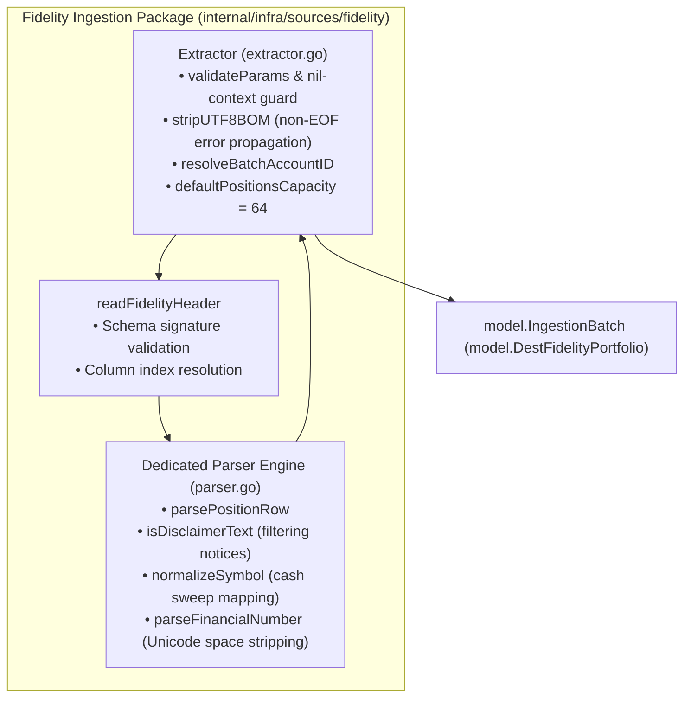

# Fidelity Portfolio Ingestion Adapter Architecture Specification

This document specifies the architectural patterns, stream handling, and data normalization invariants of the Fidelity Portfolio Ingestion Adapter located in `babylon_data_loader/internal/infra/sources/fidelity/`.

---

## 1. Overview & Architectural Boundaries

Fidelity brokerage portfolio exports represent point-in-time holdings snapshots across one or more accounts. The adapter transforms heterogeneous, tabular portfolio exports into strongly-typed `model.FidelityPosition` domain records and encapsulates them into an `IngestionBatch`.



---

## 2. Real-World Export Quirks & Handling

Fidelity portfolio CSV exports exhibit distinctive formatting characteristics that require specialized parsing defenses:

### 1. UTF-8 Byte Order Mark (BOM) Detection & Propagation
Fidelity CSV files routinely start with a 3-byte UTF-8 BOM (`0xef, 0xbb, 0xbf`). [`stripUTF8BOM`](../../internal/infra/sources/fidelity/extractor.go) inspects the stream header:
- Surfaces non-EOF I/O peek errors immediately.
- Treats graceful EOF (empty file) as a non-error.
- Discards the BOM bytes without corrupting header detection.

```go
func stripUTF8BOM(br *bufio.Reader) error {
	bom := []byte{0xef, 0xbb, 0xbf}
	peekBytes, err := br.Peek(len(bom))
	if err != nil {
		if errors.Is(err, io.EOF) || errors.Is(err, io.ErrUnexpectedEOF) {
			return nil
		}
		return fmt.Errorf("failed to peek BOM header: %w", err)
	}
	if bytes.Equal(peekBytes, bom) {
		if _, discardErr := br.Discard(len(bom)); discardErr != nil {
			return fmt.Errorf("failed to discard BOM: %w", discardErr)
		}
	}
	return nil
}
```

### 2. Multi-Line Legal Disclaimers & Summary Totals Filtering
Fidelity statements include multi-line legal notices, quote delays, and summary lines (e.g. `"Account Total"`, `"Ending Value"`) embedded in the CSV body. [`isDisclaimerText`](../../internal/infra/sources/fidelity/parser.go) identifies and skips these lines:
- Skips legal preamble: `"Please note"`, `"The data and information"`, `"Brokerage services"`.
- Skips summary rows: `"Total"`, `"Account Total"`, `"Ending Value"`, `"Portfolio Total"`.
- Skips numbered footnotes and footnote annotations: `"* "`, `"** "`, `"1. "`, `"2. "`.

### 3. Core Cash Sweep Normalization
Fidelity represents cash sweeps using non-standard ticker markers:
- `"**"` (cash holding indicator)
- `"FCASH"` (Fidelity cash reserve)
- `"CORE"` (Core sweep position)

The parser normalizes these tokens to canonical `"CASH"`, while carefully preserving valid tickers that carry footnote asterisks (e.g. `SPAXX**` -> preserved as `SPAXX**` or resolved to ticker).

```go
func normalizeSymbol(symbol, description string) (string, bool) {
	symUpper := strings.ToUpper(strings.TrimSpace(symbol))
	if symUpper == "**" || symUpper == "FCASH" || symUpper == "CORE" {
		return "CASH", true
	}
	if symUpper != "" {
		return symUpper, true
	}
	descUpper := strings.ToUpper(description)
	if strings.Contains(descUpper, "HELD IN") || strings.Contains(descUpper, "CORE") || strings.Contains(descUpper, "CASH") {
		return "CASH", true
	}
	return "", false
}
```

### 4. Preservation of Mutual Funds with "Total" in Description
Earlier parsers dropped legitimate broad-market index funds (e.g. `VTI` Vanguard Total Stock Market, `BND` Total Bond Market, `TTE` TotalEnergies) because their descriptions contained `"Total"`. The parser decouples symbol evaluation: if `symbol != ""` and the row is not a summary row, the record is unconditionally preserved.

---

## 3. Schema Signature Validation

To prevent arbitrary non-Fidelity CSVs from being ingested as zero-dollar cash positions, `readFidelityHeader` validates two mandatory schema signatures:
1. Symbol Column Group: Requires at least one alias matching `{"symbol", "ticker"}`.
2. Valuation Column Group: Requires at least one alias matching `{"current value", "market value", "current balance", "last price", "quantity"}`.

If either group is missing, the adapter rejects the statement immediately with `ErrMissingRequiredColumns`.

---

## 4. Single-Account Batch Inference (`resolveBatchAccountID`)

Fidelity portfolio files frequently represent single-account statements where account numbers appear on every record. The adapter verifies consistency across all rows:
- If all rows reference a single account (e.g. `"Z12345678"`), that account ID is assigned to the `IngestionBatch.AccountID`.
- If accounts are mixed (multi-account portfolio export), the batch retains the caller's `meta.AccountID`.

---

## 5. Exported Sentinel Errors

[`extractor.go`](../../internal/infra/sources/fidelity/extractor.go) exports typed sentinels:

```go
var (
	ErrNilReader              = errors.New("reader cannot be nil")
	ErrMissingRequiredColumns = errors.New("fidelity CSV missing required header columns")
)
```
