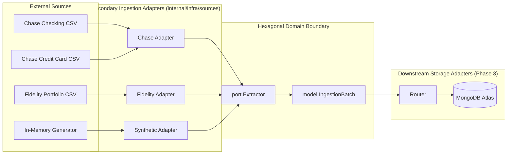
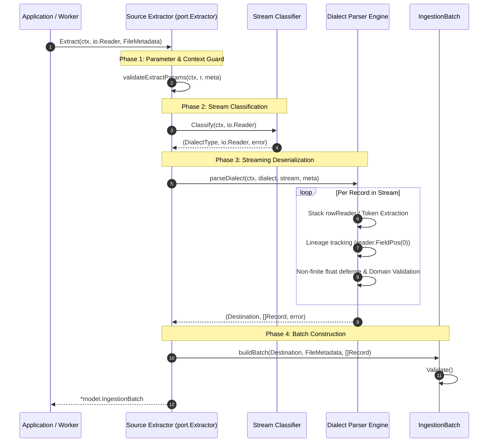

# Hexagonal Ingestion Architecture & Stream Lifecycle

This document specifies the architectural patterns, data flow lifecycles, and isolation boundaries governing source adapters within the `babylon_data_loader` service.

---

## 1. Executive Summary & Architectural Motivation

The ingestion subsystem decouples file parsing, dialect classification, string sanitization, and data validation from core domain models, persistence mechanisms, and transport infrastructure. 



### Architectural Value Drivers:
1. **Separation of Concerns**: Dialect peculiarities (e.g., Chase checking vs. credit card schemas, Fidelity UTF-8 BOMs, summary footer disclaimers) are encapsulated inside dedicated secondary adapters.
2. **Deterministic Domain Delivery**: Adapters emit strongly-typed, immutable `IngestionBatch` aggregates with typed payloads (`[]ChaseTransaction`, `[]FidelityPosition`), strictly decoupling persistence concerns from stream ingestion.
3. **Pluggable & Extensible Extraction**: New banking institutions or brokerage data formats implement `port.Extractor` without altering core business rules or storage routers.
4. **Standard Library Purity**: Ingestion adapters rely strictly on standard library packages (`encoding/csv`, `bufio`, `io`, `time`, `strings`, `math`), guaranteeing zero third-party supply chain vulnerabilities.

---

## 2. Ingestion Architecture & Data Flow

Every ingestion adapter processes data through four discrete lifecycle phases:



### Ingestion Lifecycle Phases:

#### Phase 1: Parameter & Context Guard
- Defensively guards against `nil` context (`ctx = context.Background()`).
- Immediately short-circuits if the context is already canceled or deadline-exceeded (`ctx.Err() != nil`), returning the raw context sentinel.
- Guards against `nil` stream reader (`ErrNilReader`).
- Validates metadata envelope invariants (`meta.Validate()`).

#### Phase 2: In-Stream Dialect Classification
- Classifies stream structure non-destructively using memory-bounded header inspection (e.g., `bufio.Reader.Peek(4096)`).
- Preserves the unconsumed reader stream, returning it to the caller without re-allocating byte buffers.
- Enforces strict nil stream guards to prevent panics from custom classifier implementations.

#### Phase 3: Streaming Deserialization & Lineage Tracking
- Stream-processes CSV records using standard `encoding/csv.Reader` (`FieldsPerRecord = -1`, `TrimLeadingSpace = true`).
- Skips empty or whitespace-only lines without error.
- Leverages zero-allocation stack value structs (e.g., Chase `rowReader`) for ergonomic, bounds-checked extraction.
- Enforces IEEE 754 non-finite number defense (`math.IsNaN`, `math.IsInf`).
- Binds exact 1-based physical line numbers to domain entities via `reader.FieldPos(0)`, ensuring comprehensive audit trails.

#### Phase 4: Batch Envelope Assembly & Canonical Validation
- Encapsulates parsed entities into a canonical `model.IngestionBatch` container.
- Populates all 6 envelope metadata properties: `Destination`, `AccountID`, `SourceFile`, `FileHash`, `IngestedAt`, `RecordCount`.
- Executes `batch.Validate()`, verifying payload size invariants and structural completeness before handing off to the pipeline.

---

## 3. Package Structure & Responsibilities

The ingestion adapter package layout in `babylon_data_loader` is strictly organized:

```text
internal/infra/sources/
├── chase/                          # Chase Bank Statement Adapter
│   ├── classifier.go               # Dialect classification (Peek-based)
│   ├── classifier_test.go          # Unit tests for dialect detection
│   ├── extractor.go                # Declarative 4-stage pipeline orchestrator
│   ├── extractor_test.go           # Pipeline, routing, concurrency, & edge tests
│   ├── checking.go                 # Checking account dialect row parser
│   ├── credit_card.go              # Credit card dialect row parser & date fallbacks
│   ├── parser.go                   # Reusable parser engine, rowReader, & primitives
│   └── parser_test.go              # Primitives, table tests, & allocation benchmarks
├── fidelity/                       # Fidelity Portfolio Adapter
│   ├── extractor.go                # Pipeline orchestrator & UTF-8 BOM handling
│   ├── extractor_test.go           # BOM, disclaimers, & synthetic tests
│   ├── parser.go                   # Holdings categorization & disclaimer filters
│   └── parser_test.go              # Number sanitization & ticker normalization
└── synthetic/                      # Synthetic Mock Fixture Adapter
    ├── extractor.go                # Deterministic PCG generator (math/rand/v2)
    └── extractor_test.go           # Concurrency, seeds, & bounds tests
```

---

## 4. Strict Isolation Boundaries & Forbidden Dependencies

To preserve the clean architecture of `babylon_data_loader`, secondary source adapters adhere to strict import isolation rules:

### Standard Library Isolation Invariant
Source adapters are strictly isolated to Go standard library primitives:
- Allowed Packages: `context`, `errors`, `fmt`, `io`, `bufio`, `bytes`, `encoding/csv`, `math`, `math/rand/v2`, `strconv`, `strings`, `sync`, `time`, `unicode`.
- Allowed Internal Dependencies: `babylon/dataloader/internal/domain/model` and `babylon/dataloader/internal/domain/port`.

### Strictly Forbidden Dependencies:
- **Database Drivers**: `go.mongodb.org/mongo-driver`, `database/sql`, `github.com/lib/pq`.
- **Third-Party CSV / Streaming Libraries**: `github.com/gocarina/gocsv`, `github.com/jszwec/csvutil`.
- **Cloud Provider SDKs**: `github.com/aws/aws-sdk-go`, `github.com/aws/aws-sdk-go-v2`.
- **Transport / Web Frameworks**: `net/http`, `github.com/gin-gonic/gin`.
- **Persistence Storage Adapters**: Packages inside `internal/infra/storage/...`.
