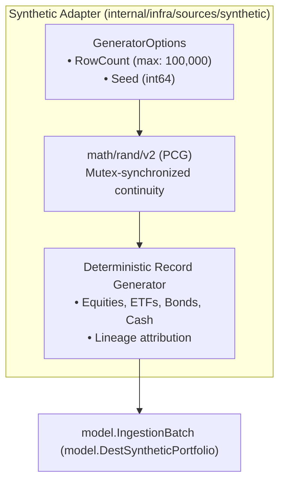

# Synthetic Deterministic Ingestion Adapter Architecture Specification

This document specifies the architectural design and deterministic generation mechanics of the Synthetic Ingestion Adapter located in `babylon_data_loader/internal/infra/sources/synthetic/`.

---

## 1. Overview & Architectural Motivation

The synthetic adapter implements `port.Extractor` to generate deterministic, strongly-typed portfolio holdings batches without requiring disk I/O, external network dependencies, or recorded database fixtures. It powers performance benchmarks, CI/CD integration suites, load tests, and pipeline stress tests.



---

## 2. Deterministic Generation via `math/rand/v2`

The synthetic adapter utilizes Go 1.22's `math/rand/v2` PCG (Permuted Congruential Generator) algorithm (`rand.NewPCG`), ensuring reproducible pseudo-random outputs across platforms:

```go
type GeneratorOptions struct {
	RowCount int
	Seed     int64
}

type Extractor struct {
	opts GeneratorOptions
	mu   sync.Mutex
	rng  *rand.Rand
}

func NewExtractor(opts GeneratorOptions) port.Extractor {
	return &Extractor{
		opts: opts,
		rng:  rand.New(rand.NewPCG(uint64(opts.Seed), uint64(opts.Seed^0x5DEECE66D))),
	}
}
```

### Key Invariants:
1. **RNG State Continuity**: The `*rand.Rand` instance is retained on the struct and guarded with a `sync.Mutex`. Sequential calls to `Extract` produce continuous, non-repeating streams while remaining 100% deterministic when seeded identically.
2. **Thread Safety**: Concurrent extraction across goroutines is synchronized via `e.mu.Lock()`, preventing data races on PRNG internal state.

---

## 3. Memory Safety & Pre-Allocation Clamping

To prevent runaway memory consumption or denial-of-service (DoS) from extreme row count requests:
- **Maximum Row Bound**: Rejects requests exceeding `MaxSyntheticRowCount = 100_000` with an explicit error.
- **Clamped Pre-Allocation**: Limits initial slice capacity to `min(opts.RowCount, 10_000)` to guard against memory exhaustion during initialization, resizing dynamically as generation proceeds.

```go
const (
	MaxSyntheticRowCount = 100_000
	maxPreAllocCapacity  = 10_000
)

func preAllocCapacity(count int) int {
	if count > maxPreAllocCapacity {
		return maxPreAllocCapacity
	}
	return count
}
```

---

## 4. Batch Envelope & Record Generation

Generated records (`model.SyntheticPosition`) satisfy domain validation rules:
- Ticker symbols chosen deterministically from standard equity/ETF/bond buckets.
- Prices and quantities generated within realistic financial bounds.
- All 6 batch metadata envelope properties are populated and validated (`batch.Validate()`).
- Ingestion destination is assigned to `model.DestSyntheticPortfolio`.
