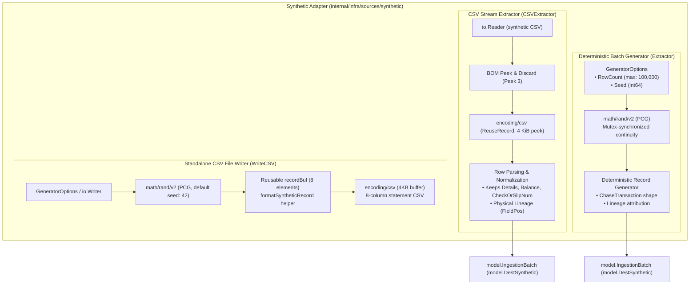

# Synthetic Deterministic Ingestion Adapter Architecture Specification

This document specifies the architectural design, deterministic generation mechanics, and CSV ingestion parser of the Synthetic Ingestion Adapter located in `internal/infra/sources/synthetic/`.

---

## 1. Overview & Architectural Motivation

The synthetic adapter package (`internal/infra/sources/synthetic/`) houses three cohesive components serving deterministic testing, benchmark fixtures, and statement generation:

1. **Deterministic Batch Generator (`Extractor`)**: Implements `port.Extractor` to generate deterministic, strongly-typed `model.ChaseTransaction` batches in memory without requiring disk I/O, external network dependencies, or recorded database fixtures. It powers performance benchmarks, CI/CD integration suites, load tests, and pipeline stress tests.
2. **File CSV Extractor (`CSVExtractor`)**: Implements `port.Extractor` to ingest legacy synthetic CSV statement files (such as `tmp/synthetic/test-synthetic-data.csv` generated via `make run-generate` and uploaded via `make upload-synthetic` or the desktop dropdown) directly from an `io.Reader` stream.
3. **Standalone CSV File Writer (`WriteCSV`)**: Generates and writes canonical 8-column synthetic CSV statements to an abstract `io.Writer`. It permanently replaces the retired legacy `synthetic/` package, providing streaming file generation with zero disk dependencies, decoupled memory reuse, and PCG PRNG determinism.

Both `Extractor` and `CSVExtractor` emit `[]model.ChaseTransaction` batches routed to `model.DestSynthetic` (`transactions_synthetic`), while `WriteCSV` emits canonical statement files readable by `CSVExtractor`.



---

## 2. Deterministic Generation via `math/rand/v2`

The generator adapter utilizes Go's `math/rand/v2` PCG (Permuted Congruential Generator) algorithm (`rand.NewPCG`), ensuring reproducible pseudo-random outputs across platforms:

```go
type GeneratorOptions struct {
	RowCount int
	Seed     int64
}

type Extractor struct {
	opts GeneratorOptions
	mu   sync.Mutex
	rng  *rand.Rand
}

func NewExtractor(opts GeneratorOptions) port.Extractor {
	return &Extractor{
		opts: opts,
		rng:  rand.New(rand.NewPCG(uint64(opts.Seed), 1)),
	}
}
```

### Key Invariants:
1. **RNG State Continuity**: The `*rand.Rand` instance is retained on the struct and guarded with a `sync.Mutex`. Sequential calls to `Extract` produce continuous, non-repeating streams while remaining 100% deterministic when seeded identically.
2. **Thread Safety**: Concurrent extraction across goroutines is synchronized via `e.mu.Lock()`, preventing data races on PRNG internal state.

---

## 3. Memory Safety & Pre-Allocation Clamping

To prevent runaway memory consumption or denial-of-service (DoS) from extreme row count requests in the generator:
- **Maximum Row Bound**: Rejects requests exceeding `MaxSyntheticRowCount = 100_000` with an explicit error.
- **Clamped Pre-Allocation**: Limits initial slice capacity to `min(opts.RowCount, 10_000)` to guard against memory exhaustion during initialization, resizing dynamically as generation proceeds.

---

## 4. Batch Envelope & Record Generation

Generated and parsed records (`model.ChaseTransaction`) satisfy domain validation rules:
- Transaction amounts, dates, descriptions, and running balances populated within realistic financial bounds.
- All batch metadata envelope properties are populated and validated (`batch.Validate()`).
- Ingestion destination is assigned to `model.DestSynthetic`.

---

## 5. Synthetic CSV Extractor (`CSVExtractor`)

`CSVExtractor` parses legacy synthetic CSV files without using the Chase extractor classifier, which would otherwise classify synthetic files with a `Category` column as Chase credit card dialect and discard checking-only fields.

### 5.1 Preservation of Checking-Only Fields
Legacy synthetic files contain checking-only fields that must be preserved:
- `Details`
- `Balance`
- `Check or Slip #`

`CSVExtractor` maps all eight legacy columns into `model.ChaseTransaction` and routes the batch to `model.DestSynthetic`.

### 5.2 Phase 2 Adapter Invariants
1. **Standard-Library Isolation**: Imports only the Go standard library and `internal/domain/*`, strictly adhering to `sources-isolation` depguard rules.
2. **Low-Allocation Row Parsing**: Uses a value-type row reader and `csv.Reader.ReuseRecord = true` with a pre-indexed column lookup table.
3. **Memory-Bounded Inspection**: Buffers streams via `bufio.NewReaderSize(r, csvPeekSize)` (4 KiB) and inspects UTF-8 BOMs with `Peek(3)` without buffering the entire input.
4. **Unwrapped Context Errors**: Context cancellation and deadlines (`context.Canceled`, `context.DeadlineExceeded`) are checked before each row and returned directly without error wrapping.
5. **Physical Lineage Attribution**: Each transaction records physical line numbers derived from `csv.Reader.FieldPos(0)`, ensuring accurate auditability across blank lines and multi-line quoted fields.

### 5.3 Error Taxonomy & Sentinels
- `ErrNilReader`: Supplied `io.Reader` is nil.
- `ErrMissingHeader`: Stream contains no header row.
- `ErrMissingRequiredColumns`: Header row is missing one or more required columns (`Posting Date`, `Description`, `Amount`).
- `ErrMalformedCSV`: CSV syntax error wrapping `*csv.ParseError`.
- `ErrInvalidRow`: Data row validation error wrapping physical line number and the underlying domain sentinel (`model.ErrMissingPostingDate`, `model.ErrMissingDescription`, `model.ErrInvalidAmount`, `model.ErrInvalidBalance`).

### 5.4 Extractor Coexistence & Pipeline Registration
Both `Extractor` and `CSVExtractor` report `SourceType() == "synthetic"`. They are registered in mutually exclusive pipelines:
- `ingest.RegisterDefaults` registers `CSVExtractor` for standard file ingestion (CLI `ingest`, Lambda, desktop).
- The generator `Extractor` is registered only in the dedicated synthetic generation pipeline.

---

## 6. Synthetic CSV Writer (`WriteCSV`)

Authoritative implementation reference: `internal/infra/sources/synthetic/csv_writer.go`.

Following Phase 5D ([Issue #98](https://github.com/ajponte/babylon_data_loader/issues/98), [PR #108](https://github.com/ajponte/babylon_data_loader/pull/108)), the synthetic CSV generation logic was relocated from the legacy root package `synthetic/` into `internal/infra/sources/synthetic/csv_writer.go`. This decouples CSV generation from filesystem state and integrates it directly into the hexagonal sources architecture.

### 6.1 Function Signature & Options
```go
func WriteCSV(w io.Writer, opts GeneratorOptions) error
```
`WriteCSV` accepts an abstract `io.Writer` and standard `GeneratorOptions`:
- `RowCount`: Total number of synthetic transaction rows to generate (bounded by `MaxSyntheticRowCount = 100_000`; negative values are normalized to 0).
- `Seed`: 64-bit integer seed for PRNG initialization. When unset (0), defaults to canonical seed `42` (`defaultSeed`).

### 6.2 Error Taxonomy & Sentinel Contracts
- **`ErrNilWriter`**: Returned immediately when the supplied `io.Writer` is `nil`.
- **`ErrExcessiveRowCount`**: Exported sentinel (`errors.New("synthetic csv: row count exceeds maximum allowable limit")`). Returned wrapped via `fmt.Errorf("%w: %d exceeds maximum allowable limit of %d", ErrExcessiveRowCount, opts.RowCount, MaxSyntheticRowCount)` when `RowCount > MaxSyntheticRowCount`. Enables callers to programmatically assert validation failures with `errors.Is(err, synthetic.ErrExcessiveRowCount)`.
- **I/O Errors**: Underlying write or flush errors from `csv.Writer` or `w.Write` are returned wrapped with contextual details (e.g., `failed to write CSV record %d: %w`, `failed to flush CSV writer: %w`).

### 6.3 Memory Safety & Zero-Allocation Optimization
To prevent excessive garbage collector pressure during large generation workloads (up to 100,000 rows):
- **Pre-Allocated Record Buffer**: A single 8-element string slice (`record := make([]string, csvColumnCount)`) is allocated once before the generation loop and mutated in-place across iterations. This eliminates up to 100,000 heap slice allocations.
- **Decomposed Formatting Helper**: Record field construction is cleanly factored into a private helper `formatSyntheticRecord(rng *rand.Rand, baseDate time.Time, index int, currentBalance *float64, record []string)` which computes rounded currency amounts, balance running totals, transaction types, and check cadence formatting without allocating intermediate slices.

### 6.4 PRNG Determinism & Canonical Statement Schema
- **PCG Algorithm**: Utilizes `math/rand/v2` with `rand.NewPCG(uint64(seed), 1)` to guarantee cross-platform deterministic output for identical seeds.
- **Canonical 8-Column Schema**: Emits the standard statement header and rows matching legacy synthetic format, fully compatible with `CSVExtractor`:
  1. `Details` (`DEBIT`, `CREDIT`, `CHECK`)
  2. `Posting Date` (`MM/DD/YYYY` decrementing by 1 day per row from `2026-10-31`)
  3. `Description` (`Synthetic transaction <index>`)
  4. `Category` (`SYNTHETIC`)
  5. `Amount` (two-decimal signed monetary amount)
  6. `Type` (`DEBIT`, `CREDIT`)
  7. `Balance` (running balance rounded to 2 decimal places)
  8. `Check or Slip #` (populated every 10th debit transaction as `baseCheckNum + index`)

### 6.5 Buffer Semantics & Flush Handling
`csv.Writer` wraps `io.Writer` with an internal 4KB buffer (`bufio.Writer`). Writing the header and initial rows buffers in memory and only performs physical writes to `w` once the buffer fills or when `csvWriter.Flush()` is explicitly called. `WriteCSV` ensures `csvWriter.Flush()` is called upon loop completion, followed immediately by `csvWriter.Error()` verification to capture any delayed I/O failures.

