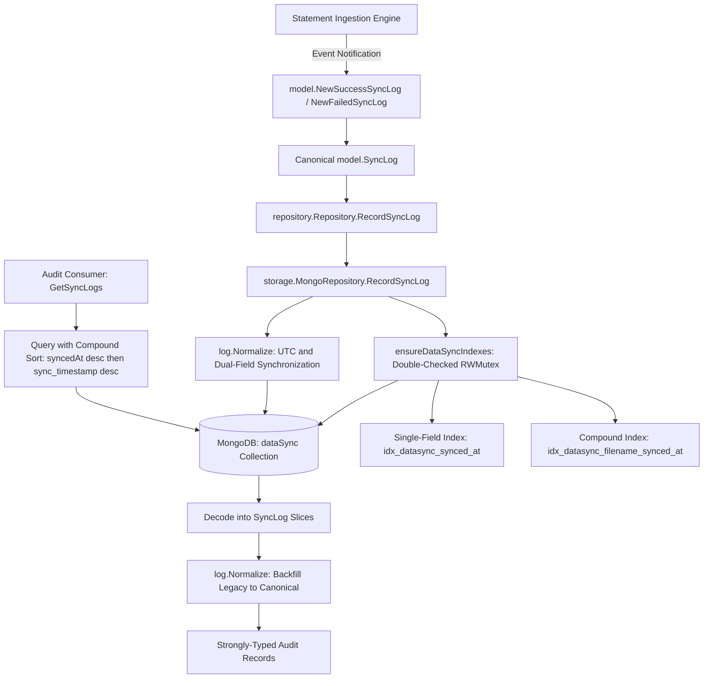
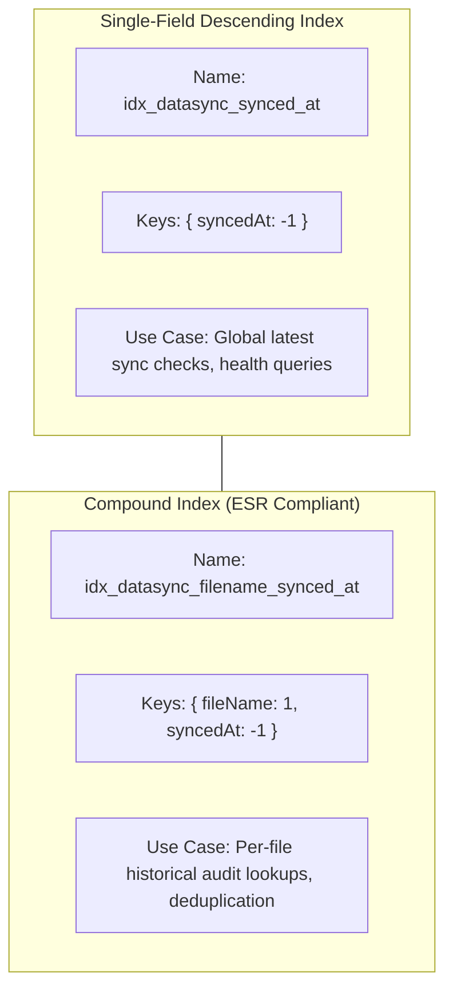
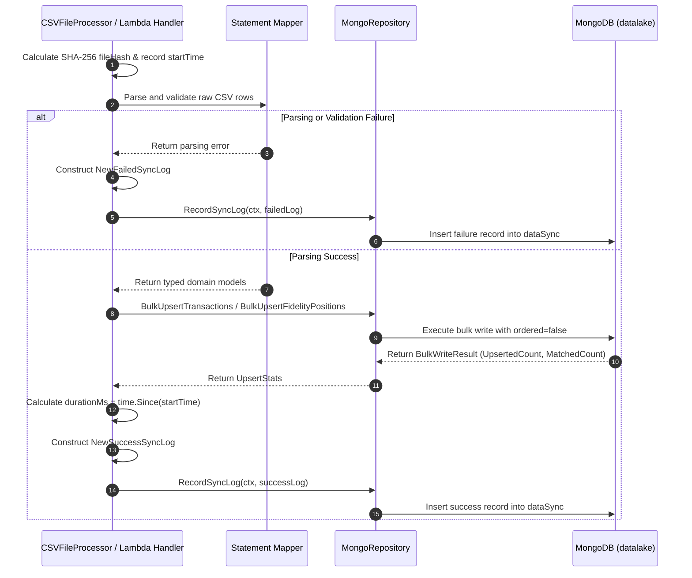

# DataSync Ingestion Audit & Observability Specification

## 1. Executive Summary & Architectural Context

This specification defines the architecture, domain models, indexing strategies, storage contracts, and observability tooling for the ingestion audit trail within the Babylon Datalake (`dataSync` collection).

The `dataSync` collection serves as the definitive, immutable operational registry for all statement ingestion processes executed by `babylon_data_loader`. Every file evaluated by the ingestion engine—whether originating from AWS S3 in serverless Lambda deployments or local directories in desktop environments—generates an audit document capturing cryptographic provenance, processing duration, detailed mutation counts, and operational health status.

### 1.1. Ingestion Audit Evolution

Historical iterations of `babylon_data_loader` maintained a minimal, unindexed 3-field audit schema (`collection_name`, `sync_timestamp`, `records_uploaded`). While functional for basic tracking, this legacy format created critical operational bottlenecks:

1. **Unindexed Collection Scans**: Operational health checks and monitoring dashboards sorting by timestamp (such as `db.dataSync.find().sort({syncedAt: -1}).limit(1)`) triggered full collection scans (`COLLSCAN`), increasing database CPU utilization as historical volume accumulated.
2. **Absence of Provenance & Deduplication Coordinates**: File names and cryptographic hashes (SHA-256) were not captured in `dataSync`, preventing deterministic file deduplication detection at the audit layer.
3. **Coarse Accounting**: Only total rows uploaded were recorded. Granular database mutations—such as new documents inserted (`upsertedCount`) versus existing documents matched and updated (`matchedCount`)—were indistinguishable.
4. **Silent Ingestion Failures**: Processing errors, CSV format anomalies, and storage exceptions aborted the pipeline without persisting a permanent failure record in `dataSync`.
5. **Specification Discrepancy**: The data format diverged from Sections 5.2 and 6.1 of the authoritative MongoDB Atlas Datalake specification (`docs/specs/mongodb-atlas-datalake.md`).

This specification formalizes the canonical 11-field `SyncLog` domain model, double-checked thread-safe automated index provisioning, bidirectional backward-compatible schema normalization, and an expanded repository contract.

> [!NOTE]
> **Zero-Downtime Backward Compatibility Guarantee**  
> Complete backward compatibility is maintained across all legacy documents stored in MongoDB and frontend bindings (such as `desktop/frontend/src/components/HistoryPanel.tsx`). Dual BSON tagging and bidirectional in-memory normalization (`Normalize()`) allow legacy and canonical records to co-exist transparently.

### 1.2. High-Level Architectural Flow



---

## 2. Ingestion Audit Requirements & Operational Challenges

### 2.1. Operational Provenance & Lineage Tracking

Ingestion audit logs must link directly to the physical statement source. The canonical model requires:
- **`fileName`**: The base name of the ingested CSV file (e.g., `Chase6896_Activity_20230312.CSV` or `Portfolio_Positions_20261017.csv`).
- **`fileHash`**: Cryptographic SHA-256 checksum calculated over the raw file content prior to parsing, establishing immutable file identity and enabling fast deduplication validation.
- **`collectionName`**: The target MongoDB collection where records were routed (e.g., `transactions_chase`, `positions_fidelity`, `transactions_synthetic`).

### 2.2. Granular Record Accounting

The legacy `records_uploaded` metric obscured the distinction between newly discovered transactions and re-ingested idempotent rows. The canonical model establishes three explicit metrics:
- **`recordCount`**: Total number of data rows parsed from the source CSV file (excluding headers, trailers, and legal disclaimers).
- **`upsertedCount`**: Number of new documents created in the datalake collection during bulk upsert execution.
- **`matchedCount`**: Number of existing documents identified and updated/verified during bulk upsert execution.

**Invariance Rule**: For successful runs, `recordCount` must equal `upsertedCount + matchedCount` (excluding explicitly dropped invalid rows).

### 2.3. Failure & Status Tracking

Operational monitoring requires distinguishing between healthy ingestions and failed attempts directly within the database:
- **`status`**: Strongly-typed operational status enum: `"SUCCESS"` or `"FAILED"`.
- **`errorMessage`**: Sanitized error message capturing the failure root cause (e.g., corrupted headers, schema validation violations, S3 retrieval timeouts, or MongoDB connection rejections). When `status == "SUCCESS"`, this field is omitted from BSON storage.

### 2.4. Performance Observability & Latency Profiling

Each audit record tracks pipeline execution characteristics:
- **`syncedAt`**: Wall-clock UTC timestamp recording when the ingestion completed or terminated.
- **`durationMs`**: Elapsed wall-clock time in milliseconds from statement parsing initiation to final database persistence and archival.

### 2.5. Elimination of Unindexed Collection Scans

The canonical datalake health check defined in `docs/specs/mongodb-atlas-datalake.md` Section 6.1 queries:
```javascript
db.dataSync.find().sort({ syncedAt: -1 }).limit(1);
```
Without dedicated indexing, MongoDB performs a collection scan (`COLLSCAN`) followed by an in-memory sort (`SORT`). As ingestion runs multiply, this degrades performance and risks query termination if the sort buffer memory limit is exceeded.

To eliminate scans, the storage layer automates index provisioning:
1. **`idx_datasync_synced_at`**: Single-field descending index `{ syncedAt: -1 }` ensuring $O(\log N)$ point lookups for latest sync timestamps and date-bounded timeline queries.
2. **`idx_datasync_filename_synced_at`**: Compound index `{ fileName: 1, syncedAt: -1 }` complying with the Equality-Sort-Range (ESR) rule for querying the complete execution history of a specific statement file.

### 2.6. Zero-Downtime Backward Compatibility Guarantee

The ingestion pipeline must run safely against datalake instances containing historical 3-field documents without requiring database migrations or downtime:
- **Dual BSON Tags**: Model fields carry both canonical tags (`syncedAt`, `recordCount`, `collectionName`) and legacy tags (`sync_timestamp`, `records_uploaded`, `collection_name`).
- **Frontend Bindings**: The desktop user interface (`desktop/frontend/src/components/HistoryPanel.tsx`) relies on JSON keys `syncTimestamp` and `recordsUploaded`. The canonical model exposes these via JSON tags while mapping internal state bidirectionally.
- **Compound Query Sorting**: The storage engine sorts by `[{ syncedAt: -1 }, { sync_timestamp: -1 }]` to interleave historical legacy documents and new canonical documents in proper chronological sequence.

---

## 3. Domain Model Specification (`datalake/model/sync_log.go`)

### 3.1. `SyncStatus` Enumeration

Operational status is modeled as a strongly-typed string enum:

```go
type SyncStatus string

const (
    SyncStatusSuccess SyncStatus = "SUCCESS"
    SyncStatusFailed  SyncStatus = "FAILED"
)
```

### 3.2. Canonical `SyncLog` Schema Specification

Defined in [`datalake/model/sync_log.go`](../../datalake/model/sync_log.go):

| Field Name | BSON Tag | JSON Tag | Go Type | Description | Spec Section |
| :--- | :--- | :--- | :--- | :--- | :--- |
| `ID` | `_id,omitempty` | `id,omitempty` | `primitive.ObjectID` | MongoDB auto-generated document identifier | Section 5.2 |
| `FileName` | `fileName` | `fileName` | `string` | Base filename of the ingested statement | Section 5.2 |
| `FileHash` | `fileHash,omitempty` | `fileHash,omitempty` | `string` | Cryptographic SHA-256 hash of raw file content | Section 5.2 |
| `CollectionName` | `collectionName,omitempty` | `collectionName` | `string` | Target collection name | Section 5.2 |
| `RecordCount` | `recordCount` | `recordCount` | `int64` | Total data rows processed | Section 5.2 |
| `UpsertedCount` | `upsertedCount` | `upsertedCount` | `int64` | New records inserted | Section 5.2 |
| `MatchedCount` | `matchedCount` | `matchedCount` | `int64` | Existing records updated / matched | Section 5.2 |
| `Status` | `status` | `status` | `string` | Execution state (`"SUCCESS"` or `"FAILED"`) | Section 5.2 |
| `ErrorMessage` | `errorMessage,omitempty` | `errorMessage,omitempty` | `string` | Sanitized error diagnostic string | Section 5.2 |
| `SyncedAt` | `syncedAt` | `syncedAt` | `time.Time` | Ingestion timestamp in UTC | Section 5.2 |
| `DurationMs` | `durationMs` | `durationMs` | `int64` | Total processing wall-clock time in milliseconds | Section 5.2 |
| `LegacyCollectionName` | `collection_name,omitempty` | `-` | `string` | Historical snake_case alias for collection name | Compatibility |
| `LegacySyncTimestamp` | `sync_timestamp,omitempty` | `syncTimestamp` | `time.Time` | Historical snake_case alias for sync timestamp | Compatibility |
| `LegacyRecordsUploaded`| `records_uploaded,omitempty` | `recordsUploaded` | `int64` | Historical snake_case alias for uploaded count | Compatibility |

#### Complete Go Struct Definition:

```go
type SyncLog struct {
    ID             primitive.ObjectID `bson:"_id,omitempty"            json:"id,omitempty"`
    FileName       string             `bson:"fileName"                 json:"fileName"`
    FileHash       string             `bson:"fileHash,omitempty"       json:"fileHash,omitempty"`
    CollectionName string             `bson:"collectionName,omitempty" json:"collectionName"`
    RecordCount    int64              `bson:"recordCount"              json:"recordCount"`
    UpsertedCount  int64              `bson:"upsertedCount"            json:"upsertedCount"`
    MatchedCount   int64              `bson:"matchedCount"             json:"matchedCount"`
    Status         string             `bson:"status"                   json:"status"`
    ErrorMessage   string             `bson:"errorMessage,omitempty"   json:"errorMessage,omitempty"`
    SyncedAt       time.Time          `bson:"syncedAt"                 json:"syncedAt"`
    DurationMs     int64              `bson:"durationMs"               json:"durationMs"`

    // Legacy backward compatibility fields for historical documents and frontend bindings
    LegacyCollectionName  string    `bson:"collection_name,omitempty"  json:"-"`
    LegacySyncTimestamp   time.Time `bson:"sync_timestamp,omitempty"   json:"syncTimestamp"`
    LegacyRecordsUploaded int64     `bson:"records_uploaded,omitempty" json:"recordsUploaded"`
}
```

### 3.3. Deterministic Domain Constructors

Constructing `SyncLog` instances via raw struct literals is prohibited. Constructors guarantee invariant enforcement and legacy alias synchronization:

#### Successful Ingestion Constructor (`NewSuccessSyncLog`)
```go
func NewSuccessSyncLog(
    fileName string,
    fileHash string,
    collectionName string,
    recordCount int64,
    upsertedCount int64,
    matchedCount int64,
    syncedAt time.Time,
    durationMs int64,
) SyncLog {
    utcSyncedAt := syncedAt.UTC()
    return SyncLog{
        FileName:              fileName,
        FileHash:              fileHash,
        CollectionName:        collectionName,
        RecordCount:           recordCount,
        UpsertedCount:         upsertedCount,
        MatchedCount:          matchedCount,
        Status:                string(SyncStatusSuccess),
        SyncedAt:              utcSyncedAt,
        DurationMs:            durationMs,
        LegacyCollectionName:  collectionName,
        LegacySyncTimestamp:   utcSyncedAt,
        LegacyRecordsUploaded: upsertedCount,
    }
}
```

#### Failed Ingestion Constructor (`NewFailedSyncLog`)
```go
func NewFailedSyncLog(
    fileName string,
    fileHash string,
    collectionName string,
    errorMessage string,
    recordCount int64,
    syncedAt time.Time,
    durationMs int64,
) SyncLog {
    utcSyncedAt := syncedAt.UTC()
    return SyncLog{
        FileName:              fileName,
        FileHash:              fileHash,
        CollectionName:        collectionName,
        RecordCount:           recordCount,
        UpsertedCount:         0,
        MatchedCount:          0,
        Status:                string(SyncStatusFailed),
        ErrorMessage:          errorMessage,
        SyncedAt:              utcSyncedAt,
        DurationMs:            durationMs,
        LegacyCollectionName:  collectionName,
        LegacySyncTimestamp:   utcSyncedAt,
        LegacyRecordsUploaded: 0,
    }
}
```

### 3.4. Bidirectional Schema Normalization (`Normalize()`)

When documents are decoded from MongoDB or prepared for write operations, `Normalize()` ensures mutual synchronization between canonical and legacy fields:

```go
func (l *SyncLog) Normalize() {
    if l == nil {
        return
    }
    // Normalize timestamps to UTC
    if l.SyncedAt.IsZero() && !l.LegacySyncTimestamp.IsZero() {
        l.SyncedAt = l.LegacySyncTimestamp.UTC()
    } else if !l.SyncedAt.IsZero() && l.LegacySyncTimestamp.IsZero() {
        l.LegacySyncTimestamp = l.SyncedAt.UTC()
    }

    // Normalize collection name
    if l.CollectionName == "" && l.LegacyCollectionName != "" {
        l.CollectionName = l.LegacyCollectionName
    } else if l.CollectionName != "" && l.LegacyCollectionName == "" {
        l.LegacyCollectionName = l.CollectionName
    }

    // Normalize counts
    if l.RecordCount == 0 && l.LegacyRecordsUploaded > 0 {
        l.RecordCount = l.LegacyRecordsUploaded
        l.UpsertedCount = l.LegacyRecordsUploaded
    }
    if l.LegacyRecordsUploaded == 0 && l.UpsertedCount > 0 {
        l.LegacyRecordsUploaded = l.UpsertedCount
    }

    // Default status if reading legacy document
    if l.Status == "" {
        l.Status = string(SyncStatusSuccess)
    }
}
```

**Key Operational Properties**:
- **Nil Safety**: If invoked on a `nil` pointer, returns immediately with zero panics.
- **Timestamp Priority**: If `SyncedAt` is zero, populates it from `LegacySyncTimestamp` in UTC. Conversely, if `LegacySyncTimestamp` is zero, populates it from `SyncedAt`.
- **Count Backfill**: When reading a legacy document with only `records_uploaded`, sets both `RecordCount` and `UpsertedCount` to that value.
- **Default Status**: Historical documents lack a `status` field. `Normalize()` defaults missing status to `"SUCCESS"`.

---

## 4. Repository Contract & Storage Implementation

### 4.1. Repository Contract (`datalake/repository/repository.go`)

The repository contract defines the interface boundary for audit persistence:

```go
type Repository interface {
    BulkUpsertTransactions(ctx context.Context, transactions []model.Transaction) (UpsertStats, error)
    BulkUpsertChaseTransactions(ctx context.Context, transactions []model.ChaseTransaction) (UpsertStats, error)
    BulkUpsertFidelityPositions(ctx context.Context, positions []model.FidelityPosition) (UpsertStats, error)
    RecordSyncLog(ctx context.Context, log model.SyncLog) error
    GetSyncLogs(ctx context.Context) ([]model.SyncLog, error)
}
```

### 4.2. Automated Thread-Safe Index Provisioning (`storage/mongo_repository.go`)

To avoid manual operational overhead during deployment, `MongoRepository` manages indexes lazily on first access using a double-checked `sync.RWMutex` locking pattern:

```go
func (r *MongoRepository) ensureDataSyncIndexes(ctx context.Context) error {
    // Fast path: Read lock check
    r.syncIndexMu.RLock()
    if r.syncIndexesCreated {
        r.syncIndexMu.RUnlock()
        return nil
    }
    r.syncIndexMu.RUnlock()

    // Slow path: Write lock check and index creation
    r.syncIndexMu.Lock()
    defer r.syncIndexMu.Unlock()

    if r.syncIndexesCreated {
        return nil
    }

    collection := r.provider.Collection(syncTableName)

    syncedAtIndex := mongo.IndexModel{
        Keys:    bson.D{{Key: fieldSyncedAt, Value: -1}},
        Options: options.Index().SetName("idx_datasync_synced_at"),
    }

    fileSyncedIndex := mongo.IndexModel{
        Keys: bson.D{
            {Key: "fileName", Value: 1},
            {Key: fieldSyncedAt, Value: -1},
        },
        Options: options.Index().SetName("idx_datasync_filename_synced_at"),
    }

    _, err := collection.Indexes().CreateMany(ctx, []mongo.IndexModel{syncedAtIndex, fileSyncedIndex})
    if err != nil {
        return fmt.Errorf("failed to create indexes on %s: %w", syncTableName, err)
    }

    r.syncIndexesCreated = true
    return nil
}
```

### 4.3. Index Topologies & Operational Access Patterns



1. **`idx_datasync_synced_at`**:
   - Keys: `{ syncedAt: -1 }`
   - Optimizes queries sorting by ingestion time across the entire datalake. Eliminates `COLLSCAN` and in-memory sorting.
2. **`idx_datasync_filename_synced_at`**:
   - Keys: `{ fileName: 1, syncedAt: -1 }`
   - Optimizes prefix filtering on `fileName` with descending sort on `syncedAt`. Enables rapid verification of whether a specific statement file has already been ingested.

### 4.4. Audit Persistence Engine (`RecordSyncLog`)

The write pathway enforces index existence, normalizes fields, guarantees UTC timestamps, and persists to the collection:

```go
func (r *MongoRepository) RecordSyncLog(ctx context.Context, log model.SyncLog) error {
    if err := r.ensureDataSyncIndexes(ctx); err != nil {
        return err
    }

    log.Normalize()
    if log.SyncedAt.IsZero() {
        log.SyncedAt = time.Now().UTC()
        log.LegacySyncTimestamp = log.SyncedAt
    }

    syncCollection := r.provider.Collection(syncTableName)
    if _, err := syncCollection.InsertOne(ctx, log); err != nil {
        return fmt.Errorf("failed to insert audit log into %s: %w", syncTableName, err)
    }

    return nil
}
```

### 4.5. Query Optimization & Normalized Fetch (`GetSyncLogs`)

The read pathway executes a compound descending sort across canonical and legacy timestamps, guaranteeing correct chronological order regardless of whether historical or canonical documents are returned:

```go
func (r *MongoRepository) GetSyncLogs(ctx context.Context) ([]model.SyncLog, error) {
    if err := r.ensureDataSyncIndexes(ctx); err != nil {
        return nil, err
    }

    syncCollection := r.provider.Collection(syncTableName)

    opts := options.Find().SetSort(bson.D{
        {Key: fieldSyncedAt, Value: -1},
        {Key: "sync_timestamp", Value: -1},
    })

    cursor, err := syncCollection.Find(ctx, bson.M{}, opts)
    if err != nil {
        return nil, fmt.Errorf("failed to query sync logs: %w", err)
    }
    defer cursor.Close(ctx)

    var syncLogs []model.SyncLog
    if err = cursor.All(ctx, &syncLogs); err != nil {
        return nil, fmt.Errorf("failed to decode sync logs: %w", err)
    }

    for i := range syncLogs {
        syncLogs[i].Normalize()
    }

    return syncLogs, nil
}
```

---

## 5. Pipeline Integration Architecture

### 5.1. Statement Ingestion Lifecycle

The diagram below details the integration between statement processors (`CSVFileProcessor`), statement mappers (Fidelity, Chase, Generic), and the `dataSync` repository contract:



### 5.2. Translating Ingestion Metrics to Domain Logs

Upon successful completion of a bulk upsert operation, the processor translates the raw metrics and repository results into a `SyncLog`:

```go
// Mapping UpsertStats and file metadata into canonical SyncLog
syncLog := model.NewSuccessSyncLog(
    fileName,
    fileHash,
    targetCollection,
    totalRecords,
    stats.UpsertedCount,
    stats.MatchedCount,
    time.Now().UTC(),
    time.Since(startTime).Milliseconds(),
)
if err := repo.RecordSyncLog(ctx, syncLog); err != nil {
    logger.ErrorContext(ctx, "failed to record ingestion audit log", "error", err)
}
```

### 5.3. Failure Interception & Forensic Auditing

When a fatal error occurs during statement extraction, parsing, or storage, the error is intercepted to construct an audit log before surfacing the error to the caller:

```go
failedLog := model.NewFailedSyncLog(
    fileName,
    fileHash,
    targetCollection,
    err.Error(),
    partialRecordCount,
    time.Now().UTC(),
    time.Since(startTime).Milliseconds(),
)
_ = repo.RecordSyncLog(ctx, failedLog)
```

This guarantees that intermittent database rejections, S3 network glitches, or malformed statement formats leave an actionable audit trail in the datalake for debugging and alert triggers.

---

## 6. Verification & Operational Tooling

### 6.1. Inspecting Live Data via `mongosh`

Database administrators and operations teams can inspect and verify the `dataSync` collection directly using Atlas connection strings:

```bash
# 1. Fetch the latest sync audit document (Section 6.1 of Atlas spec)
mongosh "<mongo-uri>" --eval 'db.dataSync.find().sort({syncedAt: -1}).limit(1)'

# 2. Inspect recently failed ingestions
mongosh "<mongo-uri>" --eval '
  db.dataSync.find({ status: "FAILED" })
    .projection({ fileName: 1, errorMessage: 1, syncedAt: 1 })
    .sort({ syncedAt: -1 })
    .limit(5)
'

# 3. Query ingestion history for a specific statement file (utilizes compound index)
mongosh "<mongo-uri>" --eval '
  db.dataSync.find({ fileName: "Chase6896_Activity_20230312.CSV" })
    .sort({ syncedAt: -1 })
'

# 4. Verify index utilization via executionStats
mongosh "<mongo-uri>" --eval '
  db.dataSync.find().sort({ syncedAt: -1 }).limit(1).explain("executionStats")
'
```

#### Verifying Index Utilization (`explain()` Output)
A successful index scan exhibits the following winning plan characteristics:
- **`stage`**: `"IXSCAN"` (using index `idx_datasync_synced_at`)
- **`totalDocsExamined`**: `1` (for `limit(1)`)
- **`totalKeysExamined`**: `1`
- **`executionStages.stage`**: `"FETCH"` without any `"SORT"` stage

### 6.2. Telemetry Signatures in CloudWatch / Structured Logger

When `babylon_data_loader` processes a file and writes audit records, `slog` telemetry logs emit the following signature:

```text
INFO msg="Data ingestion process completed successfully."
INFO msg="Recording dataSync audit log" fileName="Chase6896_Activity_20230312.CSV" status="SUCCESS" records=93 upserted=93 matched=0 durationMs=412
INFO msg="Successfully inserted audit log into dataSync"
```

In the event of an ingestion failure:
```text
ERROR msg="Statement parsing rejected" fileName="Corrupted_Statement.csv" error="record on line 4: wrong number of fields"
WARN msg="Recording failed ingestion log" fileName="Corrupted_Statement.csv" status="FAILED" error="record on line 4: wrong number of fields"
```

### 6.3. Hermetic Quality Gates & Test Suite Matrix

Every component specified in this document is validated by hermetic unit tests with race detection:

| Test Identifier | Test Function | Test File | Architectural Validation Target |
| :--- | :--- | :--- | :--- |
| `TC-SL-01` | `TestSyncLog_NewSuccessSyncLog` | `datalake/model/sync_log_test.go` | Asserts all 11 fields, canonical keys, UTC timestamping, and legacy alias synchronization. |
| `TC-SL-02` | `TestSyncLog_NewFailedSyncLog` | `datalake/model/sync_log_test.go` | Asserts `Status="FAILED"`, error message capture, zeroed counts, and legacy alias synchronization. |
| `TC-SL-03` | `TestSyncLog_Normalize_LegacyRecord` | `datalake/model/sync_log_test.go` | Verifies bidirectional backfilling between legacy and canonical BSON formats. |
| `TC-SL-04` | `TestSyncLog_Normalize_NilReceiver` | `datalake/model/sync_log_test.go` | Asserts nil-safety and zero panic behavior on nil receivers. |
| `TC-SL-05` | `TestSyncLog_BSONSerialization` | `datalake/model/sync_log_test.go` | Confirms round-trip BSON marshaling with exact camelCase tags matching spec. |
| `TC-SR-01` | `TestRecordSyncLog_Success` | `storage/mongo_repository_test.go` | Verifies automated lazy creation of both indexes and document insertion into `dataSync`. |
| `TC-SR-02` | `TestRecordSyncLog_FailedEntry` | `storage/mongo_repository_test.go` | Verifies insertion of failed sync records with error message and zero upserts. |
| `TC-SR-03` | `TestRecordSyncLog_IndexError` | `storage/mongo_repository_test.go` | Verifies proper error propagation and write abortion when index creation fails. |
| `TC-SR-04` | `TestGetSyncLogs_MixedCanonicalAndLegacy` | `storage/mongo_repository_test.go` | Verifies compound sorting (`syncedAt` then `sync_timestamp`) and automatic normalization of mixed documents. |

#### Quality Verification Commands:
```bash
# Execute static quality, linter, and format gates
make check-quality

# Execute Lambda test suite
make test-lambda

# Execute full suite under race detector
go test -count=1 -race ./...

# Target domain model tests
go test -v -race -count=1 ./datalake/model/...

# Target storage repository tests
go test -v -race -count=1 ./storage/...
```

---

## 7. Specifications & References

- **MongoDB Atlas Datalake Specification**: [`docs/specs/mongodb-atlas-datalake.md`](./mongodb-atlas-datalake.md) (Section 5.2 `dataSync` Schema and Section 6.1 Operational Tooling)
- **Fidelity Portfolio Positions Ingestion**: [`docs/specs/fidelity-portfolio-ingestion.md`](./fidelity-portfolio-ingestion.md)
- **Continuous Delivery Pipeline Specification**: [`docs/specs/continuous-delivery-pipeline.md`](./continuous-delivery-pipeline.md)
- **Datalake Architectural Context**: [`docs/architecture.md`](../architecture.md)
