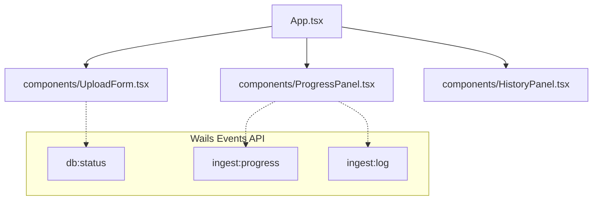

# Phase 3 & 4 Specification: React Frontend & Vitest Suites

> [!NOTE]
> **The Lead**: This specification outlines the Phase 3 (Frontend Integration) and Phase 4 (History View & Vitest Testing) implementation in the Wails desktop app. The frontend has been converted from a placeholder to a premium, dark-themed React + TypeScript dashboard with validation, streaming progress updates, live logging, and historical run tracking. All components are verified via a suite of 17 Vitest unit and integration tests.

---

## 1. Frontend Architecture & Types

The frontend is constructed using React, TypeScript, and Vite, running within Wails v2. Communication between the React app and the Go backend occurs via generated Go bindings and runtime event listeners:



### 1.1 Type Definitions
To ensure strict type-safety, all events are modeled in [events.ts](../../../desktop/frontend/src/types/events.ts):

* **`ProgressEvent` & `ProgressPhase`**:
  ```typescript
  export type ProgressPhase =
    | 'validating'
    | 'parsing'
    | 'upserting'
    | 'saving'
    | 'done'
    | 'complete'
    | 'failed'
    | (string & {});

  export interface ProgressEvent {
    phase: ProgressPhase;
    message: string;
    fileName: string;
    currentRecord: number;
    totalRecords: number;
    upsertedCount: number;
    duplicateCount: number;
  }
  ```
* **`DbStatus`**:
  ```typescript
  export interface DbStatus {
    connected: boolean;
    error?: string;
  }
  ```
* **`SyncLog`**:
  ```typescript
  export interface SyncLog {
    id?: string;
    fileName?: string;
    fileHash?: string;
    collectionName: string;
    recordCount?: number;
    upsertedCount?: number;
    matchedCount?: number;
    status?: string;
    errorMessage?: string;
    syncedAt?: string;
    durationMs?: number;
    // Backward compatibility legacy fields
    syncTimestamp?: string;
    recordsUploaded?: number;
  }
  ```
* **`FrontendLog`**:
  ```typescript
  export interface FrontendLog {
    time: string;
    level: string;
    message: string;
    attrs?: Record<string, any>;
  }
  ```

---

## 2. Component Design & Interactions

### 2.1 [UploadForm.tsx](../../../desktop/frontend/src/components/UploadForm.tsx)
The upload form handles user selection, metadata entry, and connection warnings:
- **File Selection**: Leverages Wails native file dialog (`OpenFileDialog`) via the browser window runtime wrapper.
- **Dropdown List**: Restricts input sources to `chase` and `synthetic`.
- **Account ID Input**: Validated to restrict entry to digits only and enforce exactly 4 digits.
- **Offline Banner**: Renders if MongoDB is offline on boot or goes down. Includes a retry button linking directly to Go `RetryConnectDB()`.

### 2.2 [ProgressPanel.tsx](../../../desktop/frontend/src/components/ProgressPanel.tsx)
Displays real-time feedback during ingestion:
- **Progress Bar**: Animates with an indeterminate glow in validating/parsing phases and displays a precise percentage during active saving (`saving` or `upserting`) and completion (`complete` or `done`) phases.
- **Metrics Grid**: Renders totals, upserted records, and skipped duplicate counts on completion.
- **Live Logs Console**: Subscribes to `ingest:log` events, displaying color-coded slog severity tags inside a scrollable console.
- **Dual-Stage Compatibility**: Additively supports both hexagonal coarse stages (`saving`, `complete`) and legacy stages (`upserting`, `done`).

### 2.3 [HistoryPanel.tsx](../../../desktop/frontend/src/components/HistoryPanel.tsx)
Retrieves and displays historical synchronizations:
- Loads previously processed statements from the MongoDB `dataSync` table using the backend `GetHistory` binding.
- Renders an aligned operational table with 7 columns:
  * **Status**: Semantic status badges (`SUCCESS` in `.badge-success` or `FAILED` in `.badge-failed`).
  * **File Name**: Name of the ingested file (`fileName` with fallback to `N/A`).
  * **Collection**: Target collection (`collectionName`).
  * **Records / Upserted**: Ingested records count (`upsertedCount ?? recordsUploaded ?? 0`).
  * **Duplicates**: Existing records matched/deduplicated (`matchedCount ?? 0`).
  * **Duration**: Execution wall-clock time in milliseconds (`${durationMs}ms` or `N/A`).
  * **Timestamp**: Ingestion time (`syncedAt || syncTimestamp`) formatted to the user's local timezone.
- Features manual refresh buttons for live polling of runs.

---

## 3. Testing Harness & Vitest Verification

Frontend unit tests are set up inside `desktop/frontend/` using **Vitest** and **React Testing Library** under a virtual DOM environment (`jsdom`).

### 3.1 Test Cases Covered
- **[UploadForm.test.tsx](../../../desktop/frontend/src/components/UploadForm.test.tsx)** (7 tests):
  * Verifies correct input and button rendering.
  * Asserts validation errors block submit when inputs are empty or invalid.
  * Asserts character-blocking pattern on the Account ID field (disallows non-digits).
  * Mocks `window.runtime.OpenFileDialog` to test browse selection.
  * Validates database offline alerts and retry connection calls.
- **[ProgressPanel.test.tsx](../../../desktop/frontend/src/components/ProgressPanel.test.tsx)** (5 tests):
  * Verifies placeholder states when no active event is broadcasted.
  * Simulates progress events and asserts that labels and percentages update dynamically.
  * Validates color-coded log parsing inside the live console.
  * Asserts the "Done" callback behaves properly on completion.
  * Verifies handling of hexagonal coarse stages (`saving` and `complete`).
- **[HistoryPanel.test.tsx](../../../desktop/frontend/src/components/HistoryPanel.test.tsx)** (7 tests):
  * Verifies spinner loading indicator.
  * Asserts empty historical run state when sync history is clean.
  * Asserts table headers render correctly (Status, File Name, Collection, Records / Upserted, Duplicates, Duration, Timestamp).
  * Verifies legacy log records render correctly with fallback values and default SUCCESS badge.
  * Verifies canonical success and failed log records with badges (`badge-success`, `badge-failed`) and accurate stats (`upsertedCount`, `matchedCount`, `durationMs`).
  * Asserts error alert display when fetching history fails.

### 3.2 Desktop History Service & DTO (Phase 4J & 4K)
- **`desktop/model/sync_log.go` & `desktop/history.go`**: Bridges `port.SyncLogReader` to the frontend via `HistoryService` and `model.SyncLog` (aliased as `HistoryEntry`):
  * Defined inside package `model` (`desktop/model/sync_log.go`), ensuring Wails generates `export namespace model { export class SyncLog }` for exact TypeScript contract continuity.
  * Omits database `id` / `_id` per ADR Divergence 10.
  * Provides dual legacy aliases (`syncTimestamp` mirroring `syncedAt`, `recordsUploaded` mirroring `upsertedCount`).
  * Defaults non-positive query limits to `DefaultHistoryLimit = 100`.
  * Guarantees `ToHistoryEntries(nil)` returns `[]HistoryEntry{}` (serializes as `[]` rather than `null`).
  * Compile-time assertion: `var _ port.SyncLogReader = (*mongo.Repository)(nil)`.

### 3.3 Desktop Hexagonal Driving Adapter Cutover (Phase 4K)
- **`desktop/app.go`**: Fully decoupled from legacy packages (`datalake`, `datalake/model`, `storage`, `csv`):
  * Rewired to hexagonal `internal/infra/storage/mongo.Repository`, `internal/app/pipeline.Pipeline`, `internal/app/ingest.Ingestor`, `HistoryService`, and `WailsProgressNotifier`.
  * **In-Place File Processing (Decision U3)**: Uses `localfs.New(filepath.Dir(filePath))` and leaves `ArchiveKey` blank, ensuring user local files are processed directly without copying, renaming, or deleting them on disk.
  * **Zero Frontend Alterations**: Regenerated Wails bindings via `wails generate module` without modifying any handwritten React frontend code.
  * **Hermetic Unit Testability**: Injected `connectRepo` and `newStore` factory hooks allow unit tests in `desktop/app_test.go` to run with 100% mock isolation.

---

## 4. Verification & Linting Status

- **Go Backend Coverage**: **87.4%** of statements in `desktop/` (100% pass rate under `go test -race`).
- **Frontend Test Suite**: **19 tests passed** successfully across `UploadForm`, `ProgressPanel`, and `HistoryPanel`.
- **Linter Status**: All linter rules check out with **0 issues** via `make check-quality`.

---

## 5. References & Links

- **Wails Integration Plan**: [wails-integration-plan.md](../../../agent-docs/wails-integration-plan.md)
- **Phase 2 Specification**: [phase2-specification.md](phase2-specification.md)
- **PII / Compliance Guidelines**: [pii_handling.md](../../pii_handling.md)
