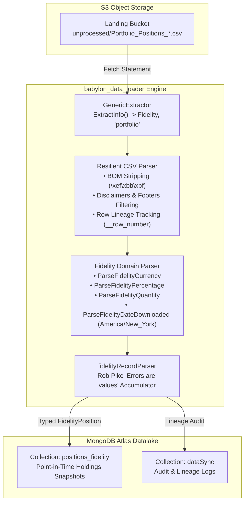

# Fidelity Portfolio Positions Ingestion Specification

## 1. Executive Summary

This document specifies the architecture, data models, parsing heuristics, and storage contracts for ingesting point-in-time brokerage portfolio position statements from **Fidelity Investments** into the Babylon Datalake. 

The ingestion pipeline handles messy real-world CSV exports (containing UTF-8 BOM headers, trailing column delimiters, and multi-line legal disclaimers) and maps them into typed, validated, and provenance-tracked MongoDB documents.



---

## 2. Source Data Characteristics & Ingestion Challenges

Fidelity portfolio position export files exhibit unique format quirks that break standard CSV parsers:

1. **UTF-8 Byte Order Mark (BOM)**: File begins with byte sequence `0xEF, 0xBB, 0xBF`, prepending hidden bytes to the primary header (`Account Number`), which causes map lookups for `"account number"` to fail silently.
2. **Asymmetric Field Delimiters (Trailing Comma)**: Header row contains 16 column definitions, whereas data rows contain 17 values terminated with an empty trailing comma. Standard strict Go `csv.Reader` instances reject this as `record on line X: wrong number of fields`.
3. **Multi-line Legal Disclaimers & Export Footers**: The CSV ends with multi-line disclaimer blocks, arbitrary blank lines, and an export timestamp line (e.g. `"Date downloaded Sep-25-2026 9:50 p.m ET"`). These rows must not be ingested as portfolio records.
4. **Eastern Time Wall-Clock Timestamps**: The export timestamp is reported in Eastern Time (`ET`) without a numeric UTC offset, requiring location-aware parsing (`America/New_York`).
5. **Human-Formatted Financial Numerics**: Monetary figures contain `$`, commas, plus signs (`+$35.26`), or empty/placeholder symbols (`--`, `n/a`). Percentages contain `%` and thousands commas (`+1,250.00%`).

---

## 3. Domain Model Specification

### 3.1. `FidelityPosition` Document Model

Defined in [`datalake/model/fidelity_position.go`](../../datalake/model/fidelity_position.go), each document represents an immutable point-in-time snapshot of an asset held within an account:

| Field Name | BSON Tag | Go Type | Description | Example |
| :--- | :--- | :--- | :--- | :--- |
| `AccountNumber` | `accountNumber` | `string` | Masked or raw account identifier | `"SYNTH-ROTH-101"` |
| `AccountName` | `accountName` | `string` | Human-readable account label | `"ROTH IRA"` |
| `Symbol` | `symbol` | `string` | Ticker symbol or cash designation (`**` suffix) | `"SPAXX**"`, `"FSKAX"` |
| `Description` | `description` | `string` | Full security description / fund title | `"FIDELITY GOVERNMENT MONEY MARKET"` |
| `Quantity` | `quantity` | `float64` | Total units / fractional shares held | `45.250` |
| `LastPrice` | `lastPrice` | `float64` | Closing price per unit | `150.00` |
| `LastPriceChange` | `lastPriceChange` | `float64` | Daily dollar change per unit | `1.25` |
| `CurrentValue` | `currentValue` | `float64` | Total position value (`Quantity * LastPrice`) | `6787.50` |
| `TodaysGainLossDollar`| `todaysGainLossDollar` | `float64` | Total dollar change today | `56.56` |
| `TodaysGainLossPct` | `todaysGainLossPct` | `float64` | Total percentage change today | `0.84` |
| `TotalGainLossDollar` | `totalGainLossDollar` | `float64` | Cumulative dollar profit/loss | `787.50` |
| `TotalGainLossPct` | `totalGainLossPct` | `float64` | Cumulative percentage return | `13.13` |
| `PercentOfAccount` | `percentOfAccount` | `float64` | Portfolio allocation weight percentage | `25.00` |
| `CostBasisTotal` | `costBasisTotal` | `float64` | Aggregate cost basis | `6000.00` |
| `AverageCostBasis` | `averageCostBasis` | `float64` | Per-share acquisition cost basis | `132.59` |
| `Type` | `type` | `string` | Asset classification (`Cash`, `Margin`, etc.) | `"Cash"` |
| `AsOfDate` | `asOfDate` | `time.Time` | Statement capture timestamp in UTC | `2026-09-26T01:50:00Z` |
| `DataSource` | `dataSource` | `string` | Provider source tag (constant `"fidelity"`) | `"fidelity"` |
| `Source` | `source` | `SourceLineage` | Embedded immutable origin coordinates | *(See 3.2)* |

### 3.2. `SourceLineage` Embedded Model

Captures forensic auditability coordinates back to the physical source file:

```go
type SourceLineage struct {
	S3URI      string    `bson:"s3Uri,omitempty"`
	FileName   string    `bson:"fileName"`
	RowNumber  int64     `bson:"rowNumber"`
	IngestedAt time.Time `bson:"ingestedAt"`
	SHA256     string    `bson:"sha256,omitempty"`
}
```

---

## 4. Parser Architecture & Heuristics

### 4.1. Resilient CSV Reader (`csv/csv.go`)

- **BOM Stripping**: `createHeaderIndex` trims `\xef\xbb\xbf` from header tokens, ensuring lowercase header normalization matches cleanly.
- **Asymmetry Tolerance**: Sets `reader.FieldsPerRecord = -1` to permit lines with trailing delimiters.
- **Disclaimer Filtering**: `isDisclaimerOrEmptyRow` skips lines matching:
  - All blank/whitespace tokens.
  - Case-insensitive prefixes: `"the data and information"`, `"brokerage services"`, and `"date downloaded"`.
- **Zero-Overhead Record Counting**: `ParseStream` only scans the file to count records if `onProgress != nil`, avoiding redundant disk I/O during headless batch loads.
- **Context-Aware Cancellation**: All reader loops poll `ctx.Err()` to support graceful early termination upon Lambda timeouts.

### 4.2. Declarative "Errors Are Values" Model Mapping

Rather than repeating 11 distinct `if err != nil` blocks, [`MapRawRecordToFidelityPosition`](../../datalake/model/fidelity_parser.go) employs Rob Pike's canonical error-accumulator pattern via `fidelityRecordParser`:

```go
type fidelityRecordParser struct {
	record map[string]string
	err    error
}

func (p *fidelityRecordParser) parse(key string, fn func(string) (float64, error)) float64 {
	if p.err != nil {
		return 0.0
	}
	val, err := fn(p.record[key])
	if err != nil {
		p.err = err
		return 0.0
	}
	return val
}

func (p *fidelityRecordParser) currency(key string) float64   { return p.parse(key, ParseFidelityCurrency) }
func (p *fidelityRecordParser) percentage(key string) float64 { return p.parse(key, ParseFidelityPercentage) }
func (p *fidelityRecordParser) quantity(key string) float64   { return p.parse(key, ParseFidelityQuantity) }
```

**Key Operational Properties**:
- **Stack Allocation**: Allocated entirely on the stack (zero heap escapes, zero GC pressure).
- **Fail-Fast**: The first conversion error sets `p.err`, causing all subsequent field parsing calls to immediately return `0.0` as no-ops.
- **Cognitive Complexity**: Reduces cyclomatic complexity from 12 to 1, facilitating maintenance.

### 4.3. Financial Numeric Parsing Rules

| Function | Sanitization Steps | Supported Examples | Fallbacks (`0.0`) |
| :--- | :--- | :--- | :--- |
| `ParseFidelityCurrency` | Strip `$`, `,`, `+`, internal whitespace | `"$3250.00"`, `"+$35.26"`, `"-$ 12.40"`, `"$ 1,234.56"` | `""`, `"--"`, `"n/a"`, `"N/A"` |
| `ParseFidelityPercentage` | Strip `%`, `,`, `+`, internal whitespace | `"29.13%"`, `"+0.60%"`, `"-3.50%"`, `"+1,250.00%"` | `""`, `"--"`, `"n/a"` |
| `ParseFidelityQuantity` | Strip `,`, internal whitespace | `"167.946"`, `"4,968.08"`, `"10"`, `" 100.50 "` | `""`, `"--"`, `"n/a"` |
| `ParseFidelityDateDownloaded` | Normalize `a.m.`/`p.m.` variations, parse in `America/New_York` | `"Date downloaded Sep-25-2026 9:50 p.m ET"` | Returns error if prefix is missing |

---

## 5. Storage Layer & Datalake Topology

### 5.1. Collection Strategy
Fidelity positions are stored in the `datalake` database under partitioned collection:
- **Collection Name**: `positions_fidelity`

### 5.2. Recommended Indexes
To support efficient point-in-time snapshot queries and historical timeline assembly:

```javascript
// Compound index for portfolio valuation at a specific timestamp
db.positions_fidelity.createIndex(
  { "accountNumber": 1, "symbol": 1, "asOfDate": -1 },
  { name: "idx_account_symbol_asof" }
);

// Index for date-range portfolio rollups
db.positions_fidelity.createIndex(
  { "asOfDate": -1 },
  { name: "idx_asof_date" }
);
```

---

## 6. Quality & Verification Standards

All code implementing this specification must pass local quality gates prior to review:

1. **Test Coverage Thresholds**:
   - `datalake/model`: **100% statement coverage**
   - `storage`: **>= 80% statement coverage** (currently at **96.2%**)
2. **Race Condition Safety**: All tests pass under `go test -race ./...`.
3. **Linter Adherence**: Zero warnings under `make check-quality` (`golangci-lint`, `goimports`, `gofumpt`, `go vet`).
4. **Zero Secrets & Portability**: No personal home directories (`/Users/`, `/home/`, `~`) in documentation or code; all paths must remain relative to repository root.
