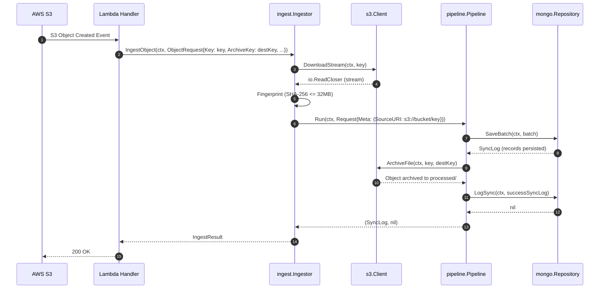
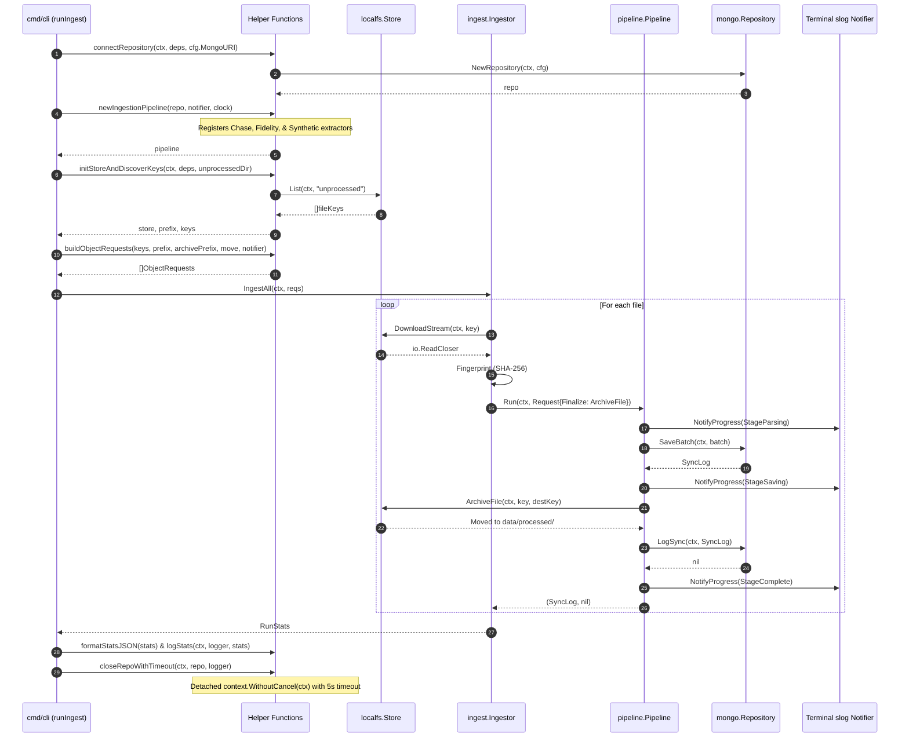
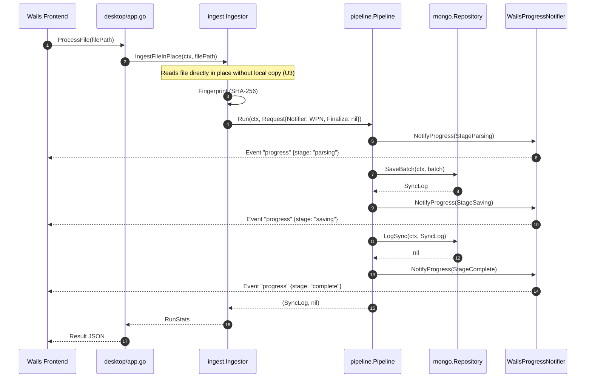

# Hexagonal Architecture Specification: Application Layer & Entrypoint Pipeline

**Target Packages**: `internal/app/pipeline/`, `internal/app/ingest/`, `internal/infra/storage/localfs/`, `cmd/cli/`, `cmd/lambda/`, `desktop/`  
**Architectural Role**: Hexagonal Application Core (Orchestrator & Ingestion Use Cases) and Primary/Secondary Adapters  
**Document Status**: Active / Canonical Application Pipeline Specification (Phase 4)  
**Primary Inbound Ports / Consumers**: CLI (`cmd/cli`), Lambda (`cmd/lambda`), Desktop (`desktop`)  
**Driven Ports**: `port.Extractor`, `port.Repository`, `port.ObjectStore`, `port.ProgressNotifier`, `port.SyncLogReader`  
**Parent Document**: [`docs/specs/hexagonal-storage-adapters.md`](./hexagonal-storage-adapters.md), [`docs/specs/hexagonal-domain-core.md`](./hexagonal-domain-core.md)  

---

## 1. Executive Summary & Headline Invariant

Phase 4 executes the application-layer cutover. It wires the extractors implemented in Phase 2 and secondary storage adapters built in Phase 3 into a unified application orchestrator (`internal/app/pipeline`), drives it via domain use cases (`internal/app/ingest`), and migrates all three composition entrypoints: AWS Lambda (`cmd/lambda`), the local CLI (`cmd/cli`), and the Wails desktop application (`desktop`). Upon completion of Phase 4, no entrypoint imports legacy packages (`ingest/`, `datalake/`, `csv/`, or `storage/`), unblocking Phase 5 cleanup.

**Headline Invariant**: For the same input file, the cut-over runtimes write identical record documents and identical `dataSync` audit rows as the legacy runtimes. The only approved differences are the Phase 3 exceptions (D4 synthetic collection shape unified with Chase, and `source.s3Uri` now populated from entrypoint metadata) and the divergences explicitly recorded in §6.

---

## 2. Layer Map & Package Architecture

The application pipeline is organized into strict hexagonal layers enforced by `depguard`:

| Directory / Component | Layer | Allowed Imports / Isolation Boundary | Primary Responsibility |
| :--- | :--- | :--- | :--- |
| `internal/app/pipeline/` | Application Orchestration | `$gostd`, `internal/domain/**`, `internal/app/**` | Generic single-stream batch execution, extractor registry, failure-auditing policy, and progress telemetry. |
| `internal/app/ingest/` | Application Use Cases | `$gostd`, `internal/domain/**`, `internal/app/**` | Filename resolution (`ResolveSource`), stream fingerprinting (`Fingerprint`), object download loop, archive dispatch, and `RunStats`. |
| `internal/infra/storage/localfs/` | Secondary Driven Adapter | `$gostd`, `internal/domain/**`, `internal/infra/storage/localfs/**` | Implements `port.ObjectStore` over local filesystem directories (`List`, `DownloadStream`, `ArchiveFile`). |
| `cmd/cli/` | Primary Driving Adapter | `internal/**`, `config`, `appcontext` | CLI composition root (`ingest`, `generate-synthetic-data`). Drives `ingest.Ingestor` with `localfs.Store` and CLI `slog` progress; composed of single-responsibility helpers (`connectRepository`, `newIngestionPipeline`, `initStoreAndDiscoverKeys`, `resolveArchiveKey`, `newSyntheticPipeline`, `newSyntheticRequest`, `formatStatsJSON`). |
| `cmd/lambda/` | Primary Driving Adapter | `internal/**`, `config`, `appcontext` | AWS Lambda composition root (`handler.go`). Consumes S3 events, resolves streams via `s3.Client`, and writes to `mongo.Repository`. |
| `desktop/` | Primary Driving Adapter | `internal/**`, `desktop/**` (module `babylon/dataloader/desktop`) | Wails desktop application. Ingests local files in place via `ingest.Ingestor` and reports progress via `WailsProgressNotifier`. |

---

## 3. `pipeline.Run` Contract Table & Failure-Audit Policy

Authoritative implementation reference: `internal/app/pipeline/pipeline.go`.

The `pipeline.Pipeline` orchestrates stream extraction, provenance copying, repository persistence, archival finalization, and audit logging.

### 3.1 `pipeline.Run` Contract Table

| Step | Trigger / Condition | Return Value | Audited? | Audit Characteristics & Policy |
| :--- | :--- | :--- | :---: | :--- |
| **Context Check** | `ctx.Err() != nil` prior to execution | `(nil, ctx.Err())` | No | Short-circuit; no side effects. |
| **Validation** | `req.Reader == nil` or `req.Meta.Validate() != nil` | `(nil, err)` | No | Cannot construct valid `SyncLog` (U1). |
| **Source Check** | Unregistered `req.SourceType` | `(nil, ErrUnknownSourceType)` | No | Pre-resolution failure; excluded from audit (U1). |
| **Extraction Failure** | `ext.Extract(ctx, r, meta)` returns error | `(failedLog, err)` | Yes | Audited with fallback collection, `recordCount: 0`, detached context (P3). |
| **Provenance Copy** | Extraction succeeds | — | — | Sets `batch.SourceURI = req.Meta.SourceURI` (P8). |
| **SaveBatch Error (With Log)** | `repo.SaveBatch` returns `(failedLog, err)` | `(failedLog, err)` | Yes | Restamps `SyncedAt` and `DurationMs` (P4); audited with detached context (P3). |
| **SaveBatch Error (Nil Log)** | `repo.SaveBatch` returns `(nil, err)` | `(failedLog, err)` | Yes | Constructs failed log with fallback collection; audited with detached context (P3). |
| **Finalize Failure** | `req.Finalize(ctx)` returns error after save | `(failedLog, wrappedErr)` | Yes | Audits single FAILED log: `storage succeeded but file archival failed: <err>` (P6). **No** success log. |
| **Success** | Persistence and finalize complete | `(successLog, nil)` | Yes | Restamps `SyncedAt` and `DurationMs` (P4); calls `LogSync(ctx, successLog)`. |
| **Success Audit Failure** | `LogSync` fails on success log | `(successLog, ErrAuditWrite)` | Yes | Non-fatal: returns success log with wrapped `ErrAuditWrite` (P5). |
| **Failure Audit Failure** | `LogSync` fails during failure audit | `(failedLog, joinedErr)` | Yes | `errors.Join(cause, fmt.Errorf("%w: %w", ErrAuditWrite, auditErr))` (P3). |

### 3.2 Failure-Audit Policy & Invariants

1. **Detached Context (P3, Phase 3 E5)**: Every failure audit is written using `context.WithoutCancel(ctx)` with a detached timeout (`DefaultAuditTimeout = 5s`). If the parent context was cancelled mid-flight, the failure audit write is still guaranteed 5 seconds to persist to `dataSync`.
2. **Error Joining (P3)**: If the failure-audit write itself fails, the resulting error is joined via `errors.Join(cause, ...)` to the original cause rather than swallowed.
3. **Audit Timing Parity (P4)**: The orchestrator restamps `SyncedAt` with the pipeline start timestamp and `DurationMs` with the end-to-end execution duration for both success and failure logs, overriding storage adapter write-only timings.
4. **Non-Fatal Success Audit (P5)**: When data records are persisted successfully but writing the success `SyncLog` fails, `Run` returns `(successLog, fmt.Errorf("%w: %w", ErrAuditWrite, err))`. Callers treat the ingestion as succeeded while logging the audit warning.
5. **Pre-Extraction Failure Audit (`RecordFailure`)**: For failures occurring prior to batch creation (such as `ErrInputTooLarge`), `RecordFailure` writes a FAILED audit log with the registered fallback collection and empty `FileHash` using the detached context.
6. **Provenance Transfer Policy (P8)**: Upon successful extraction, `Run` transfers `req.Meta.SourceURI` to `batch.SourceURI`. Extractors do not parse or handle file transport URIs. Storage adapters receive `batch.SourceURI` and emit `source.s3Uri: <uri>` as a dotted `$set` path when non-empty, omitting it when empty (E6). `SourceURI` is strictly excluded from upsert filters.

### 3.3 Pipeline Types, Constructors & Sentinel Errors

```go
package pipeline

import (
	"context"
	"errors"
	"io"
	"time"

	"babylon/dataloader/internal/domain/model"
	"babylon/dataloader/internal/domain/port"
)

// DefaultAuditTimeout is the maximum duration allocated for detached audit logging.
const DefaultAuditTimeout = 5 * time.Second

var (
	ErrUnknownSourceType   = errors.New("unknown source type")
	ErrDuplicateSourceType = errors.New("source type already registered")
	ErrInvalidRegistration = errors.New("invalid extractor registration")
	ErrNilReader           = errors.New("reader cannot be nil")
	ErrAuditWrite          = errors.New("audit log write failed")
)

// Request encapsulates the input stream and metadata for a pipeline ingestion execution.
type Request struct {
	Reader     io.Reader
	Meta       model.FileMetadata
	SourceType string
	Finalize   func(ctx context.Context) error
	Notifier   port.ProgressNotifier
}

// Option configures pipeline behavior.
type Option func(*Pipeline)

// WithClock overrides the timestamp generator used for audit durations.
func WithClock(clock func() time.Time) Option

// WithAuditTimeout configures the timeout for detached failure audit persistence.
func WithAuditTimeout(timeout time.Duration) Option

// New creates a new application pipeline orchestrator.
func New(repo port.Repository, notifier port.ProgressNotifier, opts ...Option) *Pipeline

// Register registers an extractor and fallback destination for a given source type.
func (p *Pipeline) Register(sourceType string, ext port.Extractor, fallback model.Destination) error

// Run executes a complete ingestion request across extract, persist, and audit stages.
func (p *Pipeline) Run(ctx context.Context, req Request) (*model.SyncLog, error)

// RecordFailure writes a failure audit record for errors occurring prior to batch creation.
func (p *Pipeline) RecordFailure(ctx context.Context, src string, meta model.FileMetadata, cause error) (*model.SyncLog, error)
```

---

## 4. Source Resolution, Fingerprinting & Registration Rules

Authoritative implementation reference: `internal/app/ingest/source.go`.

### 4.1 Source Resolution Rules (`ResolveSource`)

Filename resolution matches legacy `datalake/datasource.GenericExtractor.ExtractInfo` semantics using standard base-name extraction across S3 keys and OS paths. Resolution evaluates in strict legacy order:

1. **Chase**: Regexp `chase(\d{4})` on lower-cased base name $\rightarrow$ `("chase", accountID)`.
2. **Fidelity**: `fidelity` anywhere in lower-cased path OR prefix `portfolio_positions` on base name $\rightarrow$ `("fidelity", "portfolio")`.
3. **Synthetic**: `synthetic` anywhere in base name $\rightarrow$ `("synthetic", "0000")`.
4. **Fallback**: If no rule matches, returns `ErrUnresolvableSource`. Pre-resolution failures are logged and counted in stats, but unaudited (U1).

Path normalization converts backslashes to forward slashes before extracting the base name. Empty inputs, directory paths, or root paths (`.`, `/`) return `ErrUnresolvableSource`.

### 4.2 Stream Fingerprinting (`Fingerprint`)

- Validates reader presence; a `nil` reader immediately returns `ErrNilReader`.
- Reads stream into an in-memory buffer up to `DefaultMaxInputBytes = 32 MiB` (P7) via `io.LimitReader(r, maxBytes+1)`. A non-positive `maxBytes` (`<= 0`) defaults to `DefaultMaxInputBytes`.
- Computes SHA-256 hash returned as a lowercase hex string.
- If stream length exceeds the cap (`len(buf) > maxBytes`), immediately returns `ErrInputTooLarge` without hashing.
- Returns `*bytes.Reader` allowing downstream extractors to read the buffered stream from offset 0.
- Stream read errors propagate wrapped as `fmt.Errorf("ingest: read stream: %w", err)`.

### 4.3 File Metadata Construction (`NewFileMetadata`)

Constructs a domain `model.FileMetadata` instance:
- Cleans and normalizes `FileName` to the file base name (stripping Unix/Windows/S3 prefixes).
- Associates the lowercase SHA-256 `FileHash`.
- Populates `AccountID` from the resolved `SourceRef`.
- Standardizes `IngestedAt` timestamp to UTC (`ingestedAt.UTC()`).
- Captures `SourceURI` from transport context (e.g., `s3://bucket/key`).

### 4.4 Ingest Types, Constants & Sentinel Errors

```go
package ingest

import (
	"bytes"
	"errors"
	"io"
	"time"

	"babylon/dataloader/internal/domain/model"
)

const (
	// SourceChase identifies Chase bank and credit card statement sources.
	SourceChase = "chase"
	// SourceFidelity identifies Fidelity brokerage statement sources.
	SourceFidelity = "fidelity"
	// SourceSynthetic identifies synthetic transaction sources.
	SourceSynthetic = "synthetic"

	// DefaultMaxInputBytes is the default maximum size (32 MiB) allowed for input streams.
	DefaultMaxInputBytes int64 = 32 << 20
)

var (
	// ErrUnresolvableSource indicates that the source type could not be determined from the file name.
	ErrUnresolvableSource = errors.New("ingest: cannot resolve source from file name")
	// ErrInputTooLarge indicates that the input stream exceeds the maximum allowed size.
	ErrInputTooLarge = errors.New("ingest: input exceeds maximum size")
	// ErrNilReader indicates that the provided reader is nil.
	ErrNilReader = errors.New("ingest: reader cannot be nil")
)

// SourceRef identifies the resolved data source and account.
type SourceRef struct {
	SourceType string
	AccountID  string
}

// ResolveSource determines the source type and account ID from a file or object name.
func ResolveSource(name string) (SourceRef, error)

// Fingerprint reads up to maxBytes from r, computes its SHA-256 digest, and returns a re-readable body.
func Fingerprint(r io.Reader, maxBytes int64) (*bytes.Reader, string, error)

// NewFileMetadata constructs a validated FileMetadata model with a UTC timestamp and clean base name.
func NewFileMetadata(name string, ref SourceRef, sha256Hex, sourceURI string, ingestedAt time.Time) model.FileMetadata
```

### 4.5 Extractor & Destination Registration Table

Composition roots register extractors using `pipeline.Register(sourceType, ext, fallbackDestination)`.

| Source Type | Extractor Adapter | Target Collection / Fallback Destination | Record Model | Description |
| :--- | :--- | :--- | :--- | :--- |
| `chase` | `chase.Extractor` | `model.DestChaseChecking` / `transactions_chase` | `model.ChaseTransaction` | Checking and credit card statements. |
| `fidelity` | `fidelity.Extractor` | `model.DestFidelityPosition` / `positions_fidelity` | `model.FidelityPosition` | Brokerage position exports. |
| `synthetic` | `synthetic.CSVExtractor` (2G) | `model.DestSynthetic` / `transactions_synthetic` | `model.ChaseTransaction` | Dedicated parser preserving `details`, `balance`, `checkOrSlipNum` (U2). |

---

## 5. Runtime Wiring & Flow

### 5.1 Lambda Runtime Flow (`cmd/lambda`)



### 5.2 CLI Runtime Flow (`cmd/cli`)



### 5.3 Desktop Runtime Flow (`desktop`)



---

## 6. Decision Record & Divergences

### 6.1 Architectural Decision Summary

- **U1 (Audit Scope)**: Attempts past source resolution are audited. Unresolvable filenames are logged in run stats but unaudited.
- **U2 (Synthetic Parser)**: Dedicated `synthetic.CSVExtractor` (2G) parses synthetic CSVs to `transactions_synthetic` retaining `details`, `balance`, and `checkOrSlipNum`.
- **U3 (Desktop In-Place Read)**: Desktop reads selected file in place; eliminates disk copying to `data/unprocessed/` and `data/processed/`.
- **U4 (Release Binaries)**: Release binaries build root `main.go` until Phase 5; `make build` uses `cmd/cli`.
- **U5 (User-Run Steps)**: D4 collection drop and Atlas verifications are executed exclusively by human operators.
- **U6 (Lambda Failure Handling)**: Transient errors error out for Lambda retry; deterministic errors audit and log, leaving object in `unprocessed/`.
- **P1–P13 (Engineering Policies)**: Layer boundaries (P1), fallback registration (P2), detached failure context (P3), timing restamp (P4), non-fatal success audit (P5), finalize before audit (P6), 32 MiB cap (P7), `source.s3Uri` provenance (P8), lazy Mongo client (P9), lazy indexes (P10), desktop module rename (P11), `port.SyncLogReader` (P12), additive cutover (P13).

### 6.2 Recorded Divergences from Legacy

1. **Pre-resolution Audits Dropped**: Non-CSV and unresolvable filenames produce no empty `collectionName` audit row.
2. **Collection Name Accuracy**: Parse failure audits record the target collection name (`transactions_chase`) rather than data source tag (`chase`).
3. **Strict Synthetic Validation**: Synthetic files use the unified D4 Chase shape and fail on single-row validation errors.
4. **Coarse Progress Stages**: Desktop progress reports phase stages (`parsing`, `saving`, `complete`) rather than row-level ticks. React frontend (`ProgressPanel.tsx`) additively accepts both hexagonal stages (`saving`, `complete`) and legacy stages (`upserting`, `done`) for 100% backward compatibility.
5. **Desktop Archiving Eliminated**: Desktop leaves source files untouched on local disk.
6. **S3 URI Provenance**: `source.s3Uri` populated on all Lambda-ingested records.
7. **Failed S3 Objects Retained**: Lambda leaves deterministic failures in `unprocessed/` for debugging.
8. **Transient Download Retries**: `DownloadStream` failures are retried without audit log creation.
9. **Too-Large File Auditing**: Files $> 32\text{ MiB}$ fail with `ErrInputTooLarge` and write a FAILED audit row with empty `FileHash`.
10. **Desktop History DTO**: `id` omitted from JSON responses; canonical and dual fields match legacy UI expectations.

---

## 7. Verification Matrix

| Slice | Focus Area | Key Verification Tests |
| :--- | :--- | :--- |
| **2G** | Synthetic CSV Extractor | `TestCSVExtractor_ExtractSuccess`, `TestCSVExtractor_PreservesFields`, `TestCSVExtractor_RejectsInvalidRow` |
| **4A** | Spec & Guardrails | `TestDepguard_AppIsolation`, `TestDepguard_InfraNoApp`, `make check-quality` |
| **4B** | S3 URI Provenance | `TestWritePlan_SourceURI_EmittedAsDottedPath`, `TestWritePlan_SourceURI_EmptyOmitted`, `TestWritePlan_SourceURI_NotInFilter`, `TestFileMetadata_ValidateIgnoresSourceURI` |
| **4C** | Pipeline Orchestrator | `TestRegister_RejectsInvalid`, `TestRun_SuccessPersistsAndAudits`, `TestRun_CopiesSourceURIToBatch`, `TestRun_FailureAuditUsesDetachedContext`, `TestRun_FinalizeRunsBeforeSuccessAudit`, `TestRun_FinalizeFailureWritesSingleFailedLog`, `TestRun_SuccessAuditFailureIsNonFatal`, `TestRun_FailureAuditFailureIsJoined`, `TestRun_CancelledContextUnwrapped`, `TestRecordFailure_AuditsWithFallbackAndEmptyHash` |
| **4D** | Resolution & Fingerprint | `TestResolveSource_LegacyParity`, `TestResolveSource_Unresolvable`, `TestResolveSource_PrecedenceChaseOverSynthetic`, `TestFingerprint_HashMatchesSHA256`, `TestFingerprint_RejectsOversize`, `TestFingerprint_ReaderErrorPropagates`, `TestFingerprint_NilReader`, `TestNewFileMetadata_Validates` |
| **4E** | LocalFS Store | `TestNew_RequiresExistingDirectory`, `TestDownloadStream_ReadsFile`, `TestDownloadStream_NotFound`, `TestKeys_RejectTraversal`, `TestArchiveFile_RenamesAndCreatesDir`, `TestArchiveFile_CopyFallback`, `TestList_FilesOnlySorted`, `TestErrors_DoNotLeakRoot` |
| **4F** | Object Ingestion | `TestIngestObject_ResolvesAndRuns`, `TestIngestObject_OverrideSkipsResolution`, `TestIngestObject_CancelledContext`, `TestIngestObject_RejectsNonCSV`, `TestIngestObject_Unresolvable`, `TestIngestObject_DownloadNotFound`, `TestIngestObject_TooLargeIsAudited`, `TestIngestObject_TooLargeAuditFailureJoined`, `TestIngestObject_FingerprintReadError`, `TestIngestObject_FinalizeArchives`, `TestIngestObject_NoArchiveKeyNoFinalize`, `TestIngestObject_ClosesStream`, `TestIngestAll_ContinuesAndCounts`, `TestRunStats_JSONMatchesLegacy`, `TestArchiveKeyFor`, `TestRegisterDefaults_Routing` |
| **4G** | CLI Entrypoint | `TestRun_UsageAndUnknownCommand`, `TestRun_IngestWiresPipeline`, `TestRun_IngestEmptyDirectory`, `TestRun_IngestContextCancelled`, `TestRun_IngestArchivesWhenConfigured`, `TestRun_IngestNoArchiveWhenDisabled`, `TestRun_IngestRespectsDirEnvOverrides`, `TestRun_IngestMissingDirFails`, `TestRun_ConnectFailureDoesNotLeakURI`, `TestRun_PersistSyntheticRoutesToSyntheticCollection`, `TestRun_GenerateSyntheticDataToDir`, `TestRun_GenerateSyntheticDataFlagError`, `TestRun_PartialFailureExitZero`, `TestSlogNotifier_LogsStages`, `TestDeps_WithDefaults`, `TestSanitizeError`, `TestRun_IngestStoreInitError`, `TestRun_IngestRepoCloseError`, `TestRun_PersistSyntheticErrors` (18/18 passing, 86.4% coverage) |
| **4L** | Local E2E Verification | `TestE2E_CLIIngest_RealMongo`, `TestE2E_CLIIngest_RerunIsIdempotent`, `TestSyntheticCSV_RoutesToSyntheticDestination` |
| **4H** | Lambda Cutover | `TestS3Handler_SuccessArchivesAndSetsSourceURI`, `TestS3Handler_TransientFailureRetries`, `TestS3Handler_DeterministicFailureLeavesObject`, `TestS3Handler_LazyInitOnceAndRetryAfterFailure`, `TestS3Handler_SecretErrorDoesNotLeakURI`, `TestS3Handler_PreCanceledContext`, `TestS3Handler_FidelitySuccess`, `TestS3Handler_SyntheticSuccess`, `TestS3Handler_EmptyRecordsEvent`, `TestS3Handler_AuditWriteErrorIsSuccess` (15/15 passing, 85.2% coverage) |
| **4I** | Desktop Notifier | `TestWailsProgressNotifier_MapsStages`, `TestWailsProgressNotifier_ThreadSafe`, `TestWailsProgressNotifier_ContextHandling`, `TestWailsProgressNotifier_CustomStageMapper`, `TestWailsProgressNotifier_DefaultEmitter`, `TestWailsProgressNotifier_ZeroValueSafe`, `TestWailsProgressNotifier_CancelledWailsCtx`, `TestWailsProgressNotifier_NegativeCountsClamped`, `TestWailsProgressNotifier_NilReceiverSafe` (100% pass rate) |
| **4J** | History Read Port | `TestToHistoryEntries_LegacyJSONGolden`, `TestHistoryService_UsesDefaultLimit`, `TestHistoryService_PropagatesError` (100% pass rate, 90.8% desktop coverage) |
| **4K** | Desktop Cutover | `TestApp_OnStartup_Success`, `TestApp_OnStartup_Failure`, `TestApp_RetryConnectDB`, `TestApp_IngestFile_Guards`, `TestApp_ProcessFile_Success`, `TestApp_IngestFile_Error`, `TestApp_GetHistory_Parity`, `TestApp_GetHistory_Failure` (100% pass rate, 87.4% desktop coverage, 19/19 Vitest tests) |

---

## 8. Downstream Consumers & Cross-Repo Prerequisites

### 8.1 Downstream Consumers (`babylon_features`)
- `babylon_features/daemon.py` periodically scans all datalake MongoDB collections using default empty prefix `""`, including `dataSync` and `transactions_synthetic`.
- **Impact**: The unified D4 Chase document shape in `transactions_synthetic` and the newly populated `source.s3Uri` field are read by downstream chunking and embedding pipelines.
- **Governance**: Notify `babylon_features` maintainers prior to running the D4 collection drop in production.

### 8.2 Cross-Repository Prerequisites (`babylon_deploy`)
- **Prerequisite DP1**: Serverless pipeline alerting defined in `babylon_deploy` (`terraform/modules/data-loader/alerting.tf`).
- **Components**: CloudWatch `Errors` alarm dispatched to SNS email topic, plus asynchronous on-failure destination for the data-loader Lambda.
- **Requirement**: DP1 must be merged and applied before cutting over Lambda in Phase 4H.

---

<a id="synclogreader-consumer-port"></a>
## 9. `SyncLogReader` Consumer Port Specification

Authoritative implementation reference: `internal/domain/port/sync_log_reader.go` (implemented in Phase 4J).

### 9.1 Consumer Read Port Contract

```go
package port

import (
	"context"

	"babylon/dataloader/internal/domain/model"
)

// SyncLogReader is the driven read port for ingestion audit history.
// Concrete implementations (such as mongo.Repository) retrieve audit records
// from the dataSync datalake collection.
type SyncLogReader interface {
	// ListSyncLogs returns up to limit audit records, newest first.
	// A non-positive limit (limit <= 0) defaults to the adapter default (100).
	ListSyncLogs(ctx context.Context, limit int64) ([]model.SyncLog, error)
}
```

### 9.2 Interface Segregation & Composition
- **Interface Segregation (Decision P12)**: Segregates query access (`ListSyncLogs`) from command persistence (`port.Repository` defining `SaveBatch` and `LogSync`).
- **Adapter Conformance**: Satisfied by `*mongo.Repository.ListSyncLogs` without modifying the core storage adapter.
- **Composition Root Assertion**: Validated in `desktop/history.go` via:
  ```go
  var _ port.SyncLogReader = (*mongo.Repository)(nil)
  ```
- **Desktop History DTO (Divergence 10)**: Desktop service maps `[]model.SyncLog` to `[]historyEntry`, preserving legacy JSON field compatibility for the frontend.

### 9.3 Desktop History Service & DTO Specification

Implementation reference: `desktop/model/sync_log.go` and `desktop/history.go`.

- **DTO Model (`model.SyncLog` / `HistoryEntry`)**:
  Defined in package `model` (`desktop/model/sync_log.go`) and aliased as `type HistoryEntry = model.SyncLog` in `desktop/history.go`:
  ```go
  package model

  type SyncLog struct {
  	FileName        string    `json:"fileName"`
  	FileHash        string    `json:"fileHash,omitempty"`
  	CollectionName  string    `json:"collectionName"`
  	RecordCount     int64     `json:"recordCount"`
  	UpsertedCount   int64     `json:"upsertedCount"`
  	MatchedCount    int64     `json:"matchedCount"`
  	Status          string    `json:"status"`
  	ErrorMessage    string    `json:"errorMessage,omitempty"`
  	SyncedAt        time.Time `json:"syncedAt"`
  	DurationMs      int64     `json:"durationMs"`
  	SyncTimestamp   time.Time `json:"syncTimestamp"`
  	RecordsUploaded int64     `json:"recordsUploaded"`
  }
  ```
- **Wails Namespace Continuity**: Defining `SyncLog` inside package `model` ensures `wails generate module` creates `export namespace model { export class SyncLog }`, keeping the React frontend (`HistoryPanel.tsx`) and Vitest suites passing with zero handwritten frontend alterations.
- **Database ID Omission**: Database `id` / `_id` is excluded from the JSON payload per ADR Section 6.2 Divergence 10.
- **Dual Field Parity**: `syncTimestamp` mirrors `syncedAt`, and `recordsUploaded` mirrors `upsertedCount`.
- **Empty Slice Guarantee**: `ToHistoryEntries(nil)` returns `[]HistoryEntry{}` ensuring serialization to `[]` instead of `null`.
- **Default Limit Fallback**: `HistoryService.GetHistory` defaults non-positive limits (`limit <= 0`) to `DefaultHistoryLimit = 100`.

---

<a id="desktop-cutover-spec"></a>
## 10. Desktop Driving Adapter Cutover Specification (`desktop/app.go`)

Authoritative implementation reference: `desktop/app.go` (implemented in Phase 4K).

### 10.1 Driving Adapter Decoupling & Hexagonal Wiring
`desktop/app.go` serves as the Wails driving adapter, completely decoupled from legacy packages (`babylon/dataloader/datalake`, `datalake/model`, `datalake/repository`, `storage`, and `csv`). It wires hexagonal domain and infrastructure components:
- **Persistence Adapter**: `internal/infra/storage/mongo.Repository` satisfying composite interface `repository` (`port.Repository`, `port.SyncLogReader`, and `Close(ctx context.Context) error`).
- **Pipeline Orchestrator**: `internal/app/pipeline.Pipeline` with default source extractors (`chase`, `fidelity`, `synthetic`).
- **Telemetry Notifier**: `desktop.WailsProgressNotifier` emitting coarse progress stages (`parsing`, `saving`, `complete`) over the Wails event bus `ingest:progress` (Decision P11).
- **History Service**: `desktop.HistoryService` mediating query requests between the frontend and `port.SyncLogReader` (Decision P12).
- **Ingestion Coordinator**: `internal/app/ingest.Ingestor` executing single-file ingestion.

### 10.2 In-Place File Ingestion (`Decision U3`)
Desktop statements selected via the UI file picker are read directly in place without copying to `data/unprocessed/` or `data/processed/`:
1. **Local Object Store**: Initialized per ingestion invocation via `localfs.New(filepath.Dir(filePath))` targeting the parent folder of the chosen file.
2. **Object Key Resolution**: Key is set to `filepath.Base(filePath)`.
3. **Zero Archival Guarantee**: `ObjectRequest.ArchiveKey = ""` ensures `Ingestor.makeFinalize` returns `nil`. The original file on the user's filesystem is untouched (not moved, renamed, or deleted).
4. **Source Overrides**: If the user provides `dataSource` or `accountID` via UI dropdowns, an explicit `ingest.SourceRef` override is passed; otherwise, `ingest.ResolveSource(filename)` automatically detects statement metadata.

### 10.3 Testability & Resilience Seams
- **Dependency Factory Injection**: `App` struct exposes `connectRepo` and `newStore` factory hooks, defaulting to `defaultConnectRepo` (`mongo.NewRepository`) and `defaultNewStore` (`localfs.New`). This permits hermetic unit tests with mock repositories and mock stores without network calls.
- **Reconnection Resilience (`RetryConnectDB`)**: Defensively closes existing degraded repositories before establishing new connections and re-initializing the ingestion pipeline.
- **JSON Compatibility**: `IngestFile` returns `ingest.RunStats` matching the legacy JSON contract (`totalFiles`, `processedFiles`, `failedFiles`, `failures`). Wails generates `export namespace ingest { export class RunStats }` in `desktop/frontend/wailsjs/go/models.ts`.
