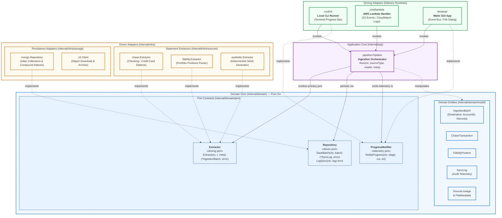
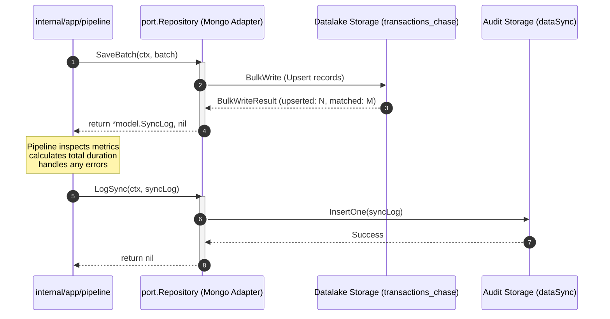

# Phase 1 Specification: Domain Core & Port Contracts

**Document Owner**: Documentation Engineer (`documentation-engineer`)  
**Target Repository**: `babylon_data_loader`  
**Parent Architecture**: Hexagonal Architecture (Ports and Adapters)  
**Tracking Issue**: [Issue #37: Pragmatic Layered Architecture](https://github.com/ajponte/babylon_data_loader/issues/37)  
**Implementation Phase**: [Phase 1 — Domain Core & Port Contracts](../../../agent-docs/hex-refactor/PHASE1-DOMAIN-CORE-AND-PORTS.md)  
**Parent Strategy**: [Hexagonal Refactoring Roadmap](../../../agent-docs/hex-refactor/README.md)  
**Status**: Implemented (Phase 1)  

---

## 1. Executive Summary & Architectural Motivation

The `babylon_data_loader` engine ingests financial statements across three heterogeneous operational runtimes:
1. **Serverless Cloud Worker**: AWS Lambda ARM64 container triggered by Amazon S3 `ObjectCreated` events.
2. **Local Batch CLI**: Developer command-line interface for bulk local filesystem ingestion.
3. **Desktop Application**: Cross-platform Wails GUI application with real-time UI telemetry.

Prior to the Hexagonal Architecture refactoring, domain records and ingestion orchestration suffered from structural architectural coupling:
- **Coupled Persistence Annotations**: Business models contained direct database BSON tags (`bson:"accountNumber"`) and CSV parser annotations (`csv:"Amount"`), creating tight coupling between in-memory financial domain logic and wire-format serializations.
- **Scattered Orchestration & Dialect Conflation**: Bank statement format variations (e.g., Chase Checking vs. Chase Credit Card) forced conditional parsing logic into storage mappers and driving entrypoints.
- **Untracked Boundary Invariants**: Compound unique index constraints required by MongoDB Atlas deduplication (such as `AccountID`) and floating-point validity boundaries were not encapsulated at the domain layer.

### 1.1. Core Architectural Objectives
Phase 1 introduces the **Domain Core** (`internal/domain/`), isolating all business records, routing envelopes, and port contracts into pure Go.

```
+-------------------------------------------------------------------------+
|                  Domain Core (internal/domain/)                         |
|                                                                         |
|  • Zero External Dependencies (Standard Library Only: errors, math, time) |
|  • Pure Domain Records (No BSON, CSV, AWS, or Mongo Annotations)        |
|  • Immutable Origin Coordinates (SourceLineage & FileMetadata)          |
|  • Explicit Port Contracts (Extractor, Repository, ProgressNotifier)    |
|  • Strict Domain Validation Invariants & IEEE 754 Float Guards         |
+-------------------------------------------------------------------------+
```

### 1.2. Standard Library Isolation
The domain layer enforces absolute isolation from third-party libraries and infrastructure packages:
- **Allowed Imports**: Standard library packages only (`context`, `errors`, `io`, `math`, `time`).
- **Strictly Forbidden Imports**: `go.mongodb.org/*`, `github.com/aws/*`, `github.com/wailsapp/*`, or any infrastructure package.
- **Verification Rule**: CI and pre-commit checks run `go list -f '{{.ImportPath}} -> {{.Imports}}' ./internal/domain/...` to guarantee that no third-party dependencies enter the domain packages.

---

## 2. Hexagonal Architecture Diagram

The system follows the Ports and Adapters (Hexagonal) pattern, enforcing unidirectional dependency flow inward toward the domain core. The domain layer has no knowledge of the concrete adapters driving it or being driven by it.



---

## 3. Package Structure & Boundaries

```
babylon_data_loader/internal/domain/
├── model/
│   ├── batch.go                  # IngestionBatch envelope, Destination enum, SourceLineage, FileMetadata
│   ├── batch_test.go             # Unit tests for batch routing, validation, and typed accessors
│   ├── chase_transaction.go      # Chase banking & credit card normalized transaction entity
│   ├── chase_transaction_test.go # Unit tests for ChaseTransaction invariants and IEEE 754 floats
│   ├── fidelity_position.go      # Fidelity investment portfolio position entity
│   ├── fidelity_position_test.go # Unit tests for FidelityPosition invariants and numeric bounds
│   ├── sync_log.go               # Ingestion audit log entity and SyncStatus enum
│   └── sync_log_test.go          # Unit tests for audit validation, constructors, and status helpers
└── port/
    ├── extractor.go              # Driving port: statement parser contract
    ├── notifier.go               # Telemetry port: non-blocking progress notification contract
    ├── port_test.go              # Contract compliance and mock implementation test suite
    └── repository.go             # Driven port: datalake persistence & audit logging contract
```

---

## 4. Domain Models Specification (`internal/domain/model/`)

All domain entities reside in [`batch.go`](../../internal/domain/model/batch.go), [`chase_transaction.go`](../../internal/domain/model/chase_transaction.go), [`fidelity_position.go`](../../internal/domain/model/fidelity_position.go), and [`sync_log.go`](../../internal/domain/model/sync_log.go).

### 4.1. `Destination` Enum & Collection Routing
The `Destination` string type dictates collection routing within the datalake database (`datalake`), aligning with the datalake specification in [`mongodb-atlas-datalake.md`](./mongodb-atlas-datalake.md):

```go
type Destination string

const (
    DestChaseChecking    Destination = "transactions_chase"
    DestChaseCreditCard  Destination = "transactions_chase"
    DestFidelityPosition Destination = "positions_fidelity"
    DestSynthetic        Destination = "transactions_synthetic"
)
```

| Destination Constant | Underlying String Value | Target Collection Name | Description |
| :--- | :--- | :--- | :--- |
| `DestChaseChecking` | `"transactions_chase"` | `transactions_chase` | Normalized checking & savings account transaction activity. |
| `DestChaseCreditCard` | `"transactions_chase"` | `transactions_chase` | Normalized credit card statement transaction activity. |
| `DestFidelityPosition` | `"positions_fidelity"` | `positions_fidelity` | Brokerage portfolio holdings snapshots. |
| `DestSynthetic` | `"transactions_synthetic"` | `transactions_synthetic` | Deterministically generated test transactions for integration QA. |

> [!NOTE]
> `DestChaseChecking` and `DestChaseCreditCard` both evaluate to the target collection `"transactions_chase"`. The `Destination.IsValid()` method verifies known routing targets:
> ```go
> func (d Destination) IsValid() bool {
>     switch d {
>     case DestChaseChecking, DestFidelityPosition, DestSynthetic:
>         return true
>     default:
>         return false
>     }
> }
> ```

---

### 4.2. `IngestionBatch` Envelope Model
The `IngestionBatch` decouples statement extraction from persistence formatting. It acts as the unit of transfer between the extractor port and the repository port.

```go
type IngestionBatch struct {
    Destination Destination
    AccountID   string
    SourceFile  string
    FileHash    string
    IngestedAt  time.Time
    RecordCount int
    Payload     any
}
```

| Field Name | Go Type | Invariants / Constraints | Description |
| :--- | :--- | :--- | :--- |
| `Destination` | `Destination` | Must satisfy `Destination.IsValid() == true` | Target datalake collection routing identifier. |
| `AccountID` | `string` | Required (`!= ""`) | Account number or identifier for compound index deduplication. |
| `SourceFile` | `string` | Required (`!= ""`) | Name or relative path of the source statement file. |
| `FileHash` | `string` | Optional / Recommended SHA-256 | Cryptographic fingerprint of the source file content. |
| `IngestedAt` | `time.Time` | Required (`!IngestedAt.IsZero()`) | UTC timestamp when the batch was processed into memory. |
| `RecordCount` | `int` | Must be `>= 0` | Total number of extracted records in `Payload`. |
| `Payload` | `any` | Non-nil when `RecordCount > 0` | Generic slice holding domain records (`[]ChaseTransaction`, `[]FidelityPosition`). |

#### Typed Accessor Methods
To protect downstream adapters from unsafe runtime casting panics, `IngestionBatch` exposes typed accessor methods:

```go
func (b *IngestionBatch) AsChaseTransactions() ([]ChaseTransaction, error)
func (b *IngestionBatch) AsFidelityPositions() ([]FidelityPosition, error)
```

**Accessor Behavior**:
1. If receiver `b == nil`: returns `(nil, ErrNilBatch)`.
2. If `b.Payload == nil`:
   - If `b.RecordCount == 0`: returns an initialized empty slice `([]T{}, nil)`.
   - If `b.RecordCount > 0`: returns `(nil, ErrNilPayload)`.
3. If type assertion fails (e.g., payload contains unexpected struct): returns `(nil, ErrPayloadTypeMismatch)`.

---

### 4.3. Lineage & File Metadata Models
Lineage models separate statement-level metadata from per-record physical coordinates.

#### `FileMetadata` (Extractor Input Parameter)
Passed into `Extractor.Extract()` to provide statement context before record parsing begins:

```go
type FileMetadata struct {
    FileName   string
    FileHash   string
    AccountID  string
    IngestedAt time.Time
}
```

| Field Name | Go Type | Validation Invariants | Description |
| :--- | :--- | :--- | :--- |
| `FileName` | `string` | Required (`!= ""`) | Name or URI of the incoming statement file. |
| `FileHash` | `string` | Optional | SHA-256 checksum of the incoming stream. |
| `AccountID` | `string` | Required (`!= ""`) | Extracted or configured account identifier. |
| `IngestedAt` | `time.Time` | Required (`!IngestedAt.IsZero()`) | Execution timestamp. |

#### `SourceLineage` (Embedded Record Coordinate)
Embedded inside each domain record to establish provenance back to the raw source file row:

```go
type SourceLineage struct {
    FileName   string
    FileHash   string
    RowNumber  int
    IngestedAt time.Time
}
```

| Field Name | Go Type | Validation Invariants | Description |
| :--- | :--- | :--- | :--- |
| `FileName` | `string` | Required (`!= ""`) | Source statement file name. |
| `FileHash` | `string` | Optional | Checksum of source file. |
| `RowNumber` | `int` | Must be `>= 0` | 1-based CSV line number (0 permitted for non-row data). |
| `IngestedAt` | `time.Time` | Optional (inherits file time) | Timestamp record was normalized. |

---

### 4.4. `ChaseTransaction` Entity Model
Represents a normalized transaction record from Chase Checking, Savings, or Credit Card statements:

```go
type ChaseTransaction struct {
    Lineage        SourceLineage
    AccountID      string
    PostingDate    time.Time
    Description    string
    Details        string
    Amount         float64
    Type           string
    Balance        *float64
    CheckOrSlipNum string
    Category       string
    Memo           string
}
```

| Field Name | Go Type | Nullability | Invariants / Validation Rules | Description |
| :--- | :--- | :--- | :--- | :--- |
| `Lineage` | `SourceLineage` | Non-nil | Delegated: `Lineage.Validate() == nil` | Record provenance coordinates. |
| `AccountID` | `string` | Required | `!= ""` (`ErrMissingAccountID`) | Account identifier for compound index deduplication. |
| `PostingDate` | `time.Time` | Required | `!PostingDate.IsZero()` (`ErrMissingPostingDate`) | Effective booking date of the transaction. |
| `Description` | `string` | Required | `!= ""` (`ErrMissingDescription`) | Primary transaction title or payee name. |
| `Details` | `string` | Optional | Any string | Supplementary bank details (e.g., debit card terminal code). |
| `Amount` | `float64` | Required | Finite number: `!math.IsNaN(v) && !math.IsInf(v, 0)` | Net transaction value (negative for debits, positive for credits). |
| `Type` | `string` | Optional | Any string | Transaction classification (`DEBIT`, `CREDIT`, `DSLIP`). |
| `Balance` | `*float64` | Optional | If non-nil: finite (`!math.IsNaN(*v) && !math.IsInf(*v, 0)`) | Running account balance (nil for credit cards). |
| `CheckOrSlipNum` | `string` | Optional | Any string | Check serial number or deposit slip identifier. |
| `Category` | `string` | Optional | Any string | Bank-assigned expense category (e.g., `Groceries`). |
| `Memo` | `string` | Optional | Any string | Statement memo or extended note. |

---

### 4.5. `FidelityPosition` Entity Model
Represents an immutable snapshot of an investment holding in a brokerage account:

```go
type FidelityPosition struct {
    Lineage      SourceLineage
    AccountID    string
    AccountName  string
    Symbol       string
    Description  string
    Quantity     float64
    LastPrice    float64
    CurrentValue float64
    CostBasis    float64
    AsOfDate     time.Time // UTC instant parsed from the "Date downloaded" footer.
}
```

| Field Name | Go Type | Invariants / Validation Rules | Description |
| :--- | :--- | :--- | :--- |
| `Lineage` | `SourceLineage` | Delegated: `Lineage.Validate() == nil` | Record provenance coordinates. |
| `AccountID` | `string` | Required: `!= ""` (`ErrMissingAccountID`) | Masked or raw brokerage account number. |
| `AccountName` | `string` | Optional | Human-readable account label (e.g., `"ROTH IRA"`). |
| `Symbol` | `string` | Required: `!= ""` (`ErrMissingSymbol`) | Ticker symbol or cash designation (e.g., `"SPAXX**"`, `"FSKAX"`). |
| `Description` | `string` | Optional | Full fund or security description. |
| `Quantity` | `float64` | Finite: `!math.IsNaN(v) && !math.IsInf(v, 0)` (`ErrInvalidQuantity`) | Total units or fractional shares held. |
| `LastPrice` | `float64` | Finite & Non-negative: `!math.IsNaN(v) && !math.IsInf(v, 0) && v >= 0` (`ErrInvalidLastPrice`, `ErrNegativeLastPrice`) | Market price per share at statement capture. |
| `CurrentValue` | `float64` | Finite: `!math.IsNaN(v) && !math.IsInf(v, 0)` (`ErrInvalidCurrentValue`) | Aggregate market value (`Quantity * LastPrice`). |
| `CostBasis` | `float64` | Finite: `!math.IsNaN(v) && !math.IsInf(v, 0)` (`ErrInvalidCostBasis`) | Total purchase cost basis (`0.0` for gifts/cash). |
| `AsOfDate` | `time.Time` | Batch-stamped by extractor (`ErrMissingAsOfDate` if missing on non-empty batch) | UTC snapshot timestamp parsed from the `"Date downloaded"` statement footer. |

#### `FidelityPosition` Sentinel Errors (`fidelity_position.go`)

| Sentinel Error | Error Message | Trigger Condition |
| :--- | :--- | :--- |
| `ErrNilFidelityPosition` | `"fidelity position is nil"` | `Validate()` invoked on a `nil` `*FidelityPosition` receiver. |
| `ErrMissingSymbol` | `"symbol is required"` | `Symbol == ""` during `Validate()`. |
| `ErrInvalidQuantity` | `"quantity must be a valid finite number"` | `Quantity` is `NaN` or `±Inf`. |
| `ErrInvalidLastPrice` | `"last price must be a valid finite number"` | `LastPrice` is `NaN` or `±Inf`. |
| `ErrNegativeLastPrice` | `"last price cannot be negative"` | `LastPrice < 0`. |
| `ErrInvalidCurrentValue` | `"current value must be a valid finite number"` | `CurrentValue` is `NaN` or `±Inf`. |
| `ErrInvalidCostBasis` | `"cost basis must be a valid finite number"` | `CostBasis` is `NaN` or `±Inf`. |
| `ErrMissingAsOfDate` | `"fidelity snapshot date (asOfDate) is required"` | Non-empty Fidelity position batch lacks a `"Date downloaded"` footer timestamp (`asOfDate.IsZero()`). |

---

### 4.6. `SyncLog` & `SyncStatus` Audit Model
Captures execution telemetry for each processed statement file, matching the schema required by the MongoDB Atlas `dataSync` audit collection:

```go
type SyncStatus string

const (
    SyncStatusSuccess SyncStatus = "SUCCESS"
    SyncStatusFailed  SyncStatus = "FAILED"
)

type SyncLog struct {
    FileName       string
    FileHash       string
    CollectionName string
    RecordCount    int64
    UpsertedCount  int64
    MatchedCount   int64
    Status         SyncStatus
    ErrorMessage   string
    SyncedAt       time.Time
    DurationMs     int64
}
```

| Field Name | Go Type | Invariants / Validation Rules | Description |
| :--- | :--- | :--- | :--- |
| `FileName` | `string` | Required: `!= ""` (`ErrMissingFileName`) | Processed statement file name. |
| `FileHash` | `string` | Optional | Source file SHA-256 checksum. |
| `CollectionName` | `string` | Required: `!= ""` (`ErrMissingCollectionName`) | Destination MongoDB collection name. |
| `RecordCount` | `int64` | Non-negative: `>= 0` (`ErrNegativeRecordCount`) | Total records extracted from file. |
| `UpsertedCount` | `int64` | Non-negative: `>= 0` (`ErrNegativeUpsertedCount`) | New documents inserted into the datalake. |
| `MatchedCount` | `int64` | Non-negative: `>= 0` (`ErrNegativeMatchedCount`) | Existing documents matched during upsert. |
| `Status` | `SyncStatus` | Must be `SyncStatusSuccess` or `SyncStatusFailed` | Final outcome status. |
| `ErrorMessage` | `string` | Required if `Status == SyncStatusFailed` | Diagnostic error string explaining failure. |
| `SyncedAt` | `time.Time` | Required: `!SyncedAt.IsZero()` (`ErrMissingSyncTime`) | UTC timestamp when sync completed. |
| `DurationMs` | `int64` | Non-negative: `>= 0` (`ErrNegativeDuration`) | Total processing elapsed time in milliseconds. |

#### Constructors
```go
func NewSuccessSyncLog(
    fileName, fileHash, collectionName string,
    recordCount, upsertedCount, matchedCount int64,
    syncedAt time.Time,
    durationMs int64,
) *SyncLog

func NewFailedSyncLog(
    fileName, fileHash, collectionName, errorMessage string,
    recordCount int64,
    syncedAt time.Time,
    durationMs int64,
) *SyncLog
```
- Both constructors normalize `syncedAt` to UTC (`syncedAt.UTC()`).
- `NewFailedSyncLog` forces `UpsertedCount = 0` and `MatchedCount = 0`.

---

## 5. Domain Invariants & Validation Architecture

Domain validation is strictly self-contained within each entity's `Validate()` method. It ensures data hygiene before records are handed off to database drivers or serialization layers.

```
Domain Validation Invariants
├── Compound Unique Key Protection
│   └── AccountID != "" (Enforces MongoDB Atlas idx_chase_dedup & idx_fidelity_dedup)
├── Provenance Integrity
│   ├── SourceLineage.FileName != ""
│   └── SourceLineage.RowNumber >= 0
├── Numeric & Floating-Point Sanitization
│   ├── !math.IsNaN(v) && !math.IsInf(v, 0) (Guards against BSON serialization corruption)
│   └── LastPrice >= 0 (Rejects negative market quotes)
├── Audit Metrics Integrity
│   ├── RecordCount >= 0, UpsertedCount >= 0, MatchedCount >= 0, DurationMs >= 0
│   └── Status == FAILED => ErrorMessage != ""
└── Batch Envelope Safety
    └── RecordCount > 0 => Payload != nil
```

### 5.1. MongoDB Atlas Compound Index Alignment
Per the MongoDB Atlas specification ([`mongodb-atlas-datalake.md`](./mongodb-atlas-datalake.md)), deduplication relies on unique compound indexes:
- `idx_chase_dedup`: `{ "accountId": 1, "postingDate": 1, "description": 1, "amount": 1 }`
- `idx_fidelity_dedup`: `{ "accountId": 1, "symbol": 1 }`

> [!IMPORTANT]
> If `AccountID` is empty, MongoDB indexes evaluate all records under a shared empty key `""`, leading to cross-account document collisions and silent data overwrites during bulk upserts. Enforcing `AccountID != ""` at the domain model level prevents un-keyed records from entering persistence.

### 5.2. IEEE 754 Floating-Point Sanitization
Go `float64` variables can represent special IEEE 754 values (`NaN`, `+Inf`, `-Inf`). When passed into MongoDB BSON serializers or Python downstream analytics pipelines (`babylon_features`), these values produce serialization errors or corrupt statistical moments. All monetary and quantitative fields must be finite numbers:
```go
if math.IsNaN(val) || math.IsInf(val, 0) {
    return ErrInvalidAmount
}
```

---

## 6. Port Contracts Specification (`internal/domain/port/`)

Ports define abstract boundaries between the domain core and the outside world.

### 6.1. Extractor Driving Port (`extractor.go`)
Implemented by statement format parsers (e.g., Chase CSV parser, Fidelity parser):

```go
package port

import (
    "context"
    "io"

    "babylon/dataloader/internal/domain/model"
)

type Extractor interface {
    // SourceType returns the unique identifier for the extractor source type.
    SourceType() string

    // Extract parses raw data from the reader and returns a normalized IngestionBatch.
    Extract(ctx context.Context, r io.Reader, meta model.FileMetadata) (*model.IngestionBatch, error)
}
```

- **`SourceType() string`**: Returns a standardized identifier (e.g., `"chase_checking"`, `"chase_credit"`, `"fidelity"`, `"synthetic"`). Used by the application orchestrator to route input streams.
- **`Extract(ctx, r, meta)`**: Accepts an `io.Reader` and file-level `FileMetadata`. Extracts records line-by-line, populating record-level `SourceLineage` (including row numbers) and returns a complete `IngestionBatch`. Receives `context.Context` to respect Lambda execution timeouts.

---

### 6.2. Repository Driven Port (`repository.go`)
Implemented by persistence adapters (e.g., MongoDB Atlas adapter):

```go
package port

import (
    "context"

    "babylon/dataloader/internal/domain/model"
)

type Repository interface {
    // SaveBatch persists an ingestion batch to the appropriate storage collection.
    // SaveBatch constructs and returns a persistence audit record (SyncLog) reflecting
    // the operation's outcome, but it does not write to the dataSync audit collection.
    SaveBatch(ctx context.Context, batch *model.IngestionBatch) (*model.SyncLog, error)

    // LogSync records an audit log entry for an ingestion run directly into the
    // dataSync audit log collection.
    LogSync(ctx context.Context, log *model.SyncLog) error
}
```

#### Contract Lifecycle & Separation of Concerns
The contract explicitly separates batch document persistence from audit trail recording:



> [!NOTE]
> `SaveBatch` creates and returns the in-memory `SyncLog` reflecting the persistence metrics (`UpsertedCount`, `MatchedCount`, `RecordCount`), but **does not write to `dataSync`**. The orchestrator retains full control over when and how the audit log is recorded, allowing it to log failed attempts even if `SaveBatch` returns an error.

---

### 6.3. Progress Telemetry Port (`notifier.go`)
Implemented by user interfaces, CLI runners, and logging handlers to receive non-blocking progress updates:

```go
package port

import "context"

type ProgressStage string

const (
    StageParsing  ProgressStage = "PARSING"
    StageSaving   ProgressStage = "SAVING"
    StageComplete ProgressStage = "COMPLETE"
)

type ProgressNotifier interface {
    // NotifyProgress emits progress telemetry for the given stage within the request context.
    NotifyProgress(ctx context.Context, stage ProgressStage, current int, total int)
}
```

- **`context.Context` Propagation**: Ensures adapters can detect cancellation and prevents goroutine leaks without storing contexts inside adapter structs.
- **Typed `ProgressStage`**: Enforces strict phase identification across delivery runtimes (CLI spinner, Wails WebSocket/event bus, CloudWatch metric publisher).

---

## 7. Architectural Decisions & Remediation Log

During the joint QA and code review of the Phase 1 implementation, 10 Medium-to-High findings were identified and resolved. The table below details the architectural rationale and remediation applied:

| Finding ID | Title | Severity | Impact Prior to Remediation | Remediation Applied |
| :---: | :--- | :---: | :--- | :--- |
| **F-01** | Unvalidated Nested `SourceLineage` | High | Entities with uninitialized or corrupt lineage (negative row numbers, empty filenames) passed validation. | Delegated `t.Lineage.Validate()` inside both `ChaseTransaction.Validate()` and `FidelityPosition.Validate()`. |
| **F-02** | Missing `AccountID` Validation | High | Empty account IDs caused collisions under MongoDB compound unique indexes (`idx_chase_dedup`, `idx_fidelity_dedup`). | Introduced `ErrMissingAccountID` and enforced `AccountID != ""` across `ChaseTransaction`, `FidelityPosition`, `IngestionBatch`, and `FileMetadata`. |
| **F-03** | Negative Counts & Missing Audit Fields | High | Corrupted negative metrics and empty error messages passed into `SyncLog`, degrading datalake diagnostics. | Enforced non-negative validation on `RecordCount`, `UpsertedCount`, `MatchedCount`, and `DurationMs`; required `FileName`, `CollectionName`, `SyncedAt`, and mandatory `ErrorMessage` on `SyncStatusFailed`. |
| **F-04** | `IngestionBatch.Payload` Type Safety | High | Downstream adapters performing unchecked runtime type assertions risked panicking on mismatched payloads. | Enforced `RecordCount > 0 && Payload == nil` check in `Validate()`; implemented type-guarded accessors `AsChaseTransactions()` and `AsFidelityPositions()`. |
| **F-05** | `Extractor.Extract` Signature Conflation | High | Extractor accepted `SourceLineage`, forcing callers to fabricate dummy per-record `RowNumber: 1` before parsing. | Introduced `FileMetadata` (containing `FileName`, `FileHash`, `AccountID`, `IngestedAt`) for `Extract()`; extractors now generate per-record `SourceLineage` during row parsing. |
| **F-06** | `ProgressNotifier` Missing Context & Typed Stages | Medium | Telemetry adapters could not detect pipeline cancellation; stage was an untyped string prone to typos. | Added `context.Context` parameter to `NotifyProgress()` and introduced strongly-typed `ProgressStage` enum (`StageParsing`, `StageSaving`, `StageComplete`). |
| **F-07** | Ambiguity in `SaveBatch` vs `LogSync` Lifecycle | Medium | Unclear whether `SaveBatch` committed audit logs to MongoDB `dataSync`, risking duplicate or missing audit entries. | Updated interface documentation establishing clear lifecycle: `SaveBatch` produces in-memory metrics; `LogSync` explicitly commits to the audit collection. |
| **F-08** | `Destination.IsValid()` Enum Exhaustiveness | Medium | Conflated file dialect detection with datalake collection routing, omitting credit card destinations from validation. | Explicitly documented shared collection routing for `DestChaseChecking` and `DestChaseCreditCard` (`"transactions_chase"`) and added exhaustive enum tests. |
| **F-09** | Float Boundaries: Missing NaN / Inf / Price Checks | Medium | Non-finite IEEE 754 floats (`NaN`, `Inf`) broke BSON encoders and corrupted downstream features; negative prices were unprevented. | Added `math.IsNaN()` and `math.IsInf()` guards on all float fields; enforced `LastPrice >= 0` on `FidelityPosition`. |
| **F-10** | Test Suite Blind Spots | Medium | Unit tests lacked coverage for negative branches, zero values, and mock port implementations. | Added comprehensive table-driven negative test suites covering nil receivers, validation sentinels, float boundaries, empty IDs, and mock port contracts. |

---

## 8. Verification & Safety Harness

The domain core maintains a three-tiered verification gate to enforce structural isolation, memory safety, and code hygiene.

### 8.1. Standard Library Isolation Gate
Run from `babylon_data_loader/`:

```bash
go list -f '{{.ImportPath}} -> {{.Imports}}' ./internal/domain/...
```

**Expected Output**:
```text
babylon/dataloader/internal/domain/model -> [errors math time]
babylon/dataloader/internal/domain/port -> [babylon/dataloader/internal/domain/model context io]
```
No external packages, database drivers, or AWS SDK modules may appear in the import lists.

### 8.2. Race Detection & Test Execution Gate
Run the full domain unit test suite with race detection enabled:

```bash
go test -v -race ./internal/domain/...
```

**Expected Output**:
```text
=== RUN   TestIngestionBatch_Validate
--- PASS: TestIngestionBatch_Validate (0.00s)
=== RUN   TestChaseTransaction_Validate
--- PASS: TestChaseTransaction_Validate (0.00s)
=== RUN   TestFidelityPosition_Validate
--- PASS: TestFidelityPosition_Validate (0.00s)
=== RUN   TestSyncLog_Validate
--- PASS: TestSyncLog_Validate (0.00s)
=== RUN   TestPortContracts_Extractor
--- PASS: TestPortContracts_Extractor (0.00s)
=== RUN   TestPortContracts_Repository
--- PASS: TestPortContracts_Repository (0.00s)
=== RUN   TestPortContracts_ProgressNotifier
--- PASS: TestPortContracts_ProgressNotifier (0.00s)
PASS
ok      babylon/dataloader/internal/domain/model        (cached)
ok      babylon/dataloader/internal/domain/port         (cached)
```

### 8.3. Static Analysis & Linter Gate
Run the local linter configuration:

```bash
golangci-lint run ./internal/domain/...
```

**Expected Output**:
```text
0 issues.
```

---

## 9. Related Documentation & References

- [MongoDB Atlas Datalake Specification](./mongodb-atlas-datalake.md)
- [Fidelity Portfolio Positions Ingestion Specification](./fidelity-portfolio-ingestion.md)
- [Hexagonal Architecture Refactoring Plan (Parent Strategy)](../../../agent-docs/hex-refactor/README.md)
- [Phase 1 Implementation Plan](../../../agent-docs/hex-refactor/PHASE1-DOMAIN-CORE-AND-PORTS.md)
- [Phase 2 Ingestion Adapters Plan](../../../agent-docs/hex-refactor/PHASE2-INGESTION-ADAPTERS.md)
- [Phase 3 Storage Adapters Plan](../../../agent-docs/hex-refactor/PHASE3-STORAGE-ADAPTERS.md)
- [Phase 4 Pipeline & Entrypoints Plan](../../../agent-docs/hex-refactor/PHASE4-PIPELINE-AND-ENTRYPOINTS.md)
- [Phase 5 Cleanup & Verification Plan](../../../agent-docs/hex-refactor/PHASE5-CLEANUP-AND-VERIFICATION.md)
