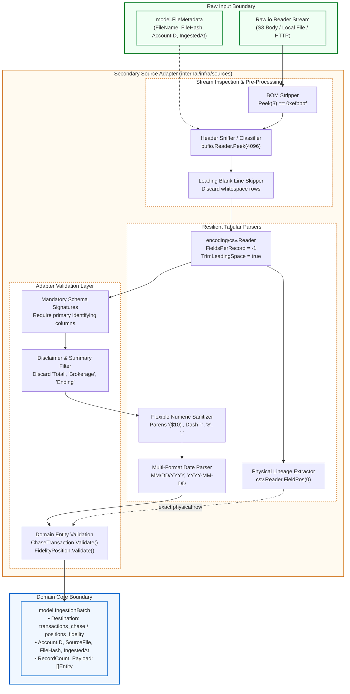

# Phase 2 Specification: Hexagonal Ingestion Adapters (Sources)

**Document Owner**: Documentation Engineer (`documentation-engineer`)  
**Target Repository**: `babylon_data_loader`  
**Parent Architecture**: Hexagonal Architecture (Ports and Adapters)  
**Tracking Issue**: [Issue #37: Pragmatic Layered Architecture](https://github.com/ajponte/babylon_data_loader/issues/37)  
**Implementation Phase**: [Phase 2 — Ingestion Adapters](../../../agent-docs/hex-refactor/PHASE2-INGESTION-ADAPTERS.md)  
**Review Synthesis**: [Phase 2 Review Findings](../../../agent-docs/reviews/hex-refactor-phase2/PHASE2-REVIEW-FINDINGS.md)  
**Related Specifications**: [Phase 1 Specification: Domain Core & Port Contracts](./hexagonal-domain-core.md)  
**Status**: Implemented (Phase 2)  

---

## 1. Executive Summary & Architectural Motivation

In the Hexagonal Architecture of `babylon_data_loader`, **Secondary Ingestion Adapters** (located under `internal/infra/sources/`) implement the driving port contract [`port.Extractor`](../../internal/domain/port/extractor.go). These adapters decode incoming raw statement byte streams (`io.Reader`), classify format dialects, validate input boundaries, and map tabular records into validated domain entities (`ChaseTransaction`, `FidelityPosition`) bundled within an `IngestionBatch`.

```
Raw Stream (io.Reader) + FileMetadata
                  │
                  ▼
┌────────────────────────────────────────────────────────┐
│     Secondary Source Adapters (internal/infra/sources) │
│                                                        │
│  • Memory-Bounded Header Peeking (bufio.Reader.Peek)   │
│  • Format & Dialect Classification Heuristics          │
│  • Resilient CSV Parsing & Physical Lineage Tracking   │
│  • Sanitization (BOM, Quotes, Parens, Placeholders)    │
│  • Conversion into Pure Domain Records                 │
└────────────────────────────────────────────────────────┘
                  │
                  ▼
Normalized & Validated IngestionBatch (model.IngestionBatch)
```

### 1.1. Standard Library & Domain Isolation
All source adapters maintain complete isolation from third-party libraries, cloud SDKs, and database drivers:
- **Allowed Imports**: Go standard library (`bufio`, `bytes`, `context`, `encoding/csv`, `errors`, `fmt`, `io`, `math`, `math/rand/v2`, `strconv`, `strings`, `sync`, `time`) and internal domain packages (`babylon/dataloader/internal/domain/model`, `babylon/dataloader/internal/domain/port`).
- **Strictly Forbidden Imports**: `go.mongodb.org/*`, `github.com/aws/*`, `github.com/wailsapp/*`, or any external CSV or utility library.
- **Verification Rule**: Pre-commit and CI verification gates run `go list -f '{{.ImportPath}} -> {{.Imports}}' ./internal/infra/sources/...` to ensure zero unauthorized dependencies.

### 1.2. Separation of Concerns
Phase 2 isolates all format quirks, bank-specific column aliases, header sniffing, and numeric parsing heuristics within adapter boundaries. Application orchestrators and domain models remain completely agnostic to:
1. Whether Chase statements originate from checking or credit card accounts.
2. Whether Fidelity exports include multi-line legal disclaimers, BOM markers, or trailing delimiters.
3. Whether synthetic test transactions are generated procedurally in-memory.

---

## 2. Ingestion Architecture & Data Flow

The diagram below details the data flow from an unconsumed `io.Reader` stream through the adapter boundary to a fully validated `IngestionBatch`:



---

## 3. Package Structure & Responsibilities

```
babylon_data_loader/internal/infra/sources/
├── chase/
│   ├── classifier.go         # DialectClassifier interface, Peek(4096) sniffer, precedence rules
│   ├── classifier_test.go    # Unit tests for dialect detection, peek bounds, and context cancellation
│   ├── checking.go           # Chase checking & deposit statement parser, schema resolution
│   ├── credit_card.go        # Chase credit card parser, pending post-date fallback
│   ├── extractor.go          # Implements port.Extractor for Chase; orchestrates classification & batching
│   └── extractor_test.go     # End-to-end tests against fixtures and synthetic edge cases
├── fidelity/
│   ├── extractor.go          # Implements port.Extractor for Fidelity; BOM, disclaimer filtering, cash heuristics
│   └── extractor_test.go     # Schema signature validation, summary total exclusion, fixture tests
└── synthetic/
    ├── extractor.go          # Implements port.Extractor; deterministic PRNG, bounds protection, concurrency safety
    └── extractor_test.go     # Determinism, RNG continuity, row-count bounds, and race safety tests
```

---

## 4. Chase Statement Ingestion Adapter (`internal/infra/sources/chase/`)

The Chase adapter handles statement exports from Chase Bank. Because Chase outputs divergent CSV formats for deposit accounts (checking/savings) versus revolving lines (credit cards), the adapter dynamically classifies the dialect before delegating to specialized sub-parsers.

### 4.1. Architecture & Component Responsibilities
- **`Extractor`**: Implements [`port.Extractor`](../../internal/domain/port/extractor.go). Resolves file metadata, triggers classification, dispatches to `parseChecking` or `parseCreditCard`, and encapsulates records into an `IngestionBatch`.
- **`Classifier`**: Inspects the stream without consuming it, returning the detected `DialectType` and an unconsumed reader.
- **`CheckingParser`**: Encapsulates checking/savings schema resolution, balance extraction, and check/slip tracking.
- **`CreditCardParser`**: Encapsulates credit card schema resolution, pending transaction date fallbacks, categories, and memos.

```go
type DialectType string

const (
    DialectChecking   DialectType = "CHASE_CHECKING"
    DialectCreditCard DialectType = "CHASE_CREDIT_CARD"
    DialectUnknown    DialectType = "UNKNOWN"
)

type Classifier interface {
    Classify(ctx context.Context, r io.Reader) (DialectType, io.Reader, error)
}
```

---

### 4.2. In-Stream Dialect Classification (`classifier.go`)

Classification determines the dialect by inspecting the CSV header without reading the entire stream into memory.

#### Memory-Bounded Header Peeking
Rather than using unbounded line reading (`ReadBytes('\n')`), [`DefaultClassifier.Classify`](../../internal/infra/sources/chase/classifier.go) wraps the reader in a `bufio.Reader` and inspects up to `4096` bytes via `br.Peek(4096)`:
- **Safety**: Bounded at 4KB. Unbounded streams, malformed binary files, or minified text streams cannot trigger memory exhaustion (OOM).
- **Non-Destructive Reuse**: Returns the existing `br` instance directly as the unconsumed `io.Reader`. Avoids heap allocations from `io.MultiReader`.
- **Context Awareness**: Immediately respects `ctx.Err()`, preventing goroutine hangs on slow or stalled streams.

```go
func (c *DefaultClassifier) Classify(ctx context.Context, r io.Reader) (DialectType, io.Reader, error) {
    if r == nil {
        return DialectUnknown, nil, errors.New("reader cannot be nil")
    }
    if ctxErr := ctx.Err(); ctxErr != nil {
        return DialectUnknown, nil, ctxErr
    }

    br := bufio.NewReader(r)
    peekBytes, err := br.Peek(peekBufferSize) // 4096 bytes
    if err != nil && !errors.Is(err, io.EOF) {
        return DialectUnknown, br, fmt.Errorf("failed to peek stream header: %w", err)
    }
    // Inspect peekBytes ...
}
```

#### Rule Precedence & Dialect Classification
Chase credit card statements frequently include balance columns (e.g., `"Balance"` or `"New Balance"`). Therefore, credit card markers must be evaluated **before** checking balance markers:

```
Dialect Detection Precedence
├── 1. Credit Card Markers (Highest Precedence)
│   ├── Contains "category"
│   ├── Contains "memo"
│   └── Contains "transaction date"
│       └── Result: DialectCreditCard
├── 2. Checking & Deposit Markers
│   ├── Contains "check or slip"
│   ├── Contains "details" AND "balance"
│   ├── Contains "posting date" AND "balance"
│   └── Contains "balance"
│       └── Result: DialectChecking
└── 3. Fallback
    └── Result: DialectUnknown
```

---

### 4.3. Checking Account Dialect (`checking.go`)

#### Header Resolution & Leading Blank Line Skipping
Files exported via web browsers or third-party aggregators frequently prepend leading blank lines. The parser scans until the first non-empty row:

```go
var header []string
for {
    record, err := reader.Read()
    if err != nil {
        if errors.Is(err, io.EOF) {
            return nil, io.EOF
        }
        return nil, fmt.Errorf("failed to read Chase %s CSV header: %w", dialectName, err)
    }
    if !isRowEmpty(record) {
        header = record
        break
    }
}
```

#### Checking Column Resolution Mapping
The checking sub-parser maps headers into normalized domain fields using case-insensitive alias lookups:

| Domain Field | Canonical Target | Supported Aliases | Invariant / Validation Rule |
| :--- | :--- | :--- | :--- |
| `PostingDate` | `posting date` | `"post date"` | Required; multi-format parsed (`MM/DD/YYYY`, `YYYY-MM-DD`). |
| `Description` | `description` | — | Required; non-empty string. |
| `Amount` | `amount` | — | Required; signed finite `float64` (negative for debits). |
| `Details` | `details` | — | Optional; falls back to `Type` or `"TRANSACTION"`. |
| `Type` | `type` | — | Optional; falls back to `Details` or `"TRANSACTION"`. |
| `Balance` | `balance` | — | Optional `*float64`; must be a valid finite number if present. |
| `CheckOrSlipNum` | `check or slip #`| `"check or slip num"` | Optional check/slip serial number. |

#### Physical Lineage Tracking via `csv.Reader.FieldPos(0)`
Rather than maintaining an error-prone logical loop counter (`rowIdx++`), the parser queries `reader.FieldPos(0)` after every `Read()`. This ensures that multi-line quoted fields and skipped empty rows report exact 1-based physical line numbers for auditing.

#### Corrupted Balance Validation
If a statement contains a balance string that is non-empty and non-placeholder (not `"-"`, `"--"`, `"n/a"`), but fails numeric conversion or evaluates to `NaN`/`Inf`, the parser returns an explicit error (`row %d: invalid balance %q`) rather than silently dropping the balance.

#### Flexible Numeric & Date Parsing
- **`cleanNumeric`**: Strips currency symbols (`$`), thousands separators (`,`), and explicit positive signs (`+`). Recognizes accounting parentheses (`($10.00)` -> `-10.00`) and translates dash placeholders (`"-"`, `"--"`) to `"0"`.
- **`parseDate`**: Evaluates strings against multiple standard date layouts:
  - `"01/02/2006"` (US standard with leading zeros)
  - `"1/2/2006"` (US compact without leading zeros)
  - `"2006-01-02"` (ISO 8601 standard)
  - `"2006/01/02"` (ISO variant)

---

### 4.4. Credit Card Dialect (`credit_card.go`)

#### Credit Card Column Resolution Mapping

| Domain Field | Canonical Target | Supported Aliases | Invariant / Validation Rule |
| :--- | :--- | :--- | :--- |
| `PostingDate` | `post date` | `"posting date"`, `"transaction date"`, `"trans date"` | Required; falls back to transaction date for pending transactions. |
| `Description` | `description` | — | Required; non-empty string. |
| `Amount` | `amount` | — | Required; signed finite `float64`. |
| `Category` | `category` | — | Optional merchant/expense category. |
| `Type` | `type` | — | Optional; defaults to `"Sale"` if blank. |
| `Memo` | `memo` | — | Optional statement memo string. |
| `Balance` | *(N/A)* | — | Always initialized to `nil` for credit cards. |

#### Pending Transaction Fallback Support
Pending credit card transactions have an empty `"Post Date"` because they have not yet cleared settlement, but they possess a valid `"Transaction Date"`. The parser falls back gracefully:

```go
postDateStr := getFieldValue(row, colIndex, "post date", "posting date")
if postDateStr == "" {
    postDateStr = getFieldValue(row, colIndex, "transaction date", "trans date")
}
if postDateStr == "" {
    return model.ChaseTransaction{}, fmt.Errorf("row %d: missing both post date and transaction date", lineNum)
}
```

---

## 5. Fidelity Portfolio Ingestion Adapter (`internal/infra/sources/fidelity/`)

Fidelity brokerage portfolio exports differ significantly from banking statement feeds. They represent point-in-time holdings snapshots rather than double-entry ledger streams.

### 5.1. File Characteristics & Ingestion Challenges
1. **UTF-8 Byte Order Mark (BOM)**: Files begin with `0xEF, 0xBB, 0xBF`, which corrupts the first column header if not stripped.
2. **Trailing Asymmetric Commas**: Data rows frequently have 17 columns while headers specify 16. Handled via `reader.FieldsPerRecord = -1`.
3. **Multi-Section Legal Footers & Disclaimers**: Disclaimers and account totals append to the file footer.
4. **Cash Core Accounts Without Symbols**: Core cash and money market accounts often omit a ticker symbol.

---

### 5.2. Mandatory Schema Signature Validation
To prevent arbitrary CSV files (such as Chase statements or unrelated documents) from parsing into phantom positions, [`fidelity.Extractor.Extract`](../../internal/infra/sources/fidelity/extractor.go) enforces mandatory column group signatures:

```go
requiredSignatures := [][]string{
    {"symbol", "description"},
    {"current value", "last price", "quantity"},
}

for _, sig := range requiredSignatures {
    if _, ok := findColumn(colIndex, sig...); !ok {
        return nil, fmt.Errorf("fidelity CSV missing required header column (expected one of %v)", sig)
    }
}
```
Any CSV lacking at least one column from each signature group is immediately rejected.

---

### 5.3. Section & Disclaimer Filtering Heuristics

#### Leading Blank Lines & UTF-8 BOM
The adapter peeks and discards `0xEF, 0xBB, 0xBF` via `stripUTF8BOM` and scans past empty lines to locate the true header row.

#### Footer & Disclaimer Filtering
The `isFidelityDisclaimerOrEmpty` function inspects rows and skips non-position records matching any of the following prefix patterns (case-insensitive):
- `"the data and information"`
- `"brokerage services"`
- `"date downloaded"`
- `"total"`
- `"account total"`
- `"portfolio total"`
- `"ending value"`
- `"disclaimer"`

#### In-Data Summary Keyword Filtering
Summary totals occasionally appear within tabular sections. Rows where the symbol or description matches `isSummaryKeyword` (e.g., `"total"`, `"account total"`, `"portfolio total"`, `"total "`) return `ok = false` and are discarded from the batch.

#### Cash Holding Evidence Heuristic
When a row has an empty `symbol`, the parser does **not** blindly default to `"CASH"`. It requires holding evidence inside the security description:

```go
if symbol == "" {
    descUpper := strings.ToUpper(description)
    if isCashDescription(descUpper) {
        symbol = "CASH"
    } else {
        // Skip metadata / non-position row cleanly
        return model.FidelityPosition{}, false, nil
    }
}

func isCashDescription(descUpper string) bool {
    return strings.Contains(descUpper, "HELD IN") ||
        strings.Contains(descUpper, "CASH") ||
        strings.Contains(descUpper, "FCASH") ||
        strings.Contains(descUpper, "CORE")
}
```

---

### 5.4. Fidelity Column Resolution Mapping

| Domain Field | Target Column | Supported Aliases | Invariant / Conversion Rule |
| :--- | :--- | :--- | :--- |
| `AccountID` | `account number` | `"account id"` | Falls back to `meta.AccountID` if unmasked in CSV. |
| `AccountName` | `account name` | — | Human-readable account label (e.g., `"ROTH IRA"`). |
| `Symbol` | `symbol` | — | Ticker or `"CASH"` (with cash description evidence). |
| `Description` | `description` | — | Full security title or money market description. |
| `Quantity` | `quantity` | — | `parseQuantity`: strips `,`, parens, converts to `float64`. |
| `LastPrice` | `last price` | — | `parseCurrency`: must be `>= 0` and finite. |
| `CurrentValue` | `current value` | — | `parseCurrency`: total market value. |
| `CostBasis` | `cost basis total`| `"cost basis"` | `parseCurrency`: purchase cost basis (`0.0` for cash). |

---

## 6. Synthetic Deterministic Ingestion Adapter (`internal/infra/sources/synthetic/`)

The synthetic adapter generates realistic, deterministic financial transactions programmatically without requiring external files or real banking credentials. It is primarily utilized in integration testing, CI/CD pipelines, and local UI development.

### 6.1. Options & Initialization
Configured via `GeneratorOptions`:

```go
type GeneratorOptions struct {
    RowCount int
    Seed     int64
}
```
- If `Seed == 0`, defaults to `defaultSeed = 42`.
- Utilizes Go's PCG PRNG (`math/rand/v2.NewPCG(uint64(seed), 1)`).

---

### 6.2. Persistent PRNG State & Concurrency Safety
To prevent duplicate transaction sequences across sequential `Extract()` calls on the same extractor instance, the PRNG instance is maintained on the struct and guarded by a `sync.Mutex`:

```go
type Extractor struct {
    opts GeneratorOptions
    mu   sync.Mutex
    rng  *rand.Rand
}
```

Sequential invocations of `Extract()` advance the internal generator state, ensuring sequential non-identical batches while preserving reproducible determinism when initialized with a fresh seed.

---

### 6.3. Memory Allocation Bounds & Safety Limits
To prevent memory exhaustion attacks or accidental out-of-memory crashes:
1. **Safety Bound**: Maximum allowable rows capped at `MaxSyntheticRowCount = 100_000`. Requests exceeding this limit return an immediate error.
2. **Negative Handling**: Negative counts are clamped to `0`.
3. **Clamped Pre-allocation**: Initial slice allocation is capped at `min(count, 10_000)`. Batches larger than 10,000 grow dynamically, preventing massive upfront heap spikes.

```go
const (
    MaxSyntheticRowCount    = 100_000
    maxInitialBatchCapacity = 10_000
)

count := e.opts.RowCount
if count < 0 {
    count = 0
}
if count > MaxSyntheticRowCount {
    return nil, fmt.Errorf("row count %d exceeds maximum allowable limit of %d", count, MaxSyntheticRowCount)
}

records := make([]model.ChaseTransaction, 0, min(count, maxInitialBatchCapacity))
```

---

## 7. Architectural Decisions & Remediation Log

During the Phase 2 code review and QA analysis, 10 findings (4 High Severity, 6 Medium Severity) were identified and remediated. The table below details the architectural impacts and the applied resolutions:

| ID | Severity | Component | Architectural Impact Prior to Remediation | Remediation Implemented |
| :---: | :---: | :--- | :--- | :--- |
| **F-01** | `High` | `fidelity` | Arbitrary non-Fidelity CSVs parsed into phantom batches of $0.00 `"CASH"` positions due to unvalidated schema. | Added mandatory schema signature checks requiring `{"symbol", "description"}` and `{"current value", "last price", "quantity"}`. |
| **F-02** | `High` | `fidelity` | Summary totals (e.g. `"Account Total"`) and legal footers parsed as massive cash positions, corrupting valuation. | Expanded disclaimer filtering prefixes (`"total"`, `"portfolio total"`, `"ending value"`) and required holding evidence (`"HELD IN"`, `"CORE"`, `"CASH"`) before assigning `"CASH"`. |
| **F-03** | `High` | `chase` | Unbounded `ReadBytes('\n')` in header classification risked memory exhaustion (OOM) on streams without newlines. | Replaced with memory-bounded `bufio.Reader.Peek(4096)`, non-destructive reader reuse, and explicit EOF handling. |
| **F-04** | `High` | `chase`, `fidelity` | Statements with leading blank lines failed header reading on first `reader.Read()`, rejecting valid bank exports. | Introduced leading blank line scanning loops across all CSV parsers to skip empty records until reaching the header. |
| **F-05** | `Medium` | `chase` | Corrupted balance strings (e.g. `"12.4A"`, `"NaN"`) silently converted to `nil`, suppressing errors and breaking auditability. | Added explicit numeric validation returning `row %d: invalid balance %q` for invalid, non-placeholder balance strings. |
| **F-06** | `Medium` | `chase` | Missing `context.Context` in classifier prevented timeout cancellation; matching `"balance"` before card markers misrouted credit cards. | Added `context.Context` to `Classifier.Classify`; reordered classification rules to evaluate Credit Card signatures before generic `"balance"`. |
| **F-07** | `Medium` | `chase` | Pending credit card transactions with empty `"Post Date"` caused entire batch ingestion to fail. | Implemented automatic fallback from empty `"Post Date"` to `"Transaction Date"` for credit card rows. |
| **F-08** | `Medium` | `chase`, `fidelity` | Financial values with accounting parens `($10.00)`, dashes `"-"`, or ISO 8601 dates (`YYYY-MM-DD`) failed parsing. | Updated `cleanNumeric` to translate parens to negative values and dashes to `"0"`; expanded `parseDate` to support ISO 8601 layouts. |
| **F-09** | `Medium` | `chase`, `fidelity` | Manual `rowIdx++` drifted from physical file line numbers on multiline quoted fields and skipped rows. | Adopted `csv.Reader.FieldPos(0)` to capture exact 1-based physical line numbers for record lineage. |
| **F-10** | `Medium` | `synthetic` | PRNG recreated per invocation yielding duplicate batches; slice pre-allocation risked OOM on extreme row counts. | Stored mutex-guarded `*rand.Rand` on struct for sequential continuity; capped row counts at 100,000 and clamped initial pre-allocation at 10,000. |

---

## 8. Verification Harness & Local Quality Gates

All secondary ingestion adapters maintain strict quality gates ensuring standard-library isolation, race safety, and high test coverage.

### 8.1. Standard Library Isolation Gate
Run from `babylon_data_loader/`:

```bash
go list -f '{{.ImportPath}} -> {{.Imports}}' ./internal/infra/sources/...
```

**Verified Output**:
```text
babylon/dataloader/internal/infra/sources/chase -> [babylon/dataloader/internal/domain/model babylon/dataloader/internal/domain/port bufio bytes context encoding/csv errors fmt io math strconv strings time]
babylon/dataloader/internal/infra/sources/fidelity -> [babylon/dataloader/internal/domain/model babylon/dataloader/internal/domain/port bufio bytes context encoding/csv errors fmt io strconv strings]
babylon/dataloader/internal/infra/sources/synthetic -> [babylon/dataloader/internal/domain/model babylon/dataloader/internal/domain/port context fmt io math math/rand/v2 sync time]
```
No external packages, third-party CSV libraries, or database drivers exist in the dependency tree.

---

### 8.2. Race Detection & Test Execution Gate
Execute tests across all source packages with race detection enabled:

```bash
go test -v -race ./internal/infra/sources/...
```

**Verified Test Summary**:
- `chase`: Passes dialect classification (peek bounds, credit card precedence, leading blank lines), checking parser (corrupted balance rejection, accounting parens, ISO dates, multiline physical lineage), credit card parser (pending transaction fallback), and production statement fixtures (`Chase6921_Activity_20260131.CSV`, `Chase2472_Activity20250101_20251231_20260201.CSV`).
- `fidelity`: Passes schema signature rejection on arbitrary CSVs, disclaimer and summary total filtering, cash holding heuristics, and synthetic fixture parsing (`Portfolio_Positions_Synthetic.csv`).
- `synthetic`: Passes deterministic reproducibility, RNG continuity across sequential calls, zero counts, metadata validation, and row-count safety bounds (>100,000 rejection).

---

### 8.3. Static Analysis & Linter Gate
Run the project linter:

```bash
golangci-lint run ./internal/infra/sources/...
```

**Verified Output**:
```text
0 issues.
```

---

### 8.4. Continuous Integration Suite
Run the full automated test suite:

```bash
make test-ci
```

**Verified Result**: Full repository test pass with 100% statement coverage across domain models and clean pass across all secondary adapters.

---

## 9. Related Documentation & References

- [Phase 1 Specification: Domain Core & Port Contracts](./hexagonal-domain-core.md)
- [Fidelity Portfolio Positions Ingestion Specification](./fidelity-portfolio-ingestion.md)
- [MongoDB Atlas Datalake Specification](./mongodb-atlas-datalake.md)
- [Hexagonal Architecture Refactoring Plan (Parent Strategy)](../../../agent-docs/hex-refactor/README.md)
- [Phase 2 Implementation Plan: Ingestion Adapters & Dialects](../../../agent-docs/hex-refactor/PHASE2-INGESTION-ADAPTERS.md)
- [Phase 2 Review Findings & Remediation Synthesis](../../../agent-docs/reviews/hex-refactor-phase2/PHASE2-REVIEW-FINDINGS.md)
- [Phase 3 Plan: Storage Adapters & MongoDB Router](../../../agent-docs/hex-refactor/PHASE3-STORAGE-ADAPTERS.md)
