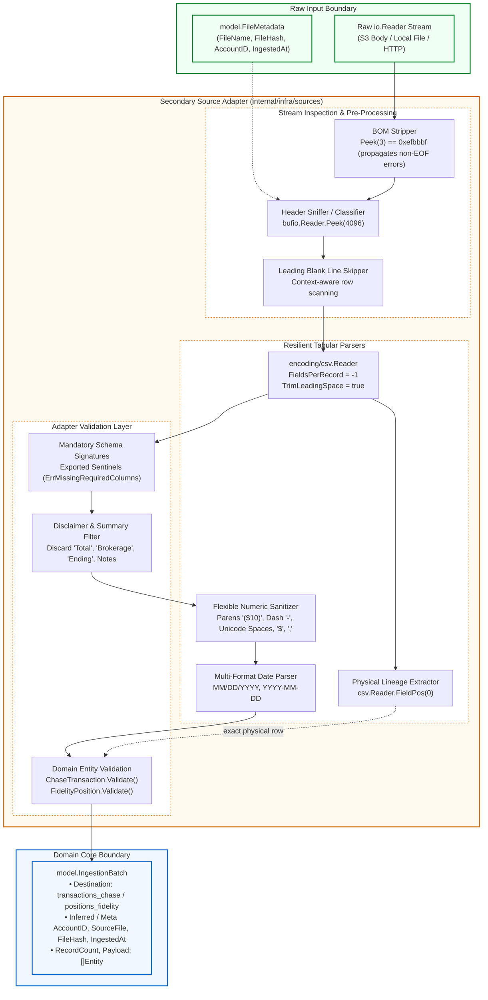
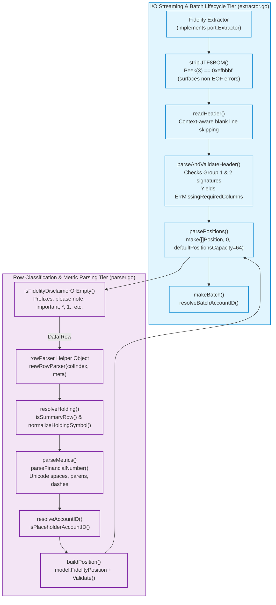

# Phase 2 Specification: Hexagonal Ingestion Adapters (Sources)

**Document Owner**: Documentation Engineer (`documentation-engineer`)  
**Target Repository**: `babylon_data_loader`  
**Parent Architecture**: Hexagonal Architecture (Ports and Adapters)  
**Tracking Issue**: [Issue #37: Pragmatic Layered Architecture](https://github.com/ajponte/babylon_data_loader/issues/37)  
**Implementation Phase**: [Phase 2 — Ingestion Adapters](../../../agent-docs/hex-refactor/PHASE2-INGESTION-ADAPTERS.md)  
**Review Syntheses**:
* [Phase 2 Consolidated Review Findings](../../../agent-docs/reviews/hex-refactor-phase2/PHASE2-REVIEW-FINDINGS.md)
* [Phase 2B Fidelity Review Findings & Remediation](../../../agent-docs/reviews/hex-phase2b-fidelity/FIDELITY-REVIEW-FINDINGS.md)
* [AI Effort Estimation Guardrails & Sizing Playbook](../../../agent-docs/reviews/hex-refactor-phase2/AI-EFFORT-ESTIMATION-GUARDRAILS.md)
* [Blameless Retrospective: Schedule Variance & Sizing Breakdown](../../../agent-docs/reviews/HEX-REFACTOR-BLAMELESS-RETROSPECTIVE.md)

**Related Specifications**: [Phase 1 Specification: Domain Core & Port Contracts](./hexagonal-domain-core.md)  
**Status**: Implemented (Phase 2)  

---

## 1. Executive Summary & Architectural Motivation

In the Hexagonal Architecture of `babylon_data_loader`, **Secondary Ingestion Adapters** (located under `internal/infra/sources/`) implement the driving port contract [`port.Extractor`](../../internal/domain/port/extractor.go). These adapters decode incoming raw statement byte streams (`io.Reader`), classify format dialects, validate input boundaries, and map tabular records into validated domain entities (`ChaseTransaction`, `FidelityPosition`) bundled within an `IngestionBatch`.

```
Raw Stream (io.Reader) + FileMetadata
                  │
                  ▼
┌────────────────────────────────────────────────────────┐
│     Secondary Source Adapters (internal/infra/sources) │
│                                                        │
│  • Memory-Bounded Header Peeking (bufio.Reader.Peek)   │
│  • Format & Dialect Classification Heuristics          │
│  • Resilient CSV Parsing & Physical Lineage Tracking   │
│  • Sanitization (BOM, Quotes, Parens, Placeholders)    │
│  • Conversion into Pure Domain Records                 │
└────────────────────────────────────────────────────────┘
                  │
                  ▼
Normalized & Validated IngestionBatch (model.IngestionBatch)
```

### 1.1. Standard Library & Domain Isolation
All source adapters maintain complete isolation from third-party libraries, cloud SDKs, and database drivers:
- **Allowed Imports**: Go standard library (`bufio`, `bytes`, `context`, `encoding/csv`, `errors`, `fmt`, `io`, `math`, `math/rand/v2`, `strconv`, `strings`, `sync`, `time`) and internal domain packages (`babylon/dataloader/internal/domain/model`, `babylon/dataloader/internal/domain/port`).
- **Strictly Forbidden Imports**: `go.mongodb.org/*`, `github.com/aws/*`, `github.com/wailsapp/*`, or any external CSV or utility library.
- **Verification Rule**: Pre-commit and CI verification gates run `go list -f '{{.ImportPath}} -> {{.Imports}}' ./internal/infra/sources/...` to ensure zero unauthorized dependencies.

### 1.2. Separation of Concerns
Phase 2 isolates all format quirks, bank-specific column aliases, header sniffing, and numeric parsing heuristics within adapter boundaries. Application orchestrators and domain models remain completely agnostic to:
1. Whether Chase statements originate from checking or credit card accounts.
2. Whether Fidelity exports include multi-line legal disclaimers, BOM markers, or trailing delimiters.
3. Whether synthetic test transactions are generated procedurally in-memory.

---

## 2. Ingestion Architecture & Data Flow

The diagram below details the data flow from an unconsumed `io.Reader` stream through the adapter boundary to a fully validated `IngestionBatch`:



---

## 3. Package Structure & Responsibilities

```
babylon_data_loader/internal/infra/sources/
├── chase/
│   ├── classifier.go         # DialectClassifier interface, Peek(4096) sniffer, precedence rules
│   ├── classifier_test.go    # Unit tests for dialect detection, peek bounds, and context cancellation
│   ├── checking.go           # Chase checking & deposit statement parser, schema resolution
│   ├── credit_card.go        # Chase credit card parser, pending post-date fallback
│   ├── extractor.go          # Implements port.Extractor for Chase; orchestrates classification & batching
│   └── extractor_test.go     # End-to-end tests against fixtures and synthetic edge cases
├── fidelity/
│   ├── extractor.go          # Implements port.Extractor; driving adapter, I/O streaming, BOM, header detection, batch assembly
│   ├── parser.go             # rowParser helper object, symbol normalization, summary filtering, parseFinancialNumber, disclaimers
│   └── extractor_test.go     # Comprehensive table-driven test suite: 100% pass across all 10 review findings, BOM, accounting, cancellation
└── synthetic/
    ├── extractor.go          # Implements port.Extractor; deterministic PRNG, bounds protection, concurrency safety
    └── extractor_test.go     # Determinism, RNG continuity, row-count bounds, and race safety tests
```

---

## 4. Chase Statement Ingestion Adapter (`internal/infra/sources/chase/`)

The Chase adapter handles statement exports from Chase Bank. Because Chase outputs divergent CSV formats for deposit accounts (checking/savings) versus revolving lines (credit cards), the adapter dynamically classifies the dialect before delegating to specialized sub-parsers.

### 4.1. Architecture & Component Responsibilities
- **`Extractor`**: Implements [`port.Extractor`](../../internal/domain/port/extractor.go). Resolves file metadata, triggers classification, dispatches to `parseChecking` or `parseCreditCard`, and encapsulates records into an `IngestionBatch`.
- **`Classifier`**: Inspects the stream without consuming it, returning the detected `DialectType` and an unconsumed reader.
- **`CheckingParser`**: Encapsulates checking/savings schema resolution, balance extraction, and check/slip tracking.
- **`CreditCardParser`**: Encapsulates credit card schema resolution, pending transaction date fallbacks, categories, and memos.

```go
type DialectType string

const (
    DialectChecking   DialectType = "CHASE_CHECKING"
    DialectCreditCard DialectType = "CHASE_CREDIT_CARD"
    DialectUnknown    DialectType = "UNKNOWN"
)

type Classifier interface {
    Classify(ctx context.Context, r io.Reader) (DialectType, io.Reader, error)
}
```

---

### 4.2. In-Stream Dialect Classification (`classifier.go`)

Classification determines the dialect by inspecting the CSV header without reading the entire stream into memory.

#### Memory-Bounded Header Peeking
Rather than using unbounded line reading (`ReadBytes('\n')`), [`DefaultClassifier.Classify`](../../internal/infra/sources/chase/classifier.go) wraps the reader in a `bufio.Reader` and inspects up to `4096` bytes via `br.Peek(4096)`:
- **Safety**: Bounded at 4KB. Unbounded streams, malformed binary files, or minified text streams cannot trigger memory exhaustion (OOM).
- **Non-Destructive Reuse**: Returns the existing `br` instance directly as the unconsumed `io.Reader`. Avoids heap allocations from `io.MultiReader`.
- **Context Awareness**: Immediately respects `ctx.Err()`, preventing goroutine hangs on slow or stalled streams.

```go
func (c *DefaultClassifier) Classify(ctx context.Context, r io.Reader) (DialectType, io.Reader, error) {
    if r == nil {
        return DialectUnknown, nil, errors.New("reader cannot be nil")
    }
    if ctxErr := ctx.Err(); ctxErr != nil {
        return DialectUnknown, nil, ctxErr
    }

    br := bufio.NewReader(r)
    peekBytes, err := br.Peek(peekBufferSize) // 4096 bytes
    if err != nil && !errors.Is(err, io.EOF) {
        return DialectUnknown, br, fmt.Errorf("failed to peek stream header: %w", err)
    }
    // Inspect peekBytes ...
}
```

#### Rule Precedence & Dialect Classification
Chase credit card statements frequently include balance columns (e.g., `"Balance"` or `"New Balance"`). Therefore, credit card markers must be evaluated **before** checking balance markers:

```
Dialect Detection Precedence
├── 1. Credit Card Markers (Highest Precedence)
│   ├── Contains "category"
│   ├── Contains "memo"
│   └── Contains "transaction date"
│       └── Result: DialectCreditCard
├── 2. Checking & Deposit Markers
│   ├── Contains "check or slip"
│   ├── Contains "details" AND "balance"
│   ├── Contains "posting date" AND "balance"
│   └── Contains "balance"
│       └── Result: DialectChecking
└── 3. Fallback
    └── Result: DialectUnknown
```

---

### 4.3. Checking Account Dialect (`checking.go`)

#### Header Resolution & Leading Blank Line Skipping
Files exported via web browsers or third-party aggregators frequently prepend leading blank lines. The parser scans until the first non-empty row:

```go
var header []string
for {
    record, err := reader.Read()
    if err != nil {
        if errors.Is(err, io.EOF) {
            return nil, io.EOF
        }
        return nil, fmt.Errorf("failed to read Chase %s CSV header: %w", dialectName, err)
    }
    if !isRowEmpty(record) {
        header = record
        break
    }
}
```

#### Checking Column Resolution Mapping
The checking sub-parser maps headers into normalized domain fields using case-insensitive alias lookups:

| Domain Field | Canonical Target | Supported Aliases | Invariant / Validation Rule |
| :--- | :--- | :--- | :--- |
| `PostingDate` | `posting date` | `"post date"` | Required; multi-format parsed (`MM/DD/YYYY`, `YYYY-MM-DD`). |
| `Description` | `description` | — | Required; non-empty string. |
| `Amount` | `amount` | — | Required; signed finite `float64` (negative for debits). |
| `Details` | `details` | — | Optional; falls back to `Type` or `"TRANSACTION"`. |
| `Type` | `type` | — | Optional; falls back to `Details` or `"TRANSACTION"`. |
| `Balance` | `balance` | — | Optional `*float64`; must be a valid finite number if present. |
| `CheckOrSlipNum` | `check or slip #`| `"check or slip num"` | Optional check/slip serial number. |

#### Physical Lineage Tracking via `csv.Reader.FieldPos(0)`
Rather than maintaining an error-prone logical loop counter (`rowIdx++`), the parser queries `reader.FieldPos(0)` after every `Read()`. This ensures that multi-line quoted fields and skipped empty rows report exact 1-based physical line numbers for auditing.

#### Corrupted Balance Validation
If a statement contains a balance string that is non-empty and non-placeholder (not `"-"`, `"--"`, `"n/a"`), but fails numeric conversion or evaluates to `NaN`/`Inf`, the parser returns an explicit error (`row %d: invalid balance %q`) rather than silently dropping the balance.

#### Flexible Numeric & Date Parsing
- **`cleanNumeric`**: Strips currency symbols (`$`), thousands separators (`,`), and explicit positive signs (`+`). Recognizes accounting parentheses (`($10.00)` -> `-10.00`) and translates dash placeholders (`"-"`, `"--"`) to `"0"`.
- **`parseDate`**: Evaluates strings against multiple standard date layouts:
  - `"01/02/2006"` (US standard with leading zeros)
  - `"1/2/2006"` (US compact without leading zeros)
  - `"2006-01-02"` (ISO 8601 standard)
  - `"2006/01/02"` (ISO variant)

---

### 4.4. Credit Card Dialect (`credit_card.go`)

#### Credit Card Column Resolution Mapping

| Domain Field | Canonical Target | Supported Aliases | Invariant / Validation Rule |
| :--- | :--- | :--- | :--- |
| `PostingDate` | `post date` | `"posting date"`, `"transaction date"`, `"trans date"` | Required; falls back to transaction date for pending transactions. |
| `Description` | `description` | — | Required; non-empty string. |
| `Amount` | `amount` | — | Required; signed finite `float64`. |
| `Category` | `category` | — | Optional merchant/expense category. |
| `Type` | `type` | — | Optional; defaults to `"Sale"` if blank. |
| `Memo` | `memo` | — | Optional statement memo string. |
| `Balance` | *(N/A)* | — | Always initialized to `nil` for credit cards. |

#### Pending Transaction Fallback Support
Pending credit card transactions have an empty `"Post Date"` because they have not yet cleared settlement, but they possess a valid `"Transaction Date"`. The parser falls back gracefully:

```go
postDateStr := getFieldValue(row, colIndex, "post date", "posting date")
if postDateStr == "" {
    postDateStr = getFieldValue(row, colIndex, "transaction date", "trans date")
}
if postDateStr == "" {
    return model.ChaseTransaction{}, fmt.Errorf("row %d: missing both post date and transaction date", lineNum)
}
```

---

## 5. Fidelity Portfolio Ingestion Adapter (`internal/infra/sources/fidelity/`)

Fidelity brokerage portfolio exports represent point-in-time holdings snapshots across one or more accounts. The adapter handles complex real-world export quirks, including UTF-8 Byte Order Marks (BOM), trailing asymmetric commas, multi-line legal disclaimers, cash sweep normalization, and accounting syntax.

### 5.1. Two-Tier Architecture & Component Responsibilities

Following Phase 2B review hardening, the Fidelity adapter is structured into a clean two-tier architectural separation:
1. **I/O Streaming & Batch Lifecycle Tier ([`extractor.go`](../../internal/infra/sources/fidelity/extractor.go))**: Handles driving adapter responsibilities, parameter validation, stream buffering, BOM stripping with error propagation, header scanning, signature validation, slice memory pre-allocation, and batch envelope assembly with account ID inference.
2. **Row Classification & Parsing Helper Object Tier ([`parser.go`](../../internal/infra/sources/fidelity/parser.go))**: Implements `rowParser`, an encapsulated helper object that performs holding resolution, cash sweep normalization, robust numeric metric extraction, disclaimer and summary filtering, and entity validation.



---

### 5.2. Mandatory Schema Signature Validation & Sentinel Errors

To prevent arbitrary or malformed CSV files (such as Chase statements or unrelated documents) from producing phantom holdings, [`parseAndValidateHeader`](../../internal/infra/sources/fidelity/extractor.go) requires at least one column match from each of two mandatory signature groups:

```go
requiredSignatures := [][]string{
    {"symbol", "ticker"},
    {"current value", "market value", "current balance", "last price", "quantity"},
}
```

#### Exported Sentinel Errors
The adapter exports explicit sentinel errors, allowing callers, pipeline routers, and test harnesses to programmatically evaluate error conditions via `errors.Is()`:

```go
var (
    // ErrNilReader indicates that a nil io.Reader was provided to Extract.
    ErrNilReader = errors.New("reader cannot be nil")

    // ErrMissingRequiredColumns indicates that the CSV header is missing mandatory columns.
    ErrMissingRequiredColumns = errors.New("fidelity CSV missing required header columns")
)
```

```go
if r == nil {
    return ErrNilReader
}

for _, sig := range requiredSignatures {
    if _, ok := findColumn(colIndex, sig...); !ok {
        return nil, fmt.Errorf("%w (expected one of %v)", ErrMissingRequiredColumns, sig)
    }
}
```

---

### 5.3. Section, Disclaimer & Normalization Heuristics

#### 1. Preservation of Legitimate Holdings with "Total" in Description (F-01)
Broad-market index funds (e.g., Vanguard Total Stock Market `VTI`, Vanguard Total Bond Market `BND`, TotalEnergies `TTE`) routinely contain `"Total "` in their descriptive fund titles.
In [`parser.go`](../../internal/infra/sources/fidelity/parser.go), `isSummaryRow` explicitly decouples ticker symbol evaluation from description scanning:
```go
func isSummaryRow(symbol, description string) bool {
    symLower := strings.ToLower(symbol)
    descLower := strings.ToLower(description)

    if isSummaryKeyword(symLower) {
        return true
    }
    // Only filter based on description if the symbol is empty or a placeholder
    return (symbol == "" || symbol == "**") && isSummaryKeyword(descLower)
}
```
If a row contains a valid ticker symbol (e.g. `VTI`), it is **never** dropped as a summary row, guaranteeing zero accidental data loss on index funds.

#### 2. Cash Sweep Holding Normalization (F-03)
Fidelity exports core cash sweep accounts with varying symbols (`"**"`, `""`, `"FCASH"`, `"CORE"`) and descriptions like `"HELD IN MONEY MARKET"` or `"DEPOSIT SWEEP"`:
- **Normalization to `"CASH"`**: If the symbol is strictly `"**"`, `"FCASH"`, `"CORE"`, or empty with cash holding markers (`isCashDescription`), it is normalized to `"CASH"`.
- **Footnote Asterisk Preservation**: For valid market tickers that include footnote asterisks (e.g. `SPAXX**`), the symbol is preserved as a distinct money market fund rather than coerced into generic `"CASH"`.

```go
func normalizeHoldingSymbol(symbol, description string) (string, bool) {
    if symbol != "" && symbol != "**" && !strings.EqualFold(symbol, "fcash") && !strings.EqualFold(symbol, "core") {
        return symbol, true
    }

    descUpper := strings.ToUpper(description)
    if isCashHolding(symbol, descUpper) {
        return "CASH", true
    }

    return "", false
}
```

#### 3. Stream I/O Safety & Non-EOF BOM Error Propagation (F-02)
[`stripUTF8BOM`](../../internal/infra/sources/fidelity/extractor.go) inspects the first 3 bytes for `0xef, 0xbb, 0xbf`. It surfaces non-EOF I/O errors immediately, treats graceful EOF (empty files) as a non-error, and verifies that `br.Discard(3)` succeeds:
```go
func stripUTF8BOM(br *bufio.Reader) error {
    bom := []byte{0xef, 0xbb, 0xbf}
    peekBytes, err := br.Peek(len(bom))
    if err != nil {
        if errors.Is(err, io.EOF) || errors.Is(err, io.ErrUnexpectedEOF) {
            return nil
        }
        return fmt.Errorf("failed to peek BOM header: %w", err)
    }
    if bytes.Equal(peekBytes, bom) {
        if _, discardErr := br.Discard(len(bom)); discardErr != nil {
            return fmt.Errorf("failed to discard BOM: %w", discardErr)
        }
    }
    return nil
}
```

#### 4. Context Cancellation in Header and Row Loops (F-05)
Both `readHeader()` and `parsePositions()` evaluate `ctx.Err()` at the start of every iteration, preventing goroutine hangs when reading slow network streams or infinite preamble lines.

#### 5. Expanded Legal Footer & Footnote Filtering (F-06)
[`isDisclaimerText`](../../internal/infra/sources/fidelity/parser.go) inspects the first non-empty field of non-data records to filter legal notices and definitions:
- **Disclaimers**: `"the data and information"`, `"brokerage services"`, `"date downloaded"`, `"disclaimer"`, `"disclosure"`, `"please note"`, `"important"`, `"quotes are"`, `"security prices"`.
- **Totals**: `"total"`, `"total market"`, `"account total"`, `"portfolio total"`, `"ending value"`.
- **Footnotes & Numbered Notes**: Lines beginning with `"* "` (excluding cash `"**"`) or numbered annotations (`"1."`).

#### 6. Slice Memory Pre-Allocation (F-07)
In `parsePositions()`, the positions slice is pre-allocated with `const defaultPositionsCapacity = 64`. This eliminates continuous array reallocations and garbage collection churn when ingesting typical multi-position brokerage accounts.

#### 7. Unified Financial Number Parsing (F-08)
[`parseFinancialNumber`](../../internal/infra/sources/fidelity/parser.go) unifies currency and quantity sanitization:
- **Unicode Non-Breaking Space Sanitization**: Strips both standard non-breaking spaces (`\u00a0` / `&nbsp;`) and narrow non-breaking spaces (`\u202f`) frequently injected by Safari, Firefox, or localized OS exports.
- **Accounting Parentheses**: Automatically transforms `($50.00)` to `-50.00`.
- **Dashes and Placeholders**: Resolves `""`, `"-"`, `"--"`, `"n/a"`, `"unknown"`, and `"pending"` to `0.0, nil`.
- **Enriched Error Context**: Wraps syntax errors with field name and raw value (`invalid %s value %q: %w`).

#### 8. Single-Account Batch Inference (F-09)
In [`resolveBatchAccountID`](../../internal/infra/sources/fidelity/extractor.go), if all extracted positions share the exact same non-empty account identifier, `batch.AccountID` is set to that inferred account ID, overriding generic metadata placeholders (`"DEFAULT"`, `"ALL"`, `"UNKNOWN"`). If records span multiple accounts, `meta.AccountID` is preserved.

---

### 5.4. Fidelity Column Resolution Mapping

The `rowParser` maps column headers to domain fields using case-insensitive alias lookups:

| Domain Field | Canonical Target | Supported Aliases | Conversion & Sanitization Rules |
| :--- | :--- | :--- | :--- |
| `AccountID` | `account number` | `"account id"`, `"account #"`, `"account"` | Falls back to `meta.AccountID` if empty or placeholder (`"-"`, `"n/a"`). |
| `AccountName` | `account name` | `"account nickname"` | Human-readable account label (e.g., `"ROTH IRA"`). |
| `Symbol` | `symbol` | `"ticker"`, `"symbol/cusip"` | Clean ticker; `"**"`, `"FCASH"`, `"CORE"` normalized to `"CASH"`. |
| `Description` | `description` | `"security description"`, `"investment name"` | Full security title or money market description. |
| `Quantity` | `quantity` | `"shares"`, `"qty"` | `parseQuantity`: strips Unicode spaces, parens, commas, plus signs. |
| `LastPrice` | `last price` | `"price"`, `"last"` | `parseCurrency`: strips `$`, must be `>= 0` and finite. |
| `CurrentValue` | `current value` | `"market value"`, `"current value ($)"` | `parseCurrency`: total market valuation. |
| `CostBasis` | `cost basis total`| `"cost basis"`, `"total cost basis"` | `parseCurrency`: aggregate purchase basis (`0.0` for cash/gifts). |

---

## 6. Synthetic Deterministic Ingestion Adapter (`internal/infra/sources/synthetic/`)

The synthetic adapter generates realistic, deterministic financial transactions programmatically without requiring external files or real banking credentials. It is primarily utilized in integration testing, CI/CD pipelines, and local UI development.

### 6.1. Options & Initialization
Configured via `GeneratorOptions`:

```go
type GeneratorOptions struct {
    RowCount int
    Seed     int64
}
```
- If `Seed == 0`, defaults to `defaultSeed = 42`.
- Utilizes Go's PCG PRNG (`math/rand/v2.NewPCG(uint64(seed), 1)`).

---

### 6.2. Persistent PRNG State & Concurrency Safety
To prevent duplicate transaction sequences across sequential `Extract()` calls on the same extractor instance, the PRNG instance is maintained on the struct and guarded by a `sync.Mutex`:

```go
type Extractor struct {
    opts GeneratorOptions
    mu   sync.Mutex
    rng  *rand.Rand
}
```

Sequential invocations of `Extract()` advance the internal generator state, ensuring sequential non-identical batches while preserving reproducible determinism when initialized with a fresh seed.

---

### 6.3. Memory Allocation Bounds & Safety Limits
To prevent memory exhaustion attacks or accidental out-of-memory crashes:
1. **Safety Bound**: Maximum allowable rows capped at `MaxSyntheticRowCount = 100_000`. Requests exceeding this limit return an immediate error.
2. **Negative Handling**: Negative counts are clamped to `0`.
3. **Clamped Pre-allocation**: Initial slice allocation is capped at `min(count, 10_000)`. Batches larger than 10,000 grow dynamically, preventing massive upfront heap spikes.

```go
const (
    MaxSyntheticRowCount    = 100_000
    maxInitialBatchCapacity = 10_000
)

count := e.opts.RowCount
if count < 0 {
    count = 0
}
if count > MaxSyntheticRowCount {
    return nil, fmt.Errorf("row count %d exceeds maximum allowable limit of %d", count, MaxSyntheticRowCount)
}

records := make([]model.ChaseTransaction, 0, min(count, maxInitialBatchCapacity))
```

---

## 7. Architectural Decisions & Remediation Log

### 7.1. Phase 2 Consolidated Ingestion Findings
The table below documents the 10 consolidated findings from the initial Phase 2 architectural and QA review:

| ID | Severity | Component | Architectural Impact Prior to Remediation | Remediation Implemented |
| :---: | :---: | :--- | :--- | :--- |
| **F-01** | `High` | `fidelity` | Arbitrary non-Fidelity CSVs parsed into phantom batches of $0.00 `"CASH"` positions due to unvalidated schema. | Added mandatory schema signature checks requiring `{"symbol", "ticker"}` and `{"current value", "market value", "current balance", "last price", "quantity"}`. |
| **F-02** | `High` | `fidelity` | Summary totals (e.g. `"Account Total"`) and legal footers parsed as massive cash positions, corrupting valuation. | Expanded disclaimer filtering prefixes (`"total"`, `"portfolio total"`, `"ending value"`) and required holding evidence (`"HELD IN"`, `"CORE"`, `"CASH"`) before assigning `"CASH"`. |
| **F-03** | `High` | `chase` | Unbounded `ReadBytes('\n')` in header classification risked memory exhaustion (OOM) on streams without newlines. | Replaced with memory-bounded `bufio.Reader.Peek(4096)`, non-destructive reader reuse, and explicit EOF handling. |
| **F-04** | `High` | `chase`, `fidelity` | Statements with leading blank lines failed header reading on first `reader.Read()`, rejecting valid bank exports. | Introduced leading blank line scanning loops across all CSV parsers to skip empty records until reaching the header. |
| **F-05** | `Medium` | `chase` | Corrupted balance strings (e.g. `"12.4A"`, `"NaN"`) silently converted to `nil`, suppressing errors and breaking auditability. | Added explicit numeric validation returning `row %d: invalid balance %q` for invalid, non-placeholder balance strings. |
| **F-06** | `Medium` | `chase` | Missing `context.Context` in classifier prevented timeout cancellation; matching `"balance"` before card markers misrouted credit cards. | Added `context.Context` to `Classifier.Classify`; reordered classification rules to evaluate Credit Card signatures before generic `"balance"`. |
| **F-07** | `Medium` | `chase` | Pending credit card transactions with empty `"Post Date"` caused entire batch ingestion to fail. | Implemented automatic fallback from empty `"Post Date"` to `"Transaction Date"` for credit card rows. |
| **F-08** | `Medium` | `chase`, `fidelity` | Financial values with accounting parens `($10.00)`, dashes `"-"`, or ISO 8601 dates (`YYYY-MM-DD`) failed parsing. | Updated `cleanNumeric` to translate parens to negative values and dashes to `"0"`; expanded `parseDate` to support ISO 8601 layouts. |
| **F-09** | `Medium` | `chase`, `fidelity` | Manual `rowIdx++` drifted from physical file line numbers on multiline quoted fields and skipped rows. | Adopted `csv.Reader.FieldPos(0)` to capture exact 1-based physical line numbers for record lineage. |
| **F-10** | `Medium` | `synthetic` | PRNG recreated per invocation yielding duplicate batches; slice pre-allocation risked OOM on extreme row counts. | Stored mutex-guarded `*rand.Rand` on struct for sequential continuity; capped row counts at 100,000 and clamped initial pre-allocation at 10,000. |

---

### 7.2. Phase 2B Fidelity Adapter Hardening Log
During the dedicated code review and QA hardening of the isolated Fidelity adapter on branch `hex-phase2b-fidelity` (documented in detail in [`agent-docs/reviews/hex-phase2b-fidelity/FIDELITY-REVIEW-FINDINGS.md`](../../../agent-docs/reviews/hex-phase2b-fidelity/FIDELITY-REVIEW-FINDINGS.md)), an additional 10 findings were prioritized and resolved:

| ID | Severity | Target File(s) | Architectural Impact Prior to Hardening | Implemented Resolution |
| :---: | :---: | :--- | :--- | :--- |
| **F-01** | `High` | `parser.go` | False-positive dropping of legitimate index funds containing `"Total "` in descriptions (e.g. `VTI`, `BND`, `TTE`). | Decoupled ticker evaluation from description checking; if `symbol != ""` and non-summary, row is always preserved. |
| **F-02** | `High` | `extractor.go` | `stripUTF8BOM` swallowed non-EOF peek and discard errors, masking underlying stream I/O failures. | Refactored `stripUTF8BOM` to return `error`, surfaces non-EOF errors, and treats graceful EOF as non-error. |
| **F-03** | `High` | `parser.go` | Core cash sweep positions retained raw punctuation ticker `"**"`, causing downstream ticker lookup failures. | Normalized `"**"`, `"FCASH"`, and `"CORE"` to `"CASH"`, while preserving footnote asterisks on valid tickers (`SPAXX**`). |
| **F-04** | `Medium` | `extractor.go` | Anonymous string errors prevented programmatic inspection via `errors.Is()`. | Declared exported sentinels: `ErrNilReader` and `ErrMissingRequiredColumns`. |
| **F-05** | `Medium` | `extractor.go` | Header-seeking loop ignored `ctx.Err()`, risking worker goroutine leaks on infinite or slow preamble streams. | Added `ctx.Err()` check to every iteration of the header-seeking loop. |
| **F-06** | `Medium` | `parser.go` | Legal notices and numbered footnotes (`"Please note"`, `"* "`, `"1."`) caused currency parsing failures. | Expanded `isDisclaimerText` to filter standard legal notices, quote disclaimers, and numbered footnote annotations. |
| **F-07** | `Medium` | `extractor.go` | Slice initialized with zero capacity, causing repeated memory reallocation churn on large exports. | Pre-allocated positions slice with `defaultPositionsCapacity = 64`. |
| **F-08** | `Medium` | `parser.go` | Unicode non-breaking spaces (`\u00a0`, `\u202f`) caused `strconv.ParseFloat` syntax errors. | Implemented `parseFinancialNumber` stripping Unicode spaces, parens, dashes, and enriching error context. |
| **F-09** | `Medium` | `extractor.go` | Homogeneous single-account statements retained generic placeholder `AccountID` (`"DEFAULT"`). | Implemented `resolveBatchAccountID` inferring single account ID across all positions for the batch envelope. |
| **F-10** | `Medium` | `extractor_test.go` | Missing table-driven tests for BOM error handling, cash normalization, accounting parens, and cancellation. | Expanded unit test matrix with 10 dedicated suites providing 100% test pass rate across all findings. |

---

## 8. Verification Harness & Local Quality Gates

All secondary ingestion adapters maintain strict quality gates ensuring standard-library isolation, race safety, and high test coverage.

### 8.1. Standard Library Isolation Gate
Run from `babylon_data_loader/`:

```bash
go list -f '{{.ImportPath}} -> {{.Imports}}' ./internal/infra/sources/...
```

**Verified Output**:
```text
babylon/dataloader/internal/infra/sources/chase -> [babylon/dataloader/internal/domain/model babylon/dataloader/internal/domain/port bufio bytes context encoding/csv errors fmt io math strconv strings time]
babylon/dataloader/internal/infra/sources/fidelity -> [babylon/dataloader/internal/domain/model babylon/dataloader/internal/domain/port bufio bytes context encoding/csv errors fmt io strconv strings]
babylon/dataloader/internal/infra/sources/synthetic -> [babylon/dataloader/internal/domain/model babylon/dataloader/internal/domain/port context fmt io math math/rand/v2 sync time]
```
No external packages, third-party CSV libraries, or database drivers exist in the dependency tree.

---

### 8.2. Race Detection & Test Execution Gate
Execute tests across all source packages with race detection enabled:

```bash
go test -v -race ./internal/infra/sources/...
```

**Verified Test Summary**:
- `chase`: Passes dialect classification (peek bounds, credit card precedence, leading blank lines), checking parser (corrupted balance rejection, accounting parens, ISO dates, multiline physical lineage), credit card parser (pending transaction fallback), and production statement fixtures (`Chase6921_Activity_20260131.CSV`, `Chase2472_Activity20250101_20251231_20260201.CSV`).
- `fidelity`: Passes schema signature rejection on arbitrary CSVs, disclaimer and summary total filtering, preservation of legitimate funds with `"Total "` in descriptions (`VTI`, `BND`, `TTE`), cash holding normalization, BOM error handling, accounting parentheses, Unicode non-breaking space parsing, single-account inference, sentinel errors, context cancellation, and synthetic fixture parsing (`Portfolio_Positions_Synthetic.csv`).
- `synthetic`: Passes deterministic reproducibility, RNG continuity across sequential calls, zero counts, metadata validation, and row-count safety bounds (>100,000 rejection).

---

### 8.3. Static Analysis & Linter Gate
Run the project linter:

```bash
golangci-lint run ./internal/infra/sources/...
```

**Verified Output**:
```text
0 issues.
```

---

### 8.4. Continuous Integration Suite
Run the full automated test suite:

```bash
make test-ci
```

**Verified Result**: Full repository test pass with 100% statement coverage across domain models and clean pass across all secondary adapters.

---

## 9. Related Documentation & References

- [Phase 1 Specification: Domain Core & Port Contracts](./hexagonal-domain-core.md)
- [Fidelity Portfolio Positions Ingestion Specification](./fidelity-portfolio-ingestion.md)
- [MongoDB Atlas Datalake Specification](./mongodb-atlas-datalake.md)
- [Hexagonal Architecture Refactoring Plan (Parent Strategy)](../../../agent-docs/hex-refactor/README.md)
- [Phase 2 Implementation Plan: Ingestion Adapters & Dialects](../../../agent-docs/hex-refactor/PHASE2-INGESTION-ADAPTERS.md)
- [Phase 2 Review Findings & Remediation Synthesis](../../../agent-docs/reviews/hex-refactor-phase2/PHASE2-REVIEW-FINDINGS.md)
- [Phase 2B Fidelity Review Findings & Remediation Synthesis](../../../agent-docs/reviews/hex-phase2b-fidelity/FIDELITY-REVIEW-FINDINGS.md)
- [AI Effort Estimation Guardrails & Task Decomposition Playbook](../../../agent-docs/reviews/hex-refactor-phase2/AI-EFFORT-ESTIMATION-GUARDRAILS.md)
- [Blameless Retrospective: Hexagonal Refactor Schedule Variance & Sizing Breakdown](../../../agent-docs/reviews/HEX-REFACTOR-BLAMELESS-RETROSPECTIVE.md)
- [Phase 3 Plan: Storage Adapters & MongoDB Router](../../../agent-docs/hex-refactor/PHASE3-STORAGE-ADAPTERS.md)
