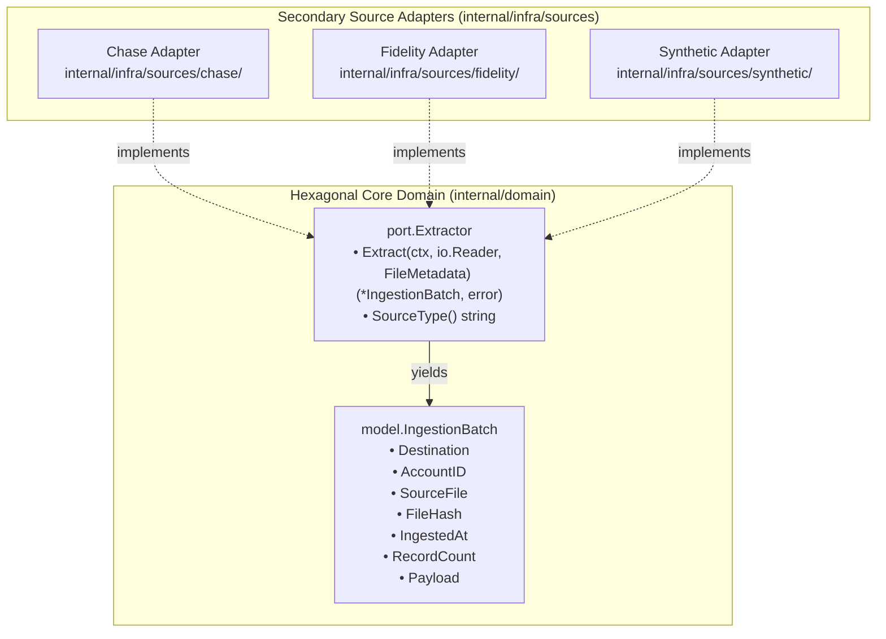
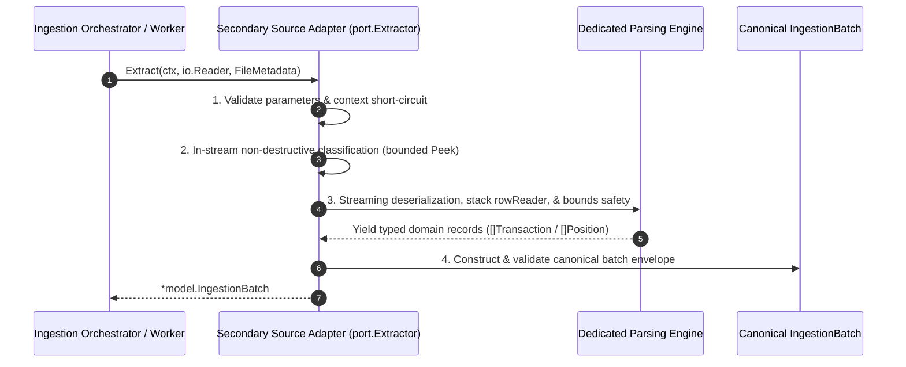

# Hexagonal Architecture Specification: Secondary Ingestion Adapters (Sources)

**Target Package**: `babylon_data_loader/internal/infra/sources/`  
**Architectural Role**: Hexagonal Secondary Driven Adapters (Input Source Extractors)  
**Document Status**: Active / Implemented (Hardened in Phases 1–3)  
**Primary Port**: [`internal/domain/port/extractor.go`](../../internal/domain/port/extractor.go)  
**Modular Architecture Directory**: [`docs/specs/architecture/`](./architecture/README.md)  

---

## 1. Executive Summary & Architectural Motivation

The ingestion layer in `babylon_data_loader` serves as the secondary driven boundary for ingesting heterogeneous financial statements, transactions, and portfolio records. To prevent banking format idiosyncrasies, malformed CSV records, and institution-specific schemas from leaking into core domain logic, all stream consumption, dialect classification, data sanitization, and lineage attribution are encapsulated inside dedicated secondary adapters.



> [!NOTE]
> Detailed, composable specifications for each architectural subsystem have been organized into the [`docs/specs/architecture/`](./architecture/README.md) directory. This master specification provides the architectural catalog, system boundaries, and summary contracts.

---

## 2. Ingestion Architecture & Data Flow

Every source adapter executes a standardized 4-stage data acquisition lifecycle:



For the comprehensive data flow specification, stream lifecycle contracts, and forbidden dependency matrices, consult:
👉 **[Ingestion Overview Specification](./architecture/ingestion-overview.md)**

---

## 3. Package Structure & Responsibilities

The ingestion adapter package layout in `babylon_data_loader` strictly separates responsibilities:

| Directory | Package / Component | Architectural Role | Composable Spec Link |
| :--- | :--- | :--- | :--- |
| `internal/infra/sources/chase/` | `chase.Extractor` | Chase deposit and credit card statement extraction, dialect classification, zero-allocation parsing primitives, and date fallbacks. | **[Chase Adapter Spec](./architecture/chase-adapter.md)** |
| `internal/infra/sources/fidelity/` | `fidelity.Extractor` | Fidelity brokerage portfolio holdings extraction, UTF-8 BOM stripping, `"Date downloaded"` footer `AsOfDate` stamping, disclaimer filtering, and cash sweep normalization. | **[Fidelity Adapter Spec](./architecture/fidelity-adapter.md)** |
| `internal/infra/sources/synthetic/` | `synthetic.Extractor` | In-memory deterministic fixture generation via `math/rand/v2` PCG generator for load testing and benchmark harnesses. | **[Synthetic Adapter Spec](./architecture/synthetic-adapter.md)** |
| *(Cross-Cutting)* | Quality & Verification | Standard library isolation, race safety, comparative benchmarks, and cognitive complexity gates. | **[Verification & Quality Gates](./architecture/verification-and-quality.md)** |
| *(Cross-Cutting)* | Remediation History | Formal audit trails and remediation logs across Phases 1 to 4 and the Round 3 review. | **[Remediation Log](./architecture/remediation-log.md)** |

---

## 4. Chase Statement Ingestion Adapter (`internal/infra/sources/chase/`)

The Chase adapter handles CSV exports from Chase Bank for checking, savings, and credit card accounts.

### Key Architectural Invariants:
1. **Declarative 4-Stage Pipeline**: `Extractor.Extract` coordinates execution across `validateExtractParams` -> `classifyStream` -> `parseDialect` -> `buildBatch`.
2. **Pure Static Strategy Router**: `resolveDialectRoute` uses an immutable Go switch statement, eliminating mutable package globals and achieving compile-time safety with 0 allocations.
3. **Pluggable Classifier Interface**: Non-destructive bounded peeking (`bufio.Reader.Peek`, 4 KiB growing to at most 64 KiB past blank preambles) locates the header with the parser's own header detection (BOM skip, shared CSV reader, `isRowEmpty`). It then matches exact column names, evaluating credit card markers (`category`, `memo`, `transaction date`, `trans date`) before checking markers (`check or slip #`, `details` with a date or balance, `posting date` with `balance`). A bare `balance` column is not a checking marker.
4. **Stack-Allocated `rowReader` Value Struct**: 40-byte value struct (`row []string` 24B, `colIndex map[string]int` 8B, `lineNum int` 8B) with uniform value receivers, yielding **0 B/op and 0 allocs/op**.
5. **Tabular Missing-Value & Unicode Dash Detection (`isPlaceholderNumeric`)**: Centralized detection of missing tokens (`"na"`, `"n/a"`, `"#n/a"`, `"none"`, `"null"`, `"nil"`, `"--"`, `"---"`, `"-$"`) and Unicode typographic dashes (`isDashRune`: `\u2012`–`\u2015`, `\u2212`, `\ufe63`, `\uff0d`).
6. **Strict Currency Grammar (`cleanNumeric`)**: Amounts and balances must match an optional sign or accounting parentheses, an optional `$`, commas only between three-digit groups, and at most two decimals. Unicode minus and dashes are normalized to `-` first. Inputs such as `12,34`, `1+2` and `0x1p4` are rejected, never silently re-valued.
7. **Ergonomic Dialect Row Mappers**: `parseCheckingRow` and `parseCreditCardRow` use `rowReader`, reducing cognitive complexity to 2.
8. **Pending Date Fallbacks (`resolveCreditCardDate`)**: Falls back from unsettled `"Post Date"` to `"Transaction Date"` for credit card rows.
9. **Transaction Date Extraction (`resolveTransactionDate`)**: Resolves optional credit card purchase date into `*time.Time` at UTC midnight (nil for checking, synthetic, or placeholders), rejecting unparseable non-placeholder dates with `ErrInvalidRow`.
10. **Unwrapped Context Cancellation**: Raw `context.Canceled` and `context.DeadlineExceeded` are returned strictly unwrapped across pipeline stages and header/row parsing (`handleReadError`). A nil context is normalized once, in `Extract`.
11. **Error Taxonomy**: Row rejections wrap `ErrInvalidRow` plus the matching domain sentinel (`model.ErrInvalidAmount`, `ErrInvalidBalance`, `ErrMissingDescription`, `ErrMissingPostingDate`). CSV syntax errors wrap `ErrMalformedCSV` and `*csv.ParseError`. Header defects return `ErrMalformedHeader` (CR-only line endings) or `ErrDuplicateColumn`. I/O failures match none of these.
12. **Shared Destination**: `model.DestChaseChecking` and `model.DestChaseCreditCard` are the same collection (`"transactions_chase"`), so the dialect is carried only by the payload fields each parser populates.

```go
// Primary interface implementation in internal/infra/sources/chase/extractor.go
type Extractor struct {
    classifier Classifier
}

// The zero value and a nil *Extractor fall back to DefaultClassifier.
var _ port.Extractor = (*Extractor)(nil)

func NewExtractor(c Classifier) *Extractor
```

For the complete technical blueprint, dialect column mappings, and code listings:  
👉 **[Complete Chase Adapter Architecture Specification](./architecture/chase-adapter.md)**

---

## 5. Fidelity Portfolio Ingestion Adapter (`internal/infra/sources/fidelity/`)

The Fidelity adapter transforms brokerage portfolio holdings exports into strongly-typed `model.FidelityPosition` domain models.

### Key Architectural Invariants:
1. **UTF-8 BOM Detection & Propagation**: `stripUTF8BOM` detects `0xef, 0xbb, 0xbf`, gracefully handling empty files and surfacing non-EOF stream errors.
2. **`"Date downloaded "` Footer `AsOfDate` Extraction & Stamping**: `matchDateDownloadedField` and `parseDateDownloaded` (with `normalizeMeridiem`, `resolveDateLocation`, and embedded `_ "time/tzdata"`) parse the statement footer into a UTC `time.Time` instant. The first footer wins and is never emitted as a position; `finalizePositions` stamps `AsOfDate` onto every extracted position and returns `model.ErrMissingAsOfDate` if a non-empty batch lacks a footer (while empty or header-only streams succeed without one).
3. **Multi-Line Disclaimer Filtering**: `isDisclaimerText` filters out legal disclaimers, footnote annotations (`"* "`, `"1. "`), and portfolio summary rows (`"Total"`, `"Account Total"`).
4. **Cash Sweep Normalization**: Normalizes non-standard markers (`"**"`, `"FCASH"`, `"CORE"`) to `"CASH"`, while preserving valid mutual fund tickers with descriptions containing `"Total"` (e.g. `VTI`, `BND`, `TTE`).
5. **Mandatory Schema Signatures**: Requires both a symbol alias (`"symbol"` / `"ticker"`) and a valuation alias (`"current value"`, `"market value"`, `"current balance"`) before parsing.
6. **Single-Account Batch Inference**: Automatically infers batch `AccountID` when homogeneous accounts are present.
7. **Full Legacy Field Parity & Performance Metric Extraction**: Extracts all 8 optional legacy portfolio columns (`LastPriceChange`, `TodaysGainLossDollar`, `TodaysGainLossPct`, `TotalGainLossDollar`, `TotalGainLossPct`, `PercentOfAccount`, `AverageCostBasis`, and `Type`). Percentage columns are parsed via `parsePercent` (pre-checking placeholders before `%` stripping, handling accounting parentheses `"(0.44%)"`, and rejecting embedded/duplicate `%`), while all 7 numeric performance fields enforce IEEE 754 finiteness (`model.ErrInvalidPerformanceMetric`).
8. **Domain Parameter Object Architecture (`holdingIdentity`, `positionMetrics`)**: Decouples row identity resolution (`resolveIdentity` -> `holdingIdentity`) from short-circuiting numeric extraction (`metricRowReader.readCore` -> `coreMetrics` and `metricRowReader.readPerformance` -> `performanceMetrics`), applying metrics to `model.FidelityPosition` via `positionMetrics.applyTo`.

For the complete technical blueprint and disclaimer filtering rules:  
👉 **[Complete Fidelity Adapter Architecture Specification](./architecture/fidelity-adapter.md)**

---

## 6. Synthetic Deterministic Ingestion Adapter (`internal/infra/sources/synthetic/`)

The synthetic adapter provides an in-memory, deterministic generator implementing `port.Extractor` for offline testing, CI integration, and benchmarks.

### Key Architectural Invariants:
1. **Deterministic PCG PRNG**: Built on Go 1.22's `math/rand/v2` PCG generator, guaranteeing platform-independent reproducible outputs.
2. **Sequential PRNG Continuity & Concurrency Safety**: The PRNG state is encapsulated on the struct and synchronized with a `sync.Mutex`.
3. **Memory Safety Clamping**: Enforces a strict ceiling of `MaxSyntheticRowCount = 100_000` and clamps initial allocation at 10,000 to prevent OOM.

For the complete generator specification:  
👉 **[Complete Synthetic Adapter Architecture Specification](./architecture/synthetic-adapter.md)**

---

## 7. Architectural Decisions & Remediation Log

All architectural decisions, defect remediations, and code review hardening logs are systematically tracked:
- **Phase 2 Consolidated Ingestion Findings**: 10 initial architecture findings (F-01 through F-10).
- **Phase 2B Fidelity Hardening Log**: 10 findings covering BOM errors, cash normalization, and disclaimer filters.
- **Phase 2C Chase Hardening Log**: 9 findings covering in-memory test fixtures, sentinel errors, and non-finite number defense.
- **Phase 1 Readability Cleanup (PR #51)**: 9 findings establishing zero-allocation `rowReader` primitives and Unicode dash detection.
- **Phase 2 Readability Cleanup (PR #52)**: 7 findings establishing ergonomic row parsers and date fallback hardening.
- **Phase 3 Readability Cleanup (Pipeline & Quality Gates)**: 7 findings establishing the 4-stage pipeline, static strategy router, nil stream protection, and unwrapped context errors.
- **Phase 4 Readability Cleanup (Benchmarks & Concurrency Hardening)**: 6 findings establishing benchmark concurrency safety (`b.Fatalf` in `RunParallel`), short-circuit fast-fail benchmarks, envelope completeness assertions, mock isolation, and 500-row streaming scaling.
- **Round 3 Chase Review (PR #43)**: 10 findings (R3-01 through R3-10) covering BOM and CR-only streams, a single header-detection path, strict currency parsing, the row and CSV error taxonomy, nil-safe extractors, and test fidelity.

For the complete decision and remediation matrix:  
👉 **[Complete Architectural Remediation Log](./architecture/remediation-log.md)**

---

## 8. Verification Harness & Local Quality Gates

All source adapters are validated against 5 automated local quality gates:

```bash
# 1. Standard library isolation gate (100% standard library purity)
go list -f '{{.ImportPath}} -> {{.Imports}}' ./internal/infra/sources/...

# 2. Race detection and statement coverage gate (chase: 97.9%, fidelity: 91.8%, synthetic: 91.1%, 0 races)
go test -v -race -cover ./internal/infra/sources/...

# 3. Static analysis and linter gate (0 issues, zero waivers, cognitive complexity < 15)
golangci-lint run ./internal/infra/sources/...

# 4. CI automated test suite
make test-ci

# 5. Expanded benchmark suite (row allocation parity, fast-fails, and 500-row streaming scaling)
go test -bench=. -benchmem ./internal/infra/sources/chase/...
```

### Verified Benchmark Suite Summary:
- **Zero-Allocation Row Parity**: `BenchmarkDirect_ParseRow` (402.3 ns/op) vs `BenchmarkRowReader_ParseRow` (441.2 ns/op) at identical allocations (16 B/op, 2 allocs/op solely from optional balance box; 0 B/op from `rowReader`).
- **Multi-Core Row Parsing**: `BenchmarkDirect_ParseRow_Parallel` (82.51 ns/op) and `BenchmarkRowReader_ParseRow_Parallel` (85.63 ns/op) achieve ~5.1x multi-core scaling with 0 heap escapes.
- **Pipeline Latency & Bandwidth** (re-measured after Round 3): Single checking/card batches process in ~5.0–5.4 µs (~43–55 MB/s, ~25.2 KB, 51–55 allocs). The classifier's shared CSV header detection adds a fixed ~13 allocs per file; per-row cost is unchanged.
- **Concurrent Scaling**: Parallel extraction runs at ~4.9 µs (~53 MB/s) with zero data races under `-race` across 20 workers.
- **Fast-Fail Interruption**: Pre-canceled contexts short-circuit in ~26.8 ns sequentially (~64 ns under parallel cancellation storm, 32 B/op, 1 alloc); empty streams are rejected by the classifier with `ErrUnknownDialect` in ~570 ns.
- **High-Volume Scaling (Sequential vs Parallel)**: 500-row statement batches process in ~343 µs (~82.6 MB/s, ~686 ns/row) sequentially and scale 2.3x to ~149 µs (**~190 MB/s**) under parallel worker pools.

For detailed benchmark analysis and gate specifications:  
👉 **[Complete Verification Harness & Quality Gates Specification](./architecture/verification-and-quality.md)**

---

## 9. Related Documentation & References

- [Architecture Catalog & Document Index](./architecture/README.md)
- [Phase 1 Specification: Domain Core & Port Contracts](./hexagonal-domain-core.md)
- [Fidelity Portfolio Positions Ingestion Specification](./fidelity-portfolio-ingestion.md)
- [MongoDB Atlas Datalake Specification](./mongodb-atlas-datalake.md)
- [Architectural Decisions & Remediation Log](./architecture/remediation-log.md): summarizes every review round, including the Phase 2C Chase findings, the Phase 1 to 4 readability cleanups and Round 3. The detailed review write-ups live in the workspace-level `agent-docs/` directory, which is outside this repository.
- [Pull Request #51: Chase Readability Cleanup Phase 1](https://github.com/ajponte/babylon_data_loader/pull/51)
- [Pull Request #52: Chase Readability Cleanup Phase 2](https://github.com/ajponte/babylon_data_loader/pull/52)
- [Pull Request #43: Phase 2C Chase Adapter](https://github.com/ajponte/babylon_data_loader/pull/43)
